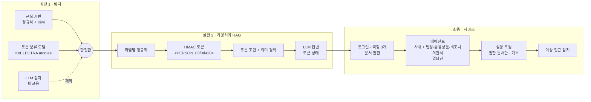
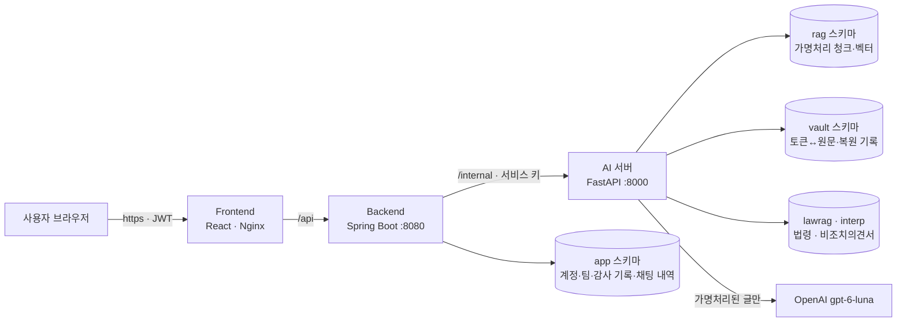

<p align="center">
  
</p>

<h1 align="center">사공삼 (403)</h1>

<p align="center">
  <b>개인정보는 가리고, 업무 답은 정확하게</b><br/>
  가명처리된 사내 문서로 답하고, 권한이 있는 사람에게만 실명을 보여 주는 금융 사내 문서 RAG 챗봇
</p>

---

## 프로젝트 소개

금융사는 상담 기록·민원·내부 메일 같은 사내 문서를 LLM 으로 활용하고 싶어 하지만, 원문 개인정보가 벡터 DB·LLM 로그·외부 API 로 흘러가면 안 됩니다.
**사공삼(403)** 은 "보호"와 "활용" 중 하나를 포기하지 않는 방법을 3단계에 걸쳐 만든 프로젝트입니다.

1. 문서 속 개인정보를 **놓치지 않고 찾고** (실전 1)
2. 같은 사람은 늘 같은 토큰이 되도록 **가명처리한 뒤에도 검색·답변이 되게** 하고 (실전 2)
3. 로그인·역할·문서 권한을 붙여 **권한 있는 사람에게만 실명을 보여 주는 서비스**로 완성했습니다 (최종)

이름의 **403** 은 HTTP 상태 코드 `403 Forbidden`(권한 없음)에서 왔습니다. "권한이 없으면 볼 수 없다"는 이 서비스의 핵심을 그대로 담았고, 로고의 `0` 은 자물쇠입니다.

> 모든 데이터는 가상의 카드사 **'새봄카드'** 를 배경으로 만든 합성 데이터입니다. 실제 개인정보·사내 문서는 쓰지 않았습니다.

---

## 한눈에 보기

| 단계 | 기간 | 주제 | 핵심 결과 | 폴더 |
|---|---|---|---|---|
| **실전 1** | 2026-10 | 개인정보 탐지 방식 비교 (규칙 · 토큰 분류 모델 · LLM) | 운영 탐지기 = **규칙(정규식 + Kiwi) + KoELECTRA(atonlee) 합집합**. test 가리기 재현율 **1.000**, 처음 보는 문서 0.988, CPU 문서당 0.06~0.11초 | [`실전프로젝트1/`](실전프로젝트1/) |
| **실전 2** | 2026-10 ~ 11 | 가명처리 기반 검색 챗봇 (기본형) | 정규화 + HMAC 토큰, **토큰 조건 + 의미 검색** 결합. holdout 검색 Hit@1 **0.943** (의미 검색만 0.261), 원문 유출 **0건** | [`실전프로젝트2/`](실전프로젝트2/) |
| **최종** | 2026-11 | 권한·실명 복원·무인 파이프라인을 갖춘 서비스 | React + Spring Boot + FastAPI. 역할 3개 문서 권한, 실명 복원 기록, 이상 접근 탐지, **공개 자료 RAG 3개(법령·금융상품·비조치의견서)를 묶는 에이전트**, 멀티턴. 새 DB 무인 실행 holdout 검색 Hit@1 **0.977**, 답변 인용 적중 **0.989**, 유출 **0건**. 배포 **https://403.p-e.kr** | [`최종프로젝트/`](최종프로젝트/) |

---

## 전체 흐름



### 실전 1 — 개인정보 탐지 방식 비교

- **과제**: 금융 사내 문서에서 개인정보 7종(이름·전화·주소·주민번호·이메일·계좌·카드)을 찾는 탐지기를 세 방식으로 비교하고, 운영에 쓸 탐지기를 근거 있게 고르기
- **결정**: "놓치는 것"이 가장 위험하므로 가리기 재현율(mask_rec)을 1순위로 봄 → **규칙 + 토큰 모델 합집합**
  - LLM 은 재현율을 더 올리지 못하면서 16~29배 느리고, 원문을 외부로 보내야 해서 **탐지에는 쓰지 않고 답변 생성에만** 씀
- **결과**: test mask_rec 1.000 · strict F1 0.986, 멘토 holdout(처음 보는 문서 19종) 개선 전 mask_rec 0.993
- **남긴 과제**: 성 없는 이름·일반 낱말 같은 이름(하늘·다운), 같은 사람의 다른 표기, 동명이인
- 자세히: [`실전프로젝트1/README.md`](실전프로젝트1/README.md), 보고서 [`실전프로젝트1/report/`](실전프로젝트1/report/)

### 실전 2 — 가명처리 기반 검색 챗봇

- **과제**: 실명이 하나도 없는 데이터로도 "윤선영 고객 상담 내역 찾아줘" 같은 질문이 동작하게 만들기
- **방법**
  - 라벨별 정규화(`윤 선영`·`윤선영은` → `윤선영`) 후 `HMAC-SHA256` 앞 8자리로 토큰 → 같은 사람은 항상 같은 토큰
  - 문서와 매핑을 다른 DB 계정에 분리 (`rag` 검색용 / `vault` 원문 매핑)
  - 질문도 같은 방식으로 토큰화 → **토큰 조건으로 후보를 좁히고 나머지 문장으로 의미 검색**
  - 임베딩·LLM 에는 가명처리된 글만 보냄
- **결과**: holdout Hit@1 0.943 · MRR 0.966, 새 데이터 synth2 0.930 · synth3 0.892, 유출 0건
- 자세히: [`실전프로젝트2/README.md`](실전프로젝트2/README.md), 연구 계획서 [`실전2_연구계획서.md`](실전2_연구계획서.md)

### 최종 — 사공삼(403) 서비스

- 실전 1·2 를 하나의 웹 서비스로 묶고 아래를 더했습니다.
  - 로그인 + **역할 3개**(직원·팀장·감사)와 **문서 단위 권한**: 권한 밖 문서는 검색 단계에서 아예 제외
  - **실명 복원**은 권한 있는 문서의 토큰만, 매번 기록. 팀장·감사는 사유 필수
  - 문서에서 **직원 목록과 문서 담당자·팀을 추론**
  - LLM 답변을 보여 주기 전 **출력 재검사** (스트리밍 중에도 문장 단위로)
  - 문서 파일만 바꾸면 새 DB 에서 끝까지 도는 **무인 파이프라인**
  - 3주차 선택 과제: **사람 검수 대상 고르기(자동 승인)**, **이상 접근 탐지**
  - **에이전트**: 질문에 필요한 자료(사내·법령·금융상품·비조치의견서)를 고르고 계획·검색·종합. 팀원 RAG 3개를 한 서버로 통합
  - **멀티턴**: 분류가 "앞 대화가 필요한 질문인가"도 같이 판단해, 필요할 때만 최근 2턴으로 질문을 다시 씀 (보통 질문은 추가 비용 0)
  - **채팅 내역** 계정별 저장 (질문 원문은 암호문, 관리자 열람은 기록), 답변 스트리밍과 진행 단계 표시
  - **배포**: EC2 + Docker + GitHub Actions, https://403.p-e.kr
- 자세한 로직: [`최종프로젝트/README.md`](최종프로젝트/README.md)

---

## 최종 서비스 구조



- PostgreSQL 16 + pgvector 하나에 우리 스키마 4개(`app`·`rag`·`vault`·`docs`) + 공개 자료 스키마 2개(`lawrag`·`interp`, 읽기 전용 계정), **스키마마다 다른 DB 계정**이라 서로 읽을 수 없음
- 스프링은 `rag`·`vault` 를 못 읽음 → 직원·문서 정보는 AI 서버 API 로만
- 임베딩(KURE-v1)은 서버 안에서 돌려 외부로 나가지 않음. 외부로 나가는 건 LLM 호출뿐이고, 그것도 가명처리된 글만

---

## 기술 스택

| 영역 | 사용 기술 |
|---|---|
| 탐지 | 정규식 + Kiwi 형태소 분석, KoELECTRA-small(`atonlee`) + 추가 학습 이름 모델 |
| 가명처리 | 라벨별 정규화, HMAC-SHA256 토큰, 추정 인물 단위 토큰(동명이인 구분) |
| 검색 | PostgreSQL 16 + pgvector (HNSW), GIN 토큰 색인, KURE-v1 임베딩(로컬), LLM 재순위 |
| LLM | OpenAI `gpt-6-luna` (질문 분류·계획·멀티턴 다시 쓰기·재순위·답변) — 가명처리된 글만 전송 |
| AI 서버 | Python 3.13, FastAPI, sentence-transformers, transformers |
| 백엔드 | Java 21, Spring Boot 3.4, Spring Security(JWT), JPA, Spring Mail(Gmail) |
| 프론트 | React, TypeScript, Vite, Pretendard |
| 인프라 | Docker Compose (개발 DB 5434, 채점 DB 5435), 배포: AWS EC2 + Docker + Nginx(Let's Encrypt) + GitHub Actions |

---

## 저장소 구조

```
likelion-AI-4team/
├── README.md                 ← 지금 이 문서 (전체 개요)
├── .github/workflows/        main → EC2 자동 배포
├── 실전1_연구계획서.md
├── 실전2_연구계획서.md
├── 실전프로젝트1/             개인정보 탐지 방식 비교 (탐지기·채점·보고서·발표)
├── 실전프로젝트2/             가명처리 검색 챗봇 기본형 (적재·검색·평가·Streamlit 데모)
└── 최종프로젝트/              사공삼(403) 서비스
    ├── AI/                   FastAPI: 탐지·가명처리·적재·검색·에이전트(멀티턴)·공개 자료 RAG 3개·복원·이상 접근 탐지
    ├── Backend/              Spring Boot: 계정·권한·이메일 인증·채팅 내역·중계
    ├── Frontend/             React: 채팅·적재·검수·통계·관리 화면 (+ 배포용 Nginx)
    ├── infra/                Docker Compose + DB 스키마
    ├── deploy/               운영(EC2) 구성·배포·인증서 스크립트
    └── ERD.md                전체 ERD
```

단계마다 로직·결정·수치는 각 폴더의 `README.md` 에 정리했습니다.

---

## 지킨 원칙

**개인정보**
- 임베딩·LLM 등 외부로 나가는 글은 **가명처리된 글만**. LLM 으로 보내기 직전에 한 번 더 검사(`guard`)
- 실명 매핑(`vault`)은 검색 계정(`rag`)이 읽을 수 없음. 실명은 화면에 보여 주기 직전에만, 권한이 있을 때만 복원하고 매번 기록
- `.env`·`HMAC_KEY`·API 키는 저장소에 올리지 않음

**평가**
- 규칙·모델을 고칠 때 보는 **개선용 세트**와 점수만 재는 **확인용 세트**를 나눔. 확인용 세트를 보고 다시 고치지 않음
- 이미 본 세트로 잰 점수는 "처음 본 값"과 구분해서 기록

---

## 팀

| 담당 | 이름 |
|---|---|
| 사내 문서 RAG (개인정보·가명처리·권한·서비스) | 나호성 |
| 법령 RAG | 백송이 |
| 금융상품 RAG | 이한별 |
| 비조치의견서 RAG | 박지훈 |

> 멋쟁이사자처럼 AI 과정 4팀
