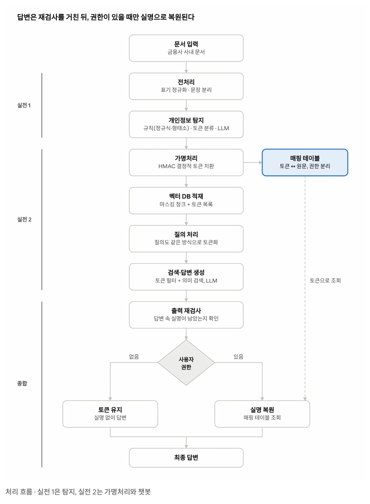

# 개인정보 보호형 RAG 챗봇 (PoC)

금융사 사내 문서에서 개인정보를 자동 탐지하고, **결정적 토큰으로 가명처리한 데이터만으로** 검색·답변하는 RAG 챗봇 프로토타입입니다.
권한이 있는 사용자에게만 실명을 복원하고, 답변을 보여주기 전에 개인정보를 한 번 더 검사합니다.

> 클라비 내부 연구 과제로 기획된 프로젝트이며, 교육생 프로젝트를 통해 PoC(개념검증)를 선행 수행합니다.

---

## 목차

- [처리 흐름](#처리-흐름)
- [문제 배경과 목표](#문제-배경과-목표)
- [프로젝트 단계](#프로젝트-단계)
- [핵심 기능](#핵심-기능)
- [데이터셋](#데이터셋)
- [제공 리소스](#제공-리소스)
- [폴더 구조](#폴더-구조)
- [시작하기](#시작하기)
- [제약사항](#제약사항)

---

## 처리 흐름



```
문서 입력 → 전처리 → 개인정보 탐지                         ┐ 실전 1
        → 가명처리(HMAC 토큰) ─→ 매핑 테이블(권한 분리)       ┐
        → 벡터 DB 적재 → 질의 토큰화 → 검색·답변 생성 (LLM)   ┘ 실전 2
        → 출력 재검사 → 사용자 권한 확인                       ┐
              ├ 권한 없음 → 토큰 유지                          │ 종합
              └ 권한 있음 → 실명 복원(매핑 테이블 조회)          │
        → 최종 답변                                            ┘
```

---

## 문제 배경과 목표

### 문제 배경

- 상담 기록·민원·메일·회의록 등 사내 문서에 `고객 실명`, `휴대전화`, `주민등록번호`, `계좌·카드번호`가 섞여 있음
- 단순 마스킹은 **"같은 사람이 어느 문서에 나오는지"** 같은 연결 정보까지 지워 검색·분석이 불가능해짐
- 탐지를 놓치면 개인정보가 벡터 DB·LLM 로그·외부 API로 그대로 흘러감
- 한국어는 조사·호칭·띄어쓰기 변형 때문에 탐지가 특히 어려움

### 목표

- 탐지 방식 3종(규칙 기반·토큰 분류·LLM)을 **정확도·속도·결과 일관성**으로 비교해 운영용 탐지기를 근거 있게 선정
- 개인정보를 결정적 토큰(`<PERSON_03f0d420>`)으로 치환해 **실명 없이도 이름 기반 검색**이 되는 챗봇 구축

### 기대 성과

- 탐지 방식 3종의 정량 비교 결과
- 한국어 특성(조사·호칭·표기 변형)을 반영한 탐지 개선 로직
- 같은 인물은 항상 같은 토큰이 되는 가명처리 모듈
- 가명처리 데이터만으로 동작하는 검색 챗봇과 권한별 복원
- End-to-End 흐름을 갖춘 서비스 또는 API

---

## 프로젝트 단계

하나의 시스템을 세 단계로 나누어 진행하며, 앞 단계 산출물이 다음 단계의 입력이 됩니다.

| 단계 | 기간 | 만드는 것 | 산출물 |
| --- | --- | --- | --- |
| **실전 1** | 1주 | 파이프라인 앞단: 탐지 방식 비교 및 탐지기 선정 | 데이터 관찰 리포트 · 방식별 비교표 · 오류 유형 분석 · 탐지기 선정 근거 |
| **실전 2** | 1주 | 파이프라인 뒷단: 가명처리 기반 검색 챗봇 (기본형) | 가명처리 모듈 · 챗봇 데모 · 토큰 일관성 채점 · 검색 질의 30개 평가 · 대화 시연 |
| **종합** | 2주 | 앞뒤 연결 + 접근 통제 · 출력 재검사 · 통합 평가 | 운영 수준 API 서비스 · 통합 평가 리포트(탐지·일관성·검색·유출) |

### 실전 1: 탐지 방식 비교

- [ ] **데이터 관찰**: 라벨 분포, 표기 형태, 어려운 사례 태그 분석. `김 과장`처럼 라벨 없는 표현에 대한 팀 기준 정의
- [ ] **탐지 방식 비교**: 규칙 기반(정규식 + Kiwi 형태소 분석) / 토큰 분류 모델 / LLM
  - 방식별로 약한 오류 유형(미탐·오탐·경계·라벨)
  - 문서 1건 처리 시간과 1만 건 환산 시간 (CPU 기준)
  - LLM 3회 반복 실행 시 결과 일관성
  - test와 holdout에서 방식별 순위 변화
  - 토큰 분류: 기준 모델 외 **한국어 PII 모델 1개 이상 추가 비교** (라이선스·크기·학습 데이터·라벨 대응 정리)
- [ ] **추가 탐구 (선택)**: 조사 정규화 개선, 정규식 보강, 앙상블, 우회 표현 탐지 등

> ⚠️ 이름 사전에 `personas.json`(데이터셋 인물 목록)을 쓰면 정답을 미리 보는 것과 같습니다. **일반 성씨 목록까지만** 사용합니다.

### 실전 2: 가명처리 기반 검색 챗봇 (기본형)

- [ ] **가명처리**: 실전 1 탐지기 → 정규화 → HMAC 토큰 치환 → 매핑 테이블 저장
- [ ] **벡터 DB 적재**: 마스킹 청크 임베딩 + 청크별 토큰 목록 메타데이터
- [ ] **질의 처리**: 질의도 같은 탐지기·정규화·키로 토큰화
- [ ] **검색·답변**: 토큰 필터 + 의미 검색, LLM에는 마스킹 텍스트만 전달 (답변은 토큰 그대로 표시)

### 종합: 운영 수준 완성

| 항목 | 실전 2 (기본형) | 종합 (고도화) |
| --- | --- | --- |
| 권한 | 없음 (토큰 그대로 표시) | 실명 복원 + 역할별 권한 + 문서 단위 접근 통제 |
| 출력 | LLM 답변 그대로 | 출력 재검사 후 표시 |
| 평가 | 검색 질의 30개 | 탐지·일관성·검색·유출 통합 평가 |
| 형태 | 데모 UI | API 서비스 |

- [ ] **접근 통제와 출력 보호**
  - 권한 있는 사용자에게만 동작하는 실명 복원
  - 역할 2~3개 설계 (예: 상담원은 담당 고객 문서만, 팀장은 소속 팀 문서 전체)
  - 권한 판단은 LLM이 아니라 **검색 전에** 문서 메타데이터로 필터링
  - LLM 답변을 보여주기 전 탐지기로 재검사
- [ ] **통합 평가**: 탐지 결과 + 토큰 일관성 + Recall@k를 하나의 리포트로, **holdout**으로 최종 성능 확인

| 주차 | 중점 | 체크포인트 |
| --- | --- | --- |
| 1주 차 | 실전 1·2 연결, 실명 복원·역할별 권한·검색 전 권한 필터 | 역할별 복원 시연 |
| 2주 차 | 출력 재검사, 통합 평가, 개선 반영 | 최종 평가 리포트, 발표 |

---

## 핵심 기능

예시 데이터: 가상 데이터셋 `D0002` (대출상담, dev)

### a. 개인정보 탐지

문서 전체에서 개인정보 구간(span)을 찾고 라벨을 붙입니다. 같은 사람의 **다른 표기**와 **형식이 바뀐 번호**도 잡아야 합니다.

```
전화 상담 요약 - 대출 한도 조회
일시: 2026년 9월 21일 18:28
상담원: 김은영

윤 선영 고객(01003492063)이 기존 새봄 사업자 운영자금 대출 이용 중 추가 한도를 문의함. ...
신청서는 고객 이메일 sy.yoon07@example.net로 발송함.
윤선영은 서류를 준비한 뒤 다시 연락하겠다고 함.
```

| 구간 | 라벨 | 인물 ID | 표기 형태 |
| --- | --- | --- | --- |
| 김은영 | person | P003 | 전체 이름 |
| 윤 선영 | person | P051 | 띄어 쓴 이름 |
| 01003492063 | phone_number | P051 | 하이픈 없음 |
| sy.yoon07@example.net | email | P051 | |
| 윤선영 | person | P051 | 조사(`은`) 제외 |

### b. 탐지 성능 평가

- 정밀도·재현율·F1 계산. **재현율과 마스킹 재현율(mask_rec)을 우선 지표**로 봄 (하나 더 가리는 것보다 하나 놓치는 게 위험)
- 오류를 유형별로 분류하고 방식별 약점 정리

| 판단 | 설명 | 예시 |
| --- | --- | --- |
| 정확 일치 | 라벨과 위치가 정답과 같음 | 정답 `윤선영` ↔ 예측 `윤선영` |
| 경계 오류 | 라벨은 맞지만 범위가 다름 | 정답 `윤선영` ↔ 예측 `윤선영은` |
| 라벨 오류 | 개인정보는 잡았지만 종류가 다름 | `01003492063`을 계좌번호로 예측 |
| 미탐 | 개인정보를 놓침 | `윤 선영` 미탐지 |
| 오탐 | 개인정보가 아닌 것을 잡음 | 대표번호 `1599-0000`, 상품명 `한결 플러스 카드` |

### c. 가명처리

탐지된 값을 정규화(공백·하이픈·조사 제거)한 뒤 HMAC으로 토큰을 만듭니다. 같은 사람의 다른 표기는 **같은 토큰**이 되어야 하며, 토큰 ↔ 원문 대응은 접근 권한이 분리된 매핑 테이블에 저장합니다.

| 원문 | 정규화 | 토큰 |
| --- | --- | --- |
| 윤 선영 | 윤선영 | `<PERSON_03f0d420>` |
| 윤선영 | 윤선영 | `<PERSON_03f0d420>` |
| 김은영 | 김은영 | `<PERSON_3b119772>` |
| 01003492063 | 01003492063 | `<PHONE_b5b20e9e>` |

```
<PERSON_03f0d420> 고객(<PHONE_b5b20e9e>)이 기존 새봄 사업자 운영자금 대출 이용 중 ...
<PERSON_03f0d420>은 서류를 준비한 뒤 다시 연락하겠다고 함.
```

### d. 가명처리 데이터 기반 검색 챗봇

| 단계 | 내용 |
| --- | --- |
| 질의 | 윤선영 고객 대출 상담 내역 찾아줘 |
| 질의 토큰화 | `<PERSON_03f0d420>` 고객 대출 상담 내역 찾아줘 |
| 검색 | 메타데이터 필터 `<PERSON_03f0d420>` + 의미 검색 "대출 상담 내역" → D0002 |
| LLM 답변 | `<PERSON_03f0d420>` 고객은 추가 대출 한도를 문의했고 ... |
| 권한 있음 | 윤선영 고객은 추가 대출 한도를 문의했고 ... |
| 권한 없음 | 토큰 그대로 표시 |

> ⚠️ 이름만으로 토큰을 만들면 동명이인이 하나로 합쳐집니다. `고객센터 김민준 대리`와 `김민준 고객`이 같은 토큰이 되는지 확인하세요 (데이터셋 질의 Q19·Q20).

### e. 출력 재검사

LLM 답변을 보여주기 직전, **토큰 상태의 답변**에 탐지기를 한 번 더 돌립니다. 적재 때 놓친 이름, 질의 속 개인정보, LLM이 지어낸 값을 막는 마지막 안전장치입니다.
실명 복원 **전에** 검사해야 정상 복원된 이름까지 걸리지 않습니다.

```
LLM 답변 (토큰 상태):
<PERSON_03f0d420> 고객은 추가 한도를 문의했고, 상담은 김은영 상담원이 맡았습니다.
                                                    ↑ 적재 때 탐지기가 놓친 실명
재검사 결과: person '김은영' 탐지 → 가리고 기록을 남긴 뒤 표시
```

---

## 데이터셋

**`pii_synth_finance`**: 가상 카드사 **새봄카드**의 사내 문서 (모두 가상 데이터)

| 분할 | 건수 | 용도 |
| --- | --- | --- |
| dev | 100 | 개선 작업 |
| test | 200 | 중간 확인 |
| holdout | 147 | 최종 평가 (새 템플릿 16종 · 새 인물, **최종 평가 전까지 열어보지 않음**) |

- 문서 유형 14종: 카드 분실 상담, 대출 상담, 민원 처리, 고객 정보 변경, 이상거래 탐지, 연체 안내, 업무 메일, 회의록, 인사 발령, 용역 계약서, 사내 메신저, 공지, 상품 안내, 민원 현황
- 개인정보가 없는 문서 50건 포함
- 라벨 8종 (개체 1,887개): `person`, `phone_number`, `organization`, `email`, `address`, `resident_registration_number`, `account_number`, `card_number`
- 제공 정보: 문서 ID · 분할 · 문서 유형 · 본문 / 개체별 라벨·위치·**인물 ID**·표기 형태 / **어려운 사례 태그**(띄어 쓴 이름, 조사 부착, 동명이인 4쌍, 전화번호 형식 변형, 오탐 미끼 등) / 인물별 표기 형태 목록 / **검색 질의 30개와 정답 문서 목록**

---

## 제공 리소스

### 스타터 코드: `pii_detect_eval`

| 파일 | 설명 |
| --- | --- |
| `run_compare.py` | 탐지기 실행·채점, `+정규식` 보강 결과와 합집합(union), 라벨별·어려운 사례별 재현율, 처리 시간, LLM 반복 실행 일관성, 오류·불일치 CSV |
| `quick_test.py` | 예문으로 탐지기 결과를 눈으로 확인 |

### 실전 2 시작 키트: `pgvector_starter`

| 파일 | 설명 |
| --- | --- |
| `docker-compose.yml`, `init/` | pgvector가 설치된 PostgreSQL 실행, 검색용(`rag`)과 매핑용(`vault`) 스키마·계정 분리 |
| `check_token_consistency.py` | 가명처리 결과를 인물 ID와 비교해 토큰 일관성(쪼개짐·합쳐짐) 채점 |
| `eval_retrieval.py` | 검색 질의 30개 결과로 Hit@k · Recall@k 계산 |

### 탐지 모델 후보

| 방식 | 내용 |
| --- | --- |
| 규칙 기반 | 정규식(전화·이메일·주민번호·계좌·카드) + Kiwi(`kiwipiepy`) 조사 분리, 고유명사 태그·성씨 목록·호칭 규칙(씨, 님, 고객, 과장 등) |
| 토큰 분류 (BIOES) | 제공 기준 모델 + Hugging Face 등에서 찾은 **다른 한국어 PII 모델 1개 이상** |
| LLM | 강사 제공 클라우드 LLM API (OpenAI 호환, 로컬 서버도 가능) |

### 기술 스택

| 영역 | 사용 기술 |
| --- | --- |
| 언어 | Python |
| 벡터 DB | PostgreSQL + pgvector (토큰 목록은 배열 컬럼 + GIN 인덱스) |
| 임베딩 | 강사 제공 클라우드 임베딩 API (마스킹된 텍스트만 전송) |
| 웹 UI / API | Streamlit, Gradio 또는 FastAPI |
| 운영 가정 | GPU 없는 CPU 서버 (처리 시간도 CPU 기준 측정) |

---

## 폴더 구조

```
실전프로젝트1/
├── README.md
├── docs/
│   └── pipeline.png               # 처리 흐름도
├── pii_synth_finance_dev.jsonl    # dev 데이터 (100건)
├── pii_synth_finance_test.jsonl   # test 데이터 (200건)
└── run_compare.py                 # 탐지 방식 비교·채점 스크립트
```

---

## 시작하기

```bash
# 1. 가상환경 생성 및 활성화 (Windows)
python -m venv .venv
.venv\Scripts\activate

# 2. 패키지 설치 (예시)
pip install kiwipiepy transformers torch openai

# 3. API 키는 환경변수로 설정 (코드에 직접 쓰지 않음)
#    PowerShell:
$env:OPENAI_API_KEY = "발급받은_키"
$env:HMAC_SECRET_KEY = "임의의_비밀키"

# 4. 탐지 방식 비교 실행
python run_compare.py
```

`.gitignore`에 다음 항목을 추가해 키와 환경 파일이 커밋되지 않게 합니다.

```
.env
.venv/
*.key
```

---

## 제약사항

- 데이터는 **제공된 가상 데이터셋(dev·test·holdout)으로 한정**. 실제 개인정보·실제 사내 문서 사용 금지
- 클라우드 API로 마스킹 전 원문 전송은 **탐지 실험에 한해** 허용. 챗봇 파이프라인(실전 2·종합)에서는 **마스킹된 텍스트만** 전송
  - 운영 환경에서는 "개인정보를 찾으려고 원문을 밖으로 보내는" 모순이 생기므로, 운영 가능성과 대안을 보고서에 정리
- 개선은 **dev**, 중간 확인은 **test**, 최종 평가는 **holdout**. holdout은 최종 평가 전까지 열어보지 않음
- 매핑 테이블은 암호화하지 않되 **마스킹 텍스트와 분리 저장**
- **API 키와 HMAC 키는 코드 저장소에 커밋하지 않고** 환경변수로 관리
