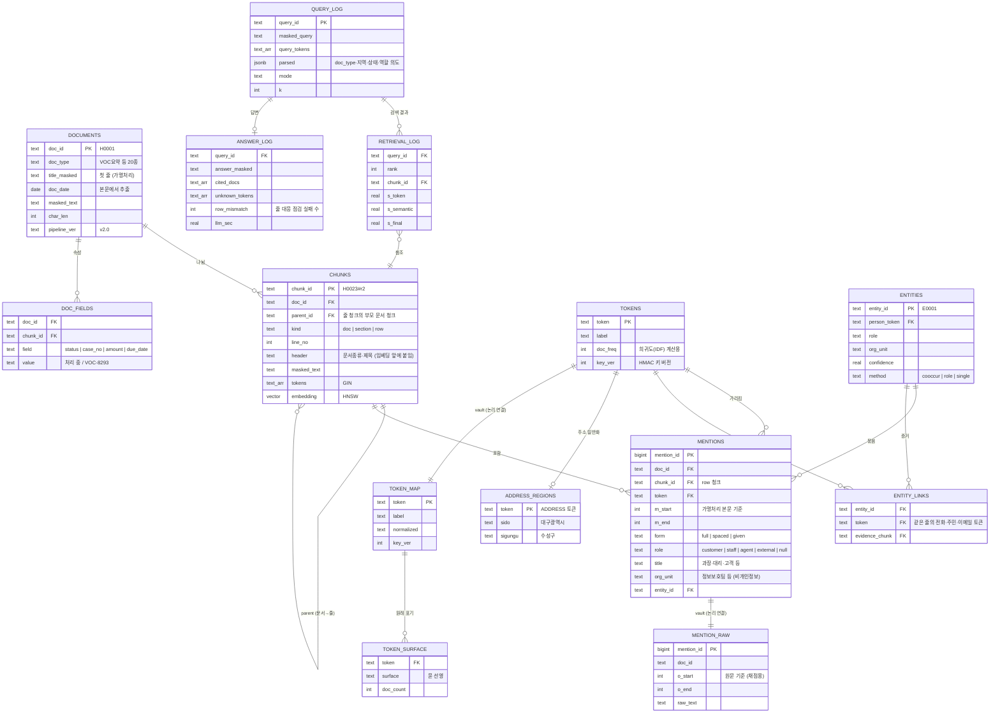

# 실전 2 v2 계획 — 상세 ERD부터 데모까지

> 작성 2026-10-30 · 기존 v1 파일(`starter/`, `app.py`, `outputs/` 등)은 **보류**(수정·삭제 없음)하고 가명처리부터 다시 시작한다.
> v1 결과는 비교 기준(baseline)으로만 쓴다.

---

## 0. 왜 다시 설계하나 — v1에서 남은 실패와 원인

강사 키트 ERD는 테이블 2개다: `rag.chunks`(문서 = 청크 1개, 토큰 배열, 임베딩) + `vault.token_map`(토큰 ↔ 원문).
v1에서 남은 실패는 대부분 **이 구조에 정보가 없어서** 생겼다.

| v1 실패 (worklog 근거) | 규모 | 구조상 원인 |
| --- | --- | --- |
| 검색 1위 실패 중 "같은 사람의 다른 주제 문서를 고름" | 16개 중 **11개** | 문서 종류·제목이 검색 점수에 안 들어감. 서식이 비슷한 문서끼리 의미 점수 차이가 작음 |
| Confuse@10 중 같은 사람의 다른 문서 몫 | **0.438** | 토큰이 하나만 맞아도 같은 순위 그룹. 토큰 가중치(희귀도) 없음 |
| `address_partial` (예: "대구 수성구 쪽") | 4개 모두 0점 | 주소가 통째로 토큰 1개 → 시·도/시·군·구 단위로 찾을 수 없음 |
| VOC 목록에서 다른 고객의 줄을 붙임 (시나리오 ④) | 실행마다 0~1건 | 문서 단위 청크 → LLM이 표의 줄 대응을 놓침. 자동 점검도 못 잡음 |
| 동명이인 (Confuse@10 중 0.100, 4쌍) | 8명 | 이름 문자열 = 토큰. 역할(고객/직원)·부서 정보가 저장되지 않음 |
| `hybrid_status` ("처리 중인 건") | 4개 | 상태·번호·날짜 같은 비개인정보 속성이 컬럼으로 없음 |

코퍼스 확인 (holdout 187건)
- 표·목록 문서 20건(출장보고 10, VOC요약 10), 표 줄 90개 → 줄 단위 청크 대상
- 이름 3개 이상 나오는 문서 73건 → 문서 안에서 사람 구분이 필요
- 이름 언급 560회 중 바로 뒤에 호칭·직함이 붙은 것 190회(`님` 72 · `고객` 61 · `팀장` 16 …), 나머지 370회는 줄 단위 문맥(`담당 정예린`, `상담사 민준`)으로 역할을 정해야 함
- 날짜가 있는 문서 110건

---

## 1. 상세 ERD (v2)

원칙
1. **rag 스키마에는 원문이 한 글자도 없다.** 원문 위치·표기는 vault에만.
2. 검색에 쓰는 정보(역할·부서·문서 종류·상태·지역)는 **개인정보가 아닌 값**만 rag에 둔다.
   주소는 시·도/시·군·구까지 **일반화**한 값만 rag에 두고, 상세 주소는 토큰으로만.
3. 개체(entity)는 **가명 토큰끼리의 공기(같은 줄에 함께 나옴)** 로만 묶는다. 원문·정답 인물 ID는 쓰지 않는다.
4. 질의·답변 기록도 가명처리된 텍스트만 남긴다.

### 스키마·계정

| 스키마 | 테이블 | 쓰기 계정 | 읽기 계정 | 비고 |
| --- | --- | --- | --- | --- |
| `rag` | documents, chunks, tokens, mentions, entities, entity_links, address_regions, doc_fields | `ingest_user` | `rag_user` (SELECT만) | 원문 없음. 챗봇은 읽기 전용 |
| `vault` | token_map, token_surface, mention_raw | `vault_user` | `vault_user` | rag 계정은 접근 불가 (v1과 동일) |
| `ops` | query_log, retrieval_log, answer_log | `rag_user` | `rag_user` | 가명 텍스트만. 평가·데모 분석용 |

- 키트는 `rag_user`가 적재와 검색을 같이 했다 → v2는 **적재 계정과 검색 계정을 분리**해 챗봇이 rag를 고칠 수 없게 한다.
- rag ↔ vault는 FK를 걸지 않는다(스키마 분리 유지). `mention_id`, `token`으로만 논리 연결.
- 채점 형식(`outputs/pseudo_*.jsonl` 원문 기준 위치, run 파일)은 `vault.mention_raw`에서 그대로 만든다.

### 테이블별로 무엇이 좋아지나

| 테이블·컬럼 | 해결하려는 실패 | 쓰는 방식 |
| --- | --- | --- |
| `chunks.header` + `documents.doc_type/title` | 같은 사람의 다른 주제 문서 (11개) | 임베딩 입력을 `[VOC요약] 주간 VOC 요약 \| 본문`으로. 질의에서 문서 종류 단어(위임장·한도·출장…)를 찾으면 해당 doc_type 가산점 |
| `chunks.kind = row` | VOC 줄 섞임 | 표·목록 줄마다 청크. 질의 토큰이 든 **줄 + 문서 머리글만** LLM에 전달 |
| `tokens.doc_freq` | Confuse@10 (같은 사람의 다른 문서) | 토큰 점수를 개수 대신 IDF 합으로. 흔한 이름보다 희귀한 번호가 강하게 |
| `address_regions` | address_partial 0/4 | 질의의 시·도/구 이름(비개인정보 사전)으로 지역 필터 |
| `mentions.role/title/org_unit` | 동명이인, role_agent 질의 | "김민준 고객" → role=customer 언급만 가진 문서 우선 |
| `entities` + `entity_links` | 동명이인 (선택, 아래 4번 결정 필요) | 같은 이름 토큰이라도 같은 줄의 전화·주민번호 토큰이 다르면 다른 개체로 분리 |
| `doc_fields` | hybrid_status | "처리 중", "VOC-8293" 같은 값으로 필터 |
| `ops.*` | 데모 설명·오류 분석 | 질의마다 점수 구성(토큰/의미/최종)과 점검 결과를 남겨 E4 사례를 바로 뽑음 |

---

## 2. 단계별 계획

### P0. 준비
- 작업 위치: `실전프로젝트2/v2/` (v1 코드·DB와 분리, 확정). docker 볼륨도 별도(`rag_docker2_v2`)
- v1 기준 수치 고정: 공식 Hit@5 0.909 · MRR 0.828 / 사후 0.943 · 0.868, 쪼개짐 12명, 합쳐짐(그 외) 0
- **데이터 사용 원칙** (worklog 19번 지적)
  - 가명처리 규칙(정규화·역할·주소 일반화)은 dev/test로 근거를 확인
  - 검색은 자체 질의 세트를 만들지 않음 (결정) → holdout 질의 88개로 비교. 대신 v1과 같은 방식으로 **두 수치 모두 보고**: S0(v1 재현) = 공식, S1 이후 = "holdout 분석으로 찾은 개선"으로 표시
  - dev/test의 `roles`(A 상담원 · C 고객 · M 관리자) 정답으로 역할 추출 정확도 측정
  - 주의: dev/test 문서 종류(대출상담·카드분실상담 등)는 holdout(VOC요약·출장보고 등)과 다름 → doc_type 사전은 코퍼스 메타데이터를 그대로 쓰고 학습하지 않음

### P1. ERD 확정 + DDL
- `init/01_schema.sh` v2: 위 13개 테이블, 인덱스(GIN tokens, HNSW embedding, mentions(token), mentions(entity_id), doc_fields(field,value), address_regions(sido,sigungu)), 계정 4개 권한
- 권한 점검 스크립트: rag_user → vault·쓰기 거부, ingest_user → vault 거부, vault_user → rag 거부
- 산출물: ERD 그림(보고서용), DDL, 권한 점검 결과

### P2. 가명처리 (처음부터)
1. 탐지: 실전 1 `PIIDetector` v10 그대로 (과제 조건)
2. 정규화: v1 규칙 재사용(이름 공백, 번호 숫자만·`+82`, 주소 시·도 약칭·우편번호) — **dev/test로 다시 근거 확인**하고, holdout에서만 근거가 있는 규칙은 표시
3. 토큰: HMAC-SHA256 + `key_ver` (키 교체 대비)
4. 언급(mentions) 만들기 — 원문 위치는 vault, 가명 본문 위치는 rag
   - `form`: 성씨 사전으로 full / given 구분 (연결은 하지 않음 — 기존 결정 유지, 종합 단계용으로 저장만)
   - `role/title/org_unit`: 언급 뒤 호칭(님·고객·과장…) → 같은 줄의 단서(담당·상담사·팀명) → 문서 종류 기본값 순으로 규칙 적용. dev/test `roles`로 정확도 측정
5. 주소 일반화: 정규화된 주소에서 시·도/시·군·구만 잘라 `address_regions`에
6. 테스트: v1 23개 + 역할·일반화·위치 변환 테스트
- 평가 E1: 쪼개짐·합쳐짐(v1과 같아야 정상), 역할 정확도(신규), 유출 점검(정답 대조 + 탐지기 재검사)

### P3. 적재
1. 가명처리 **후** 청킹: doc 청크 1개 + 표·목록 줄마다 row 청크 (`|` 2개 이상 줄, `VOC-` 줄)
2. 머리글: `[doc_type] 제목` 을 청크 앞에 붙여 임베딩
3. tokens.doc_freq, doc_fields(상태·번호·날짜 정규식), entities(선택)
4. 임베딩 호출 수: 187 + 줄 90 ≈ 280회 → 분당 60회 한도로 약 5분. **다른 작업과 키를 같이 쓰지 않도록 팀 확인** (v1 429 문제)

### P4. 검색 v2 — 하나씩 켜며 비교 (ablation)
질의 분석 → 후보 수집 → 점수 결합 → 문서 단위로 모으기

| 버전 | 추가하는 것 | 겨냥 유형 |
| --- | --- | --- |
| S0 | v1 hybrid 재현 (새 DB에서 v1과 같은 점수인지 확인) | — |
| S1 | + 머리글 임베딩 | hybrid_person_content, name_topic |
| S2 | + 질의 doc_type 의도 가산점 | 같은 사람의 다른 주제 |
| S3 | + 토큰 IDF 가중 (개수 → IDF 합) | Confuse@10 |
| S4 | + 지역 필터 | address_partial |
| S5 | + 상태·번호 필터 | hybrid_status |
| S6 | + 역할 필터 / 개체 구분 | homonym_role, hybrid_homonym_semantic |
| S7 | 점수 결합을 순위 결합(RRF)으로 바꿔 비교 | 전체 |

- 각 버전: holdout 질의 88개로 비교. 버전마다 겨냥 유형만 오르고 다른 유형이 떨어지지 않는지(부작용) 함께 확인. S1 이후 수치는 "사후 개선"으로 표시
- 지표: Hit@1·3·5·10, Recall@3·10, MRR, Confuse@10(같은 사람 몫 / 동명이인 몫 분리), 유형별·묶음별(이름/번호·주소/없음)

### P5. 답변 v2
- LLM 입력: 질의 토큰이 든 **row 청크 + 문서 머리글**만 (문서 전체 대신). 표가 아닌 문서는 v1처럼 문서 전체
- 프롬프트: v1 규칙 1~10 재사용, 줄 단위 입력에 맞게 정리
- **새 자동 점검 — 줄 대응 점검:** 답변의 각 문장에서 토큰·번호(VOC-xxxx)를 뽑아, 같은 row 청크에 함께 있는지 확인 → 시나리오 ④ 같은 "다른 고객 줄 붙임"을 잡음 (`answer_log.row_mismatch`)
- 추론 설정: v1 결정(low) 유지, 줄 단위 입력으로 none이 안정되는지 재비교

### P6. 평가·보고
- E1 토큰 일관성 + 역할 정확도 / E2 가명처리 조건(B0·B1·제안·상한선) / E3 검색 ablation(S0~S7) / E4 정성 분석(v1 실패 사례가 v2에서 어떻게 됐는지 1:1 추적)
- 시연 시나리오 5개 재실행: 질의 유출 0, 지어낸 토큰 0, **줄 대응 오류 0** 목표
- 처리 시간: 적재(줄 청크로 늘어난 임베딩 수 포함), 질의당, 답변당

### P7. 데모
- v1 화면 구조(질문 묶음 상자, 근거 문서 탭, 스트리밍) 재사용
- 추가로 보여 줄 것: 질의 분석 결과(문서 종류·지역·역할 의도), 근거를 **줄 단위로 강조**, 토큰 칩 옆 역할 배지(고객/직원), 줄 대응 점검 배지
- 시연에 ERD 1장 + "v1 → v2에서 고쳐진 질문" 비교 1개(④ 김민준)

---

## 3. 위험과 대응

| 위험 | 대응 |
| --- | --- |
| 개체 묶기가 다른 사람을 합침 (H0113 같은 오병합) | 같은 줄 공기만 증거로, 증거 없으면 묶지 않음(`method=single`). merge률을 E1에 함께 보고 |
| 동명이인 구분은 원래 종합 단계 범위 | 실전 2 필수가 아니므로 S6를 "선택 확장"으로 분리 보고 |
| holdout 과적합 (자체 질의 세트 없음) | S0 공식 / S1 이후 사후 개선으로 나눠 보고. 규칙은 특정 질의 문구가 아니라 구조(문서 종류·줄·지역)에 거는 것만 허용 |
| 역할 규칙 적용 범위가 좁음 (뒤 호칭 있는 언급 190/560) | 줄 단서·문서 종류 기본값 추가, 못 정하면 null로 두고 필터에서 제외하지 않음 |
| 임베딩·LLM 호출 한도 (분당 60회, 키 공유) | 적재 전 키 사용 정리, 재시도 로직 v1 것 재사용 |
| 지역 일반화 값이 재식별 단서가 됨 | 시·군·구까지만, 읍·면·동 이하 저장 안 함. 보고서에 근거 명시 |

## 3-1. 사전 검증 결과 (2026-10-30, `v2/eval/simulate_erd.py`)

v1 결과물로 v2 테이블 정보를 만들어 순위를 다시 매긴 모의 실험. holdout 88개, 사후 개선 수치.

| 변형 (누적) | Hit@1 | Hit@3 | Hit@5 | Recall@10 | MRR | 판정 |
| --- | --- | --- | --- | --- | --- | --- |
| S0 v1 재현 (상위 10 일치 87/88) | 0.818 | 0.909 | 0.943 | 0.946 | 0.868 | 기준 |
| S1 + 머리글 임베딩 | 0.795 | 0.898 | 0.932 | 0.946 | 0.853 | **역효과** |
| S2 + 줄 청크 | 0.795 | 0.898 | 0.932 | 0.951 | 0.855 | 검색 영향 없음, 답변 문맥에 효과 |
| S3 + 토큰 희귀도 | 0.795 | 0.898 | 0.932 | 0.951 | 0.855 | 효과 없음 |
| S4 + 문서 종류 | 0.818 | 0.898 | 0.932 | 0.951 | 0.867 | 소폭 |
| S5 + 지역 | 0.864 | 0.932 | 0.966 | 0.988 | 0.907 | **효과** (address_partial 0 → 1) |
| S6 + 상태 | **0.886** | **0.943** | **0.966** | **0.988** | **0.923** | **효과** (hybrid_status 0.25 → 0.75) |
| S7 + 역할 필터 | 0.761 | 0.864 | 0.943 | 0.973 | 0.831 | 동명이인 질의는 고침, 나머지 13개 망가짐 |
| S8 + 개체 묶기 | 0.807 | 0.875 | 0.955 | 0.985 | 0.862 | 역할 추출 정확도 부족 |

- 줄 청크: 표 문서에서 LLM 문맥에 섞이는 다른 사람 토큰 **문서당 3.03개 → 0.03개** (64건)
- 개체 묶기: 같은 개체로 묶은 쌍의 정밀도 0.993, 재현율 0.588 (잘못 합치기는 거의 없고 너무 많이 쪼갬). 동명이인 4쌍 중 이서연만 정확히 분리
- 반영: 머리글·희귀도는 기본에서 빼고, dev/test `roles`로 역할 추출을 먼저 고침

### 2차 (역할 추출 개선 후, `v2/pseudo/roles.py`)

역할 추출 (문서별 인물, 정답 위치 기준)

| | dev 역할 붙임 | dev 정확 | test 역할 붙임 | test 정확 |
| --- | --- | --- | --- | --- |
| 첫 실험 규칙 | 0.632 | 0.903 | — | — |
| 새 규칙 | **0.948** | **0.991** | **0.908** | **0.980** |

검색 (머리글·희귀도 제외, 줄 청크는 머리글 없이)

| 변형 (누적) | Hit@1 | Hit@3 | Hit@5 | Recall@10 | MRR | 동명이인 Conf@10 |
| --- | --- | --- | --- | --- | --- | --- |
| S0 v1 재현 | 0.818 | 0.909 | 0.943 | 0.946 | 0.868 | 0.100 |
| + 줄 청크 | 0.852 | 0.920 | 0.943 | 0.954 | 0.890 | 0.103 |
| + 문서 종류 | 0.886 | 0.955 | 0.955 | 0.956 | 0.918 | 0.103 |
| + 지역 | 0.932 | 0.989 | 0.989 | 0.990 | 0.958 | 0.103 |
| + 상태 | **0.943** | **0.989** | **0.989** | **0.990** | **0.965** | 0.103 |
| + 역할 필터 (새 추출기) | **0.943** | **0.989** | **0.989** | **0.990** | **0.965** | **0.086** |
| 참고: 역할 가산점 | 0.841 | 0.898 | 0.966 | 0.967 | 0.884 | 0.100 |
| 참고: 역할 필터 (첫 추출기) | 0.761 | 0.864 | 0.943 | 0.973 | 0.831 | 0.086 |

- 역할은 **필터**(역할이 다르다고 확인된 같은 이름 문서를 토큰 일치에서 뺌)가 맞음. 첫 실험의 하락은 추출 오류 탓이었고, 새 추출기로는 점수 손실 없이 동명이인 혼동만 줄어듦. 가산점은 역할 단서 없는 정답 문서를 밀어내 오히려 나쁨
- 개체 묶기: 쌍 재현율 0.588 → 0.662, 잘못 쪼갠 한 사람 토큰 24 → 20. 동명이인 4쌍 분리는 그대로(이서연만) → 검색 점수에도 추가 효과 없음. 둘 다 고객인 정하은은 역할로 못 나눔

## 4. 결정 (2026-10-30 확정)

1. 작업 위치: `실전프로젝트2/v2/` 새 폴더 + 새 DB 볼륨
2. dev 자체 질의 세트: **만들지 않음** → 검색은 holdout 88개로 비교, S0 공식 / S1 이후 사후 개선으로 구분 보고
3. 개체 묶기: entities 테이블은 만들고, 채우는 작업(S6)은 선택 확장으로 마지막에
4. 일정: 날짜 없이 단계 순서대로 진행
