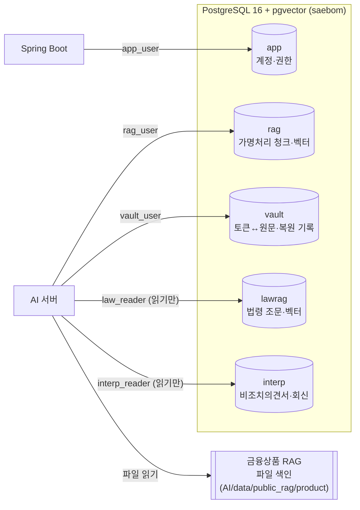
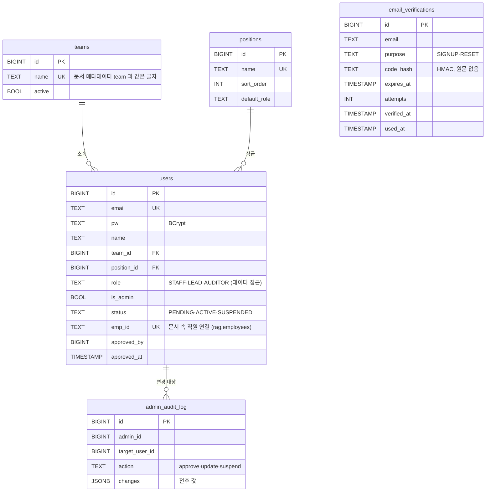
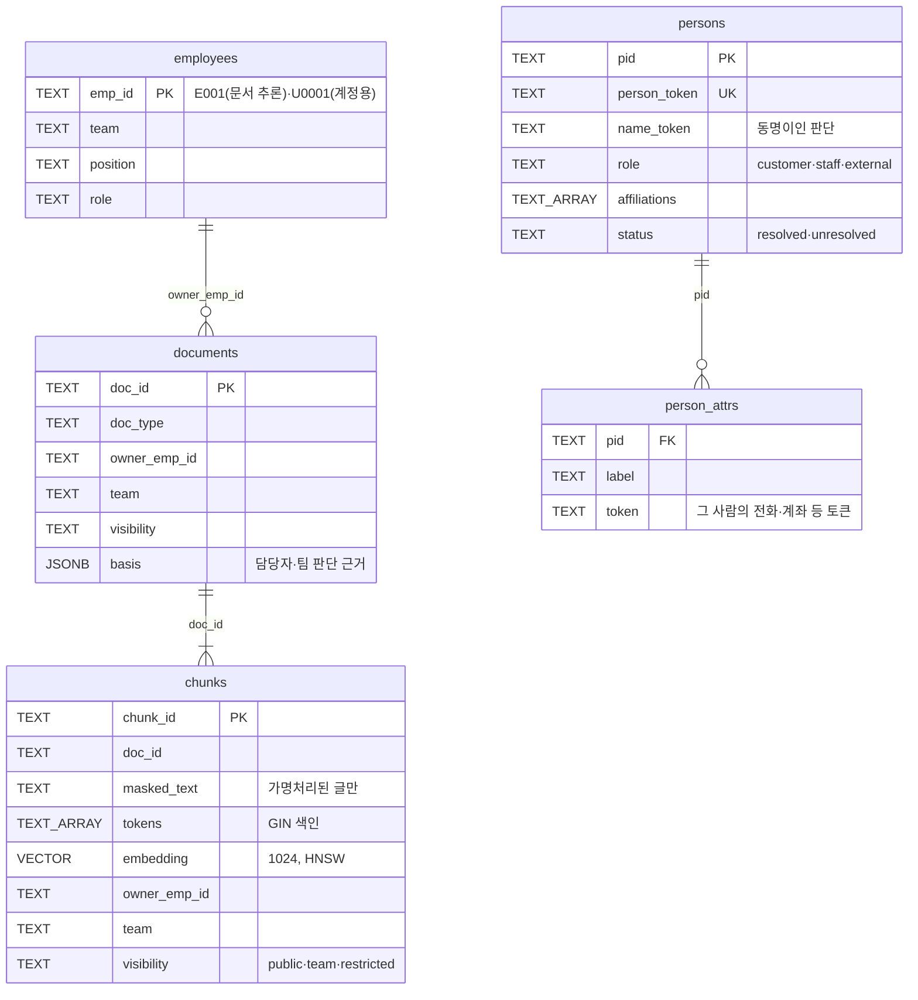
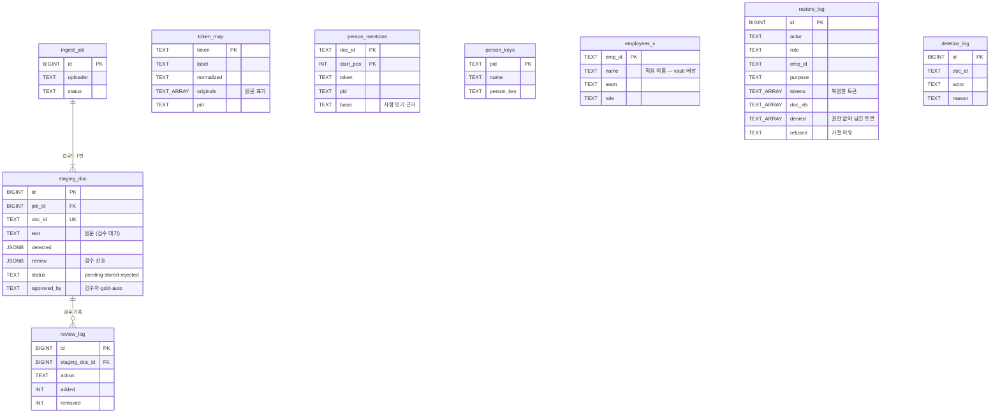
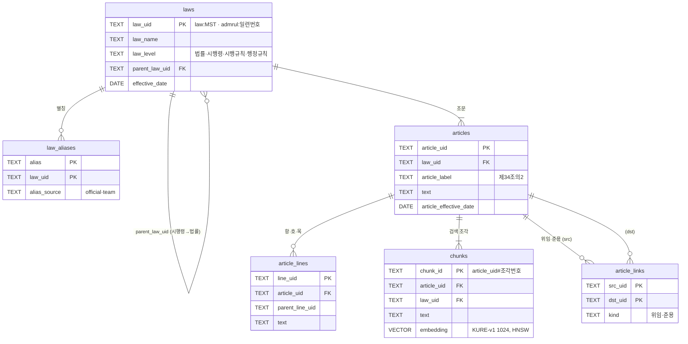
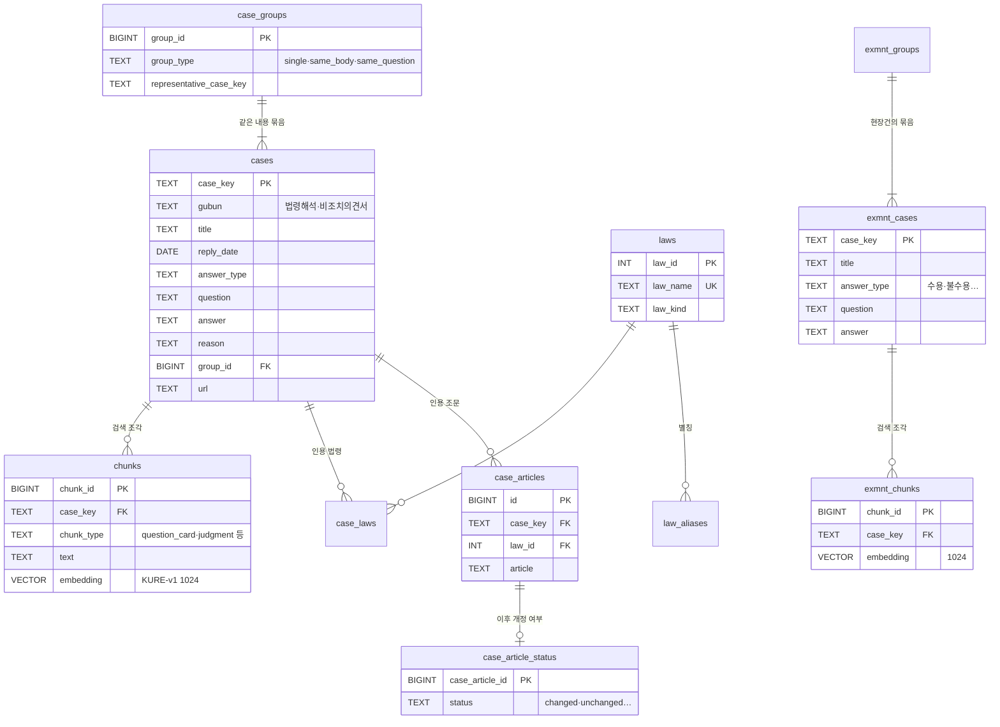
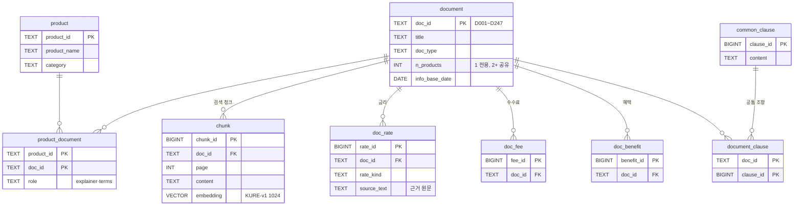

# 사공삼(403) 전체 ERD

사내 RAG(개인정보) + 공개 자료 RAG 3개(법령·금융상품·비조치의견서)를 한 서비스에서 쓰는 데이터 구조입니다.
**스키마마다 다른 DB 계정**을 써서 서로 읽을 수 없게 나눴습니다.

## 1. 한눈에 보기

| 스키마 | 계정 | 내용 | 개인정보 |
|---|---|---|---|
| `app` | app_user | 계정·팀·직급·관리자 기록·이메일 인증 | 계정 이메일·이름 |
| `rag` | rag_user | **가명처리된** 청크·토큰·벡터, 문서 권한, 추정 인물(토큰만), 직원(이름 없음) | 없음 (토큰만) |
| `vault` | vault_user | 토큰↔원문, 이름 포함 직원, 실명 복원 기록, 업로드·검수 원문 | **있음** — AI 서버만 |
| `lawrag` | law_reader (SELECT 만) | 법령 380개 · 조문 28,510 · 조각 35,321 · 위임·준용 연결 11,477 | 없음 |
| `interp` | interp_reader (SELECT 만) | 금융당국 회신 선례·현장건의 과제 | 없음 (적재 때 가림) |
| (파일) | — | 금융상품 391 · 문서 247 · 청크 2,218 | 없음 |

- 사내 RAG 계정은 공개 자료를 못 읽고, 공개 자료 계정은 `rag`·`vault` 를 못 읽습니다 (확인: `law_reader` → `rag` 거부, `rag_user` → `lawrag` 거부, `law_reader` 쓰기 거부).
- 공개 자료는 특정 고객 정보가 없어 HMAC 토큰화를 하지 않습니다. 에이전트가 공개 RAG 로 보내는 검색어에서 토큰·번호를 지웁니다.

---

## 2. app — 계정·권한 (Spring JPA)

---

## 3. rag · vault — 사내 RAG (개인정보)

`rag` 와 `vault` 는 계정이 달라 DB 외래 키로 잇지 않고, **토큰·pid·doc_id 값으로** 이어집니다 (점선 = 값으로 연결).

(`employees_v` = `vault.employees`)

---

## 4. lawrag — 법령 RAG (`AI/app/rag_public/law/`)

국가법령정보센터 Open API 로 받은 법률·시행령·시행규칙·감독규정. 덤프 `AI/data/public_rag/law/law_rag.dump` (Git LFS) → `infra/load_public_rag.sh` 로 넣음.

---

## 5. interp — 금융당국 회신 선례(비조치의견서) RAG (`AI/app/rag_public/noaction/`)

금융위원회·금융감독원 법령해석·비조치의견서 회신과 현장건의 과제. 스키마 파일: `AI/data/public_rag/noaction/schema.sql`·`exmnt_schema.sql`·`indexes.sql`. 데이터(`processed/`, 포털 저작권정책상 git 제외) → `AI/scripts/load_noaction.py` 로 넣음 (회신 4,366 · 조각 8,973 · 현장건의 조각 12,445).

(그 밖에 `case_depts`, `attachments`, `law_source_ids`, `law_article_history`, `admrul_versions`, `exmnt_groups` — 전체는 스키마 파일)

---

## 6. 금융상품 RAG (`AI/app/rag_public/product/`)

신한은행 상품공시의 판매 중 상품 391개와 설명서·약관·특약 247개. 실행 코드는 DB 가 아니라 `AI/data/public_rag/product/` 의 `meta/*.csv`(git 포함)·`chunks/*.jsonl`(은행 문서 원문, git 제외)·`vectors.npz`(git 제외, `scripts/build_product_vectors.py`)를 메모리로 읽습니다. 아래는 같은 내용을 DB 로 옮길 때의 설계 ERD (금리·수수료·혜택 추출 표는 답변 경로에서 아직 안 씀).

---

## 7. 에이전트가 이 저장소들을 쓰는 방식

| 도구 | 저장소 | 계정 | 검색어 | 결과 번호 |
|---|---|---|---|---|
| `search_internal` | rag (+ vault 는 복원 때만) | rag_user | 원문 질문 (서버 안에서만, 권한 밖 문서 검색 전 제외) | 문서 ID `H0071` |
| `search_law` | lawrag | law_reader | 토큰·번호 지운 질문 | `LAW-1` |
| `search_product` | 파일 색인 | — | 토큰·번호 지운 질문 | `PRD-1` |
| `search_noaction` | interp | interp_reader | 토큰·번호 지운 질문 | `CASE-1` (혼합 질문) · `L123`/`O45` (비조치만) |
