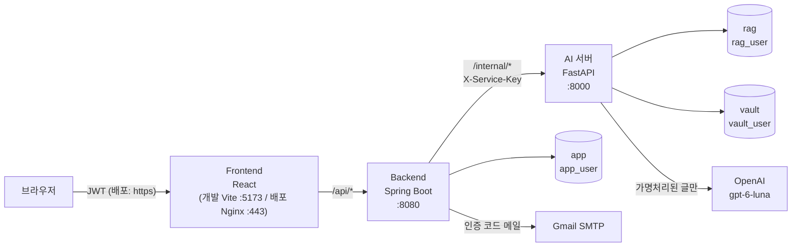
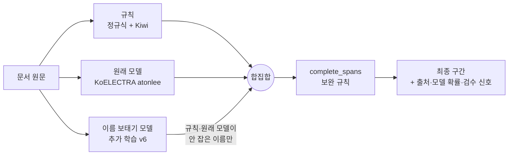
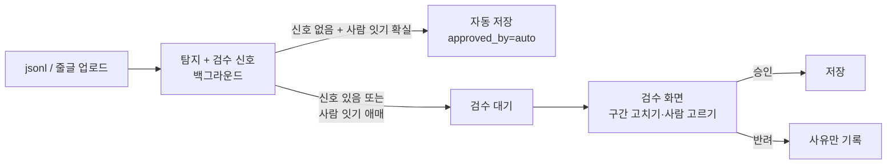
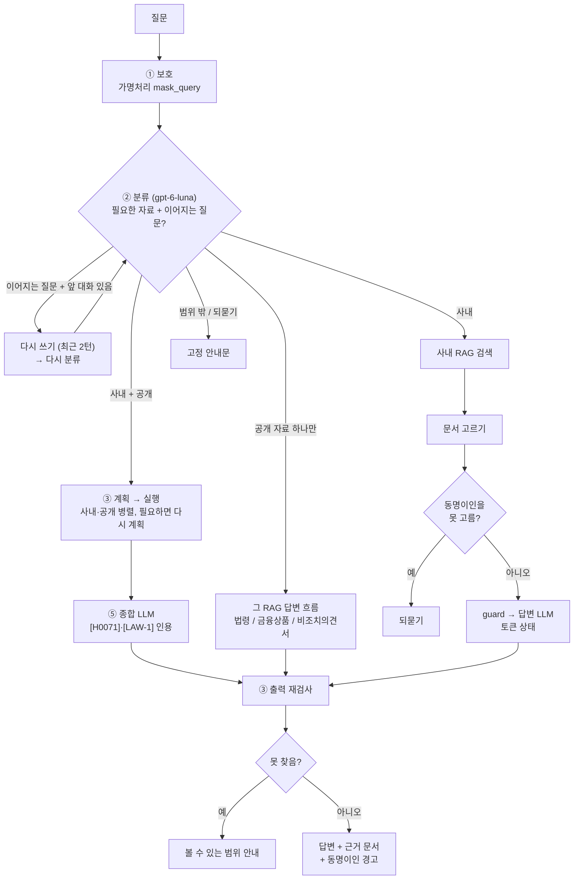
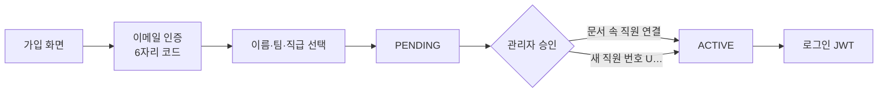

<p align="center">
  
</p>

# 사공삼(403) — 최종 프로젝트 상세 문서

가명처리된 사내 문서로 답하고, **권한이 있는 사람에게만 실명을 보여 주는** 금융 사내 문서 RAG 챗봇입니다.
이 문서는 최종 프로젝트에서 돌아가는 **모든 로직**을 순서대로 설명합니다. 프로젝트 전체 소개는 [저장소 맨 위 README](../README.md)를 보세요.

> 각 절의 `(worklog N장)` 은 `worklog.md` 의 장 번호입니다. 결정 이유·실험 수치·실패한 시도까지 모두 그곳에 있습니다 (작업 기록이라 git 에는 올리지 않고 팀 로컬에 둠).

---

## 목차

1. [전체 구조](#1-전체-구조)
2. [DB 와 계정 분리](#2-db-와-계정-분리)
3. [개인정보 탐지](#3-개인정보-탐지)
4. [가명처리와 사람 잇기(동명이인)](#4-가명처리와-사람-잇기동명이인)
5. [직원 목록·문서 메타데이터 추론](#5-직원-목록문서-메타데이터-추론)
6. [문서 적재: 화면 업로드와 무인 파이프라인](#6-문서-적재-화면-업로드와-무인-파이프라인)
7. [문서 권한](#7-문서-권한)
8. [질문 처리: 에이전트 → 검색 → 답변 → 출력 재검사](#8-질문-처리-에이전트--검색--답변--출력-재검사)
9. [실명 복원과 기록](#9-실명-복원과-기록)
10. [이상 접근 탐지](#10-이상-접근-탐지)
11. [계정: 가입·이메일 인증·승인·로그인](#11-계정-가입이메일-인증승인로그인)
12. [화면](#12-화면)
13. [평가 결과](#13-평가-결과)
14. [실행 방법](#14-실행-방법)
15. [API 목록](#15-api-목록)
16. [폴더 구조](#16-폴더-구조)
17. [한계와 남은 일](#17-한계와-남은-일)

---

## 1. 전체 구조



| 서버 | 맡은 일 | 쓰는 DB 계정 |
|---|---|---|
| **Frontend** (React) | 채팅·실명 보기·적재·검수·통계·관리 화면 | — |
| **Backend** (Spring Boot) | 로그인·JWT, 가입·이메일 인증·승인, 계정·팀·직급, 관리자 기능, **채팅 내역 저장**(질문 원문은 암호문), AI 서버 중계(답변 스트리밍 포함) | `app_user` (`app` 스키마만) |
| **AI 서버** (FastAPI) | 탐지·가명처리·적재·검색·에이전트(멀티턴 포함)·공개 자료 RAG 3개·답변·출력 재검사·실명 복원·이상 접근 탐지 | `rag_user`, `vault_user`, 공개 RAG 읽기 전용 `law_reader`·`interp_reader` |

- 사용자 확인(로그인·역할·직원 연결)은 **스프링이 요청마다 DB 에서 읽어** `{emp_id, team, role}` 을 만들고, AI 서버는 그 값으로 권한을 판단합니다. 화면이 역할을 끼워 보내도 무시합니다 (worklog 13장).
- AI 서버의 `/internal/*` 는 스프링만 부를 수 있습니다 (`X-Service-Key` 헤더).
- 임베딩 모델(KURE-v1)은 AI 서버 안에서 돌기 때문에 **외부로 나가는 건 LLM 호출뿐**이고, 그것도 가명처리된 글만 보냅니다.
- **배포**: EC2 한 대(m7i.xlarge)에 Docker 로 4개(Nginx·Spring·AI·DB), 주소 **https://403.p-e.kr**. main 에 올라오면 GitHub Actions 가 자동 배포합니다 ([14-3-1](#14-3-1-서버-배포-ec2--github-actions), worklog 65·66장).

---

## 2. DB 와 계정 분리

PostgreSQL 16 + pgvector 하나에 스키마 4개를 두고, **스키마마다 다른 계정**을 씁니다. 계정끼리는 서로의 스키마를 읽을 수 없습니다 (`REVOKE`, `infra/init/01_schema.sh`).

| 스키마 | 계정 | 주요 테이블 | 내용 |
|---|---|---|---|
| `app` | app_user | `users`, `teams`, `positions`, `admin_audit_log`, `email_verifications`, `chat_conversations`, `chat_messages` | 계정·역할·선택칸·관리자 변경 기록·이메일 인증·**채팅 내역(가명처리된 글 + 질문 원문 암호문)** (Spring JPA 가 만듦) |
| `rag` | rag_user | `chunks`, `documents`, `persons`, `person_attrs`, `employees` | **가명처리된** 청크·벡터·토큰 목록, 문서 권한 메타데이터, 추정 인물, 직원(이름 없음) |
| `vault` | vault_user | `token_map`, `person_mentions`, `person_keys`, `employees`, `restore_log`, `ingest_job`, `staging_doc`, `review_log`, `deletion_log` | 토큰↔원문 매핑, 이름 포함 직원 목록, 실명 복원 기록, 업로드·검수 대기 원문 |
| `docs` | docs_user | (비어 있음) | 예전 공개 자료 자리 |
| `lawrag` | law_reader (읽기만) | `laws`, `articles`, `chunks`, `article_links` 등 | 법령 RAG — 덤프로 넣음 |
| `interp` | interp_reader (읽기만) | `cases`, `case_groups`, `chunks`, `exmnt_*`, 인용 조문·개정 이력 | 비조치의견서 RAG — `scripts/load_noaction.py` |

전체 ERD(우리 스키마 + 공개 RAG 3개)는 [ERD.md](ERD.md) 에 있습니다.

- `rag.chunks`: `masked_text`, `tokens text[]`(GIN 색인), `embedding vector(1024)`(HNSW), `owner_emp_id`·`team`·`visibility`(public/team/restricted, 기본 restricted)
- 직원 이름은 개인정보라 `vault.employees` 에만 있고, `rag.employees` 에는 `emp_id`·팀·직급·역할만 있습니다.
- DB 는 두 개를 띄웁니다: **개발 DB**(포트 5434, 화면 테스트) / **채점 DB**(포트 5435, 무인 파이프라인). 같은 compose 파일을 `CONTAINER_NAME`·`DB_PORT` 만 바꿔 씁니다 (worklog 28장).

---

## 3. 개인정보 탐지

라벨 7종: `person`, `phone_number`, `address`, `resident_registration_number`, `email`, `account_number`, `card_number`.



### 3-1. 실전 1 운영 탐지기 (그대로 가져옴)
- **규칙**(정규식 + Kiwi 형태소 분석)과 **토큰 분류 모델**(KoELECTRA-small `atonlee`)의 합집합. 놓치는 게 가장 위험해서 가리기 재현율을 1순위로 골랐습니다.
- 코드: `AI/app/pii/detector/` (실전 1 코드와 같음)

### 3-2. 보완 규칙 `complete_spans` (worklog 20~23·25장)
탐지기 뒤에 붙는 단계라, 적재·질문·탐지 캐시 어디서 탐지해도 같은 결과가 나옵니다.

| 보완 | 내용 |
|---|---|
| 라벨 없는 긴 숫자 | 9자리 이상 숫자를 모양으로 번호 토큰화 (13자리 생년월일 꼴 = 주민번호, 0으로 시작 9~11자리 = 전화, 14~16자리 = 카드, 나머지 = 계좌). 사업자번호·접수번호·운송장·경찰청 사건번호 등은 제외 |
| 이름 오탐 빼기 | `신정법`·`금소법` 같은 법 줄임말, `보류·상태·접수·완료` 같은 업무 말, `반송된`·`연체된` 같은 동사 꼴 |
| 성 없는 이름 + 호칭 | `보람대리님`, `다운고객님` (꾸밈말 `우수고객님`·`해당 고객` 등은 제외) |
| 문서 안 퍼뜨리기 | 같은 문서에 성 포함 이름이 탐지돼 있으면, 이름만 쓴 표기 + 사람에게 붙는 조사(`하늘이한테`)도 잡음 |
| 한 글자 이름 | `린님`, `진씨`, `장께서`, `진이한테` (손님·형님·함께 등은 제외). **성 + 직함(`박 과장`)은 팀 라벨 기준상 가리지 않음** |
| 이메일 모양 | `@`·`at`·`골뱅이` + 도메인 점이 없으면 이메일 아님 |

### 3-3. 이름 보태기 모델 (worklog 30~32장)
- 남은 이름 미탐의 91% 가 성 없는 순우리말 이름·띄어 쓴 이름·앞말에 붙은 이름처럼 **문맥을 봐야 하는 유형**이라 규칙으로는 오탐만 늘었습니다.
- `gpt-6-luna` 로 문장 틀만 만들고 가짜 값을 채운 학습 데이터(약 2만 문장, 개선·확인 세트는 한 줄도 안 씀)로 atonlee 를 추가 학습했습니다 (`scripts/ft_make_data.py`, `scripts/ft_train.py`).
- 추가 학습 모델을 단독으로 쓰면 holdout 형식에서 오탐이 늘어서, **원래 모델은 그대로 두고 원래 모델·규칙이 안 잡은 자리의 이름만 보태는** 방식으로 정했습니다 (`PII_NAME_MODEL`).

| 확인 세트 synth_fresh (1,775건, 한 번만) | 가리기 재현율 | 이름 재현율 | 미탐 |
|---|---|---|---|
| 원래 탐지기 | 0.9790 | 0.9571 | 124 |
| **원래 + 이름 보태기 (기본값)** | **0.9858** | **0.9743** | **84** |

### 3-4. 구간마다 검수 신호 (worklog 27·29장)
`detect_scored()` 가 구간마다 출처(rule/model/name_model/complete)와 모델 확률을 남기고 아래 신호를 붙입니다. 화면 업로드의 자동 승인 판단에 씁니다 ([6-1](#6-1-화면-업로드-검수자동-승인)).

| 신호 | 조건 | 근거 (개선용 세트) |
|---|---|---|
| `low_conf` | 모델만 잡은 구간인데 모델 확률 < 0.9 | 확률 < 0.5 구간 오류율 59~70% |
| `rule_added` | 보완 규칙이 더한 구간 | |
| `disagree` | 규칙은 이름인데 모델 확률 < 0.5 | 오류율 70~83% |
| 힌트(표시만) | 모델이 O 로 냈지만 개인정보 확률 ≥ 0.1 | "놓쳤을 수 있는 곳" |

---

## 4. 가명처리와 사람 잇기(동명이인)

### 4-1. 토큰 만들기
- 라벨별 정규화 → `HMAC-SHA256(HMAC_KEY, "라벨|정규화값")` 앞 8자리 → `<PHONE_NUMBER_1a2b3c4d>`
  - 이름: 공백·조사·호칭 제거 (`윤 선영`, `윤선영은` → `윤선영`) / 전화: 숫자만, `+82` → `0` / 계좌·카드·주민번호: 숫자만 / 이메일: 소문자
- 사람은 **추정 인물 단위** 토큰 `<PERSON_…>` 을 씁니다. 같은 이름이어도 다른 사람이면 다른 토큰입니다.
- 원문과의 매핑은 `vault.token_map` 에만 저장합니다.
- 비밀키 `HMAC_KEY` 는 `.env` 에만 둡니다. 키가 같으면 실전 2 와 같은 토큰이 나옵니다.

### 4-2. 사람 잇기 `person_resolve.py`
같은 이름의 언급을 누구로 볼지 단서로 정합니다.

| 단서 | 예 |
|---|---|
| 닻(같은 사람임을 확정하는 값) | 같은 문서·같은 줄의 전화·이메일·주민번호·계좌·카드 |
| 역할 | 고객 / 직원 / 외부 (`고객님`, `상담원`, `수탁사`) |
| 소속 | 팀 이름 (`채권관리팀 이상훈`) |
| 직급 (worklog 35장) | `대리`, `과장` — 붙일 묶음을 고를 때만 씀 |
| 고객 번호 충돌 (worklog 35장) | 문서의 카드·계좌·주민번호가 묶음의 번호와 다르면 다른 고객 |

- 서로 어긋나지 않는 묶음이 하나뿐이면 합치고, 여럿이면 새 사람이나 **미확정**(이름 기준 토큰)으로 둡니다.
- 설계 원칙: **잘못 합치는 것이 쪼개지는 것보다 위험**합니다. 실명 복원 때 엉뚱한 사람 이름이 나올 수 있기 때문입니다.
- 무인 파이프라인은 파일 전체를 한꺼번에 묶고, 화면 업로드는 문서 1건씩 기존 인물과 잇습니다 (`ingest/linking.py`). 한 건씩 저장해도 한꺼번에 저장한 결과와 거의 같습니다 (synth2 쪼개짐 21.1% vs 21.1~22.0%, worklog 9-4).

### 4-3. 외부로 보내기 전 마지막 검사 `guard`
청크·질문을 LLM 으로 보내기 직전에 원문 개인정보가 남았는지 다시 보고, 남았으면 `<MASKED>` 로 가립니다.

---

## 5. 직원 목록·문서 메타데이터 추론

담당자·소속 정보는 주어지지 않으므로 **문서에서 직접 추론**합니다 (`AI/app/org/infer.py`, worklog 10장).

1. **직원 언급 찾기**: 탐지된 이름 중 직원 단서(직급, 담당 항목, 가까운 팀 이름)가 있는 것. 고객·협력사는 제외합니다.
   - 항목 우선순위: 작성(작성자·보고자·발신) > 담당 > 처리(처리자·상담원·심사역) > 신청 > 직급만 > 승인(결재·수신·참조)
   - 서명 꼴(`○○ 드림`, `○○ 차장입니다`)과 표·슬래시 꼴(`리스크관리팀 / 부장 / 김성호`)도 읽습니다.
2. **직원 목록**: 이름별로 모으고 팀이 다르면 다른 직원(동명이인)으로 봅니다. 역할은 정보보호·감사 쪽 팀이거나 이사급이면 AUDITOR, 팀장·차장·부장이면 LEAD, 나머지는 STAFF 입니다.
3. **문서 메타데이터**
   - 담당자 = 위 우선순위의 첫 직원
   - 팀 = 담당자 팀 > 소속 항목 > 문서 속 직원들의 팀이 하나뿐일 때 그 팀 > 모름
   - 공개 범위 = `public`(공지·부고·전 임직원 대상) / `team` / `restricted`(팀을 모르거나 감사 보고서)
   - **끝까지 모르면 더 엄격하게**: 팀을 모르는 문서와 감사 지적 문서는 `restricted` (감사만)

```
employees.jsonl : {"emp_id": "E012", "name": "김성호", "team": "리스크관리팀", "position": "부장", "role": "LEAD"}
doc_meta.jsonl  : {"id": "H0130", "owner_emp_id": "E012", "team": "리스크관리팀", "visibility": "team"}
```

holdout(187건): 직원 74명, 담당자 있음 109건, 팀 있음 136건, 공개 범위 public 23 / team 109 / restricted 55.

---

## 6. 문서 적재: 화면 업로드와 무인 파이프라인

저장 순서는 두 경로가 같습니다:
**사람 잇기 → 가명처리 → guard → 청크(600자) → 임베딩(가명처리된 청크만) → rag 커밋 → vault 커밋**.
한 번에 한 건씩만 저장되도록 잠급니다 (`pg_advisory_xact_lock`). 같은 새 사람이 동시에 두 번 생기지 않게 하려는 것입니다.

### 6-1. 화면 업로드 (검수·자동 승인)



- 정답이 있는 문서는 탐지 결과가 정답과 같을 때만 자동 저장(`approved_by=gold`)하고, 다르면 검수로 보냅니다.
- 자동 저장 직전에 사람 잇기도 확인합니다. 이름만으로 기존 사람과 이은 경우(`unique_link`)나 후보가 여럿인 경우(`ambiguous`)는 검수로 돌립니다.
- 검수 기록(`vault.review_log`)에는 **값 없이** 추가·삭제·라벨 변경 개수와 위치만 남깁니다.

| 자동 저장 비율 | holdout | synth2 | 어려운 문서(synth_hard_eval) |
|---|---|---|---|
| 자동 저장 | 91% | 97% | 62% |
| 자동 저장 중 오류 있는 문서 | 0.6% | 0.1% | 43% |

쉬운·보통 문서는 90% 이상 자동으로 들어갑니다. 다만 미탐은 모델 점수에 신호가 거의 없어서 검수로 걸러지지 않습니다. 노출 위험을 줄이는 건 탐지기 개선의 몫입니다 (worklog 29장).

### 6-2. 무인 파이프라인 `scripts/run_pipeline.py` (worklog 28·33장)
**문서 파일만 바꾸면 새 DB 에서 처음부터 끝까지 수작업 없이** 돕니다.

```
탐지(새로 실행) → 직원 목록·문서 메타데이터 → 사람 잇기·가명처리 → 적재
 → (정답 있으면) 탐지 채점 → 검색 + 채점 → 답변(gpt-6-luna) + 출력 재검사 → 답변 채점·유출 검사
 → (사람 정답 있으면) 사람 잇기 채점 → report.md · scores.json
```

- 안전장치: 개발 DB(5434)는 `--allow-dev-db` 없이는 거부하고, 비어 있지 않은 DB 는 `--reset` 없이는 거부합니다.
- 결과 폴더: `detect`, `employees`, `doc_meta`, `load_summary`, `search_run`, `answers`, `scores.json`, `report.md`, `person_cases.csv`, `run.log`
- 같은 Holdout 을 새 DB 에서 다시 돌리면 직원 목록·메타데이터·적재 요약·검색 순위 10위까지가 **개발 DB 와 완전히 같게** 나옵니다.

---

## 7. 문서 권한

규칙은 `AI/app/core/access.py` 한 곳에 있고, **검색 SQL 조건(`sql(user)`)과 파이썬 판단(`can_view`·`can_restore`)을 같은 곳에서** 정의합니다.

| 역할 | 볼 수 있는 문서 | 실명 보기 |
|---|---|---|
| **STAFF** (직원) | 전사 공개 + 자기 팀 중 담당자가 정해진 문서 + 자기 담당 문서 | 자기 담당 문서만, 사유 없이 |
| **LEAD** (팀장) | 전사 공개 + 자기 팀 문서 전부 + 자기 담당 문서 | 볼 수 있는 문서 전부, **사유 필수** |
| **AUDITOR** (감사) | 전부 (restricted 포함) | 전부, **사유 필수** |

- **권한 밖 문서는 검색 단계에서 아예 빠집니다.** 토큰 후보 쿼리와 의미 검색 상위 N **서브쿼리 안쪽**에 조건을 넣습니다. 밖에서 거르면 권한 밖 문서가 상위 N 자리를 차지해 결과가 줄어들기 때문입니다. HNSW + WHERE 로 후보가 모자라지 않게 `hnsw.iterative_scan = relaxed_order` 를 씁니다.
- 담당자 본인은 역할·공개 범위와 상관없이 자기 문서를 봅니다.
- 직원 연결이 없는 계정은 감사가 아니면 질문할 수 없습니다 (403).
- 사유 필수는 화면·스프링·AI **세 곳 모두에서** 막습니다. 화면만 막으면 API 로 우회할 수 있기 때문입니다.
- 확인: 직원 74명 전원에서 SQL 로 고른 문서 = 파이썬 판단, 직원 14명 × 질의 25개 실제 검색에서 **권한 밖 문서 0건** (worklog 11-3).

---

## 8. 질문 처리: 에이전트 → 검색 → 답변 → 출력 재검사



### 8-1. 에이전트 `AI/app/agents/` (worklog 16·25장)
- **① 보호**: 외부 LLM 보다 먼저 질문을 가명처리합니다. 분류 LLM 에는 가명처리된 질문만 보냅니다.
  - 질문에서 규칙만 이름으로 본 말 중 형태소로 보통 말로 풀리는 것(`크게 주려면`, `금적립`, `신청한`)은 가리지 않습니다. 처음 보는 이름은 한 덩어리로 남아 계속 가립니다 (worklog 64장).
- **② 분류** (`router.py`): 필요한 출처(사내 / 법령 / 금융상품 / 비조치의견서)를 고르고, 경로(internal·public·mixed·out_of_scope·clarify)는 코드가 정합니다.
  - 이름이 있어도 법·상품 일반 내용만 묻는 질문이면 사내가 아닙니다.
  - `~건 있으면`·`있었어?` 는 사내 기록을 확인하라는 신호입니다.
  - 대상을 알 수 없는 지시어(`그 건`)는 되묻습니다.
  - 질문이 사람 토큰뿐이면 LLM 없이 사내 검색으로 보냅니다.
- **③ 계획·실행** (`planner.py`, `agent.run_plan`): 사내 + 공개 자료가 필요한 질문은 2라운드로 돕니다. 지금 할 수 있는 검색(사내·공개)은 병렬로 하고, 사내 기록을 봐야 정할 공개 검색은 사내 결과를 본 뒤 다시 계획합니다. 사내 기록이 없으면 LLM 을 부르지 않고 공개 검색도 생략합니다. **공개 검색어의 토큰·이름·번호는 코드가 한 번 더 지웁니다** (`planner.strip_public`).
- **공개 자료 하나만 필요한 질문**은 그 RAG 의 답변 흐름을 그대로 씁니다 (지시문·임계값·근거·원문 링크).
- **⑤ 종합** (`agent._with_public`): 사내 기록(`[H0071]`)과 공개 자료(`[LAW-1]`)를 한 번에 넘겨 답하게 합니다. 사내 검색이 질문 속 이름을 문서 속 사람 토큰으로 이어 준 질문을 같이 넘깁니다. 동명이인을 고르지 못하면 사내만일 때처럼 되묻습니다.
- **출처를 구분한 출력 재검사**: 공개 자료 본문에서 개인정보 모양으로 잡히는 말(법 조문 속 예시 이름 등)은 고객 개인정보가 아니므로 답변 재검사에서 막지 않습니다 (`_public_safe_words`).
- 분류 LLM 이 실패하면 사내 검색으로 넘어갑니다. `AGENT_CHAT=0` 이면 에이전트 없이 사내 RAG 를 바로 씁니다.

### 8-1-1. 공개 자료 RAG `AI/app/rag_public/` (worklog 53장)
팀원 RAG 3개를 브랜치 merge 없이 코드를 읽어 `AI/` 아래 한 패키지로 옮겼습니다. 실험용 분기(버전별 지시문, 환경변수 토글)는 빼고 **채택된 설정만** 남겼고, 설정·DB 연결·임베딩·LLM 은 서버 공통(`app.core.config`, `app.rag.embed`)을 씁니다. 질문 임베딩은 사내 RAG 와 같은 KURE-v1 하나로 같이 씁니다 (벡터 일치 확인).

| 패키지 | 자료 | 저장 | 검색·답변 |
|---|---|---|---|
| `law/` | 금융 법령 380개 · 조각 35,321 | DB `lawrag`, 읽기 전용 `law_reader` | 벡터 → 조문 단위 → 1~10위 + 위임·준용 연결 조문 → LLM 1회 (1위 점수 0.5338 미만이면 "찾지 못함"). 검색어에 조문 용어를 덧붙임: 보이스피싱·스미싱 → 전기통신금융사기, 대포통장 → 사기이용계좌 (worklog 67장) |
| `product/` | 신한은행 판매 중 상품 391 · 문서 247 · 청크 2,218 | 파일 색인 (`data/public_rag/product/`) | 상품명 찾기(별칭·LLM 확인) → 상품으로 좁힌 벡터+BM25 → LLM 점수형 재순위 → 판매 상태·대상 상품 줄 |
| `noaction/` | 법령해석·비조치의견서 회신 4,366 · 현장건의 | DB `interp`, 읽기 전용 `interp_reader` | 회신 시기 조건 분리 → 벡터 20 → LLM 재순위 5 + 현장건의 → 직접성 판정 → 답, 못 찾으면 키워드 완화 |

공개 자료 하나만 필요한 질문은 그 RAG 의 답변 흐름을 그대로, 사내와 섞이면 근거만 받아 에이전트가 종합합니다.
데이터가 없는 RAG 는 도구로 등록하지 않아, 에이전트가 "준비 중"으로 안내합니다. 아직 없는 RAG 는 60초마다 다시 확인해서, DB 가 AI 서버보다 늦게 켜져도 저절로 붙습니다 (worklog 63장). 서버를 켤 때 공개 RAG 색인도 미리 읽어 첫 질문이 빠릅니다 (worklog 55장). 전체 데이터 구조는 [ERD.md](ERD.md).

### 8-1-2. 멀티턴 (worklog 67장)
- 질문 분류가 같은 LLM 호출에서 **이전 대화가 필요한 질문인지(followup)**도 판단합니다. 대부분의 질문은 추가 비용이 없습니다
- 필요하고 같은 대화에 앞 턴이 있으면, 최근 2턴의 가명처리된 질문·답변 앞부분만 보고 **혼자 읽어도 되는 질문으로 다시 쓴 뒤** 평소 흐름을 탑니다 (근거 문서 본문은 넘기지 않아 대화가 길어져도 비용이 늘지 않음)
- 앞 대화는 Spring 이 DB 에서 꺼내 넘기고(남의 대화면 AI 를 부르기 전에 404), 다시 쓴 질문의 토큰은 AI 서버 안에서만 원문 이름으로 되돌려 사내 검색에 씁니다
- 사람을 가리키는 말은 역할을 맞춥니다: "그 고객" = 앞 질문의 고객, "그 직원·담당자" = 앞 답변에서 처리·담당한 사람
- 앞 답변에서 이미 확정된 사람은 검색에서 **그 사람으로 고정**합니다. 이름만 넘기면 같은 이름의 다른 사람 문서가 섞이기 때문입니다
- 앞 대화가 없는데 지시어("그 건")만 있으면 지금처럼 되묻습니다
- 화면 답변 위에 "앞 대화를 이어서: (다시 쓴 질문)"을 보여 줍니다
- 평가: [13-6](#13-6-멀티턴-worklog-67장-개선용-세트-20개)

### 8-2. 검색 `AI/app/rag/search.py`
**점수 = 토큰 점수(질문 조건을 얼마나 맞췄나, 0~1) + 의미 유사도(코사인) + 문서 종류 가산점 + 처리 상태 가산점**

| 조건 | 토큰 점수 |
|---|---|
| 전화·이메일·주민번호·계좌·카드 | 같은 값 토큰이 있으면 1 |
| 주소 | 전체 토큰 1, 아니면 주소 조각(시군구·도로명·동·호)이 겹친 비율 × 0.8 |
| 지역만 있는 질문 | `구로구에 사는 고객` → 주소 조각으로. `충청남도에 사는 고객`처럼 **시·도만** 있으면 vault 에서 그 시·도 주소 토큰을 모아 조건으로 (worklog 68장) |
| 이름 | 그 사람 토큰 1 / 이름만 쓴 표기 0.6 / 같은 이름의 **미확정** 토큰 0.7 / 같은 이름의 **다른 확정 인물** 0.3 |
| 문서 종류 | 질문 단어 → 문서 종류 사전 + 종류별 평균 임베딩, 같으면 +0.3 |
| 처리 상태 (worklog 19장) | 질문의 상태 집합(접수·처리 중·처리 완료·보류)에 문서 상태가 들면 +0.2. 표 한 줄 = 한 사람이면 줄 단위 상태 |

- 후보는 토큰이 하나라도 겹치는 청크(GIN 색인)와 의미 검색 상위 50개입니다. 둘 다 권한 조건 안에서 찾습니다.
- 질문의 이름은 질문 속 다른 단서(번호·역할·소속)로 사람을 고르고, 근거 문장의 토큰도 같이 바꿉니다. 멀티턴에서 앞 답변이 가리킨 사람은 단서로 고르지 않고 고정합니다.
- 재순위(`RERANK=1`): 상위 8개를 LLM 으로 다시 정렬합니다.
- 임베딩: **KURE-v1**(로컬, 1024차원). bge-m3 와 비교해 390개 중 2개 차이로 사실상 같고, 외부 전송이 없습니다 (worklog 17장).

### 8-3. 답변 `AI/app/rag/chat.py`
- **문서 고르기**: 검색 1위는 항상 넘기고, 질문 조건을 맞춘 문서가 있으면 토큰 점수 0.7 미만(다른 사람이 확실한 문서)은 뺍니다. 다른 사람 문서를 인용하는 걸 줄이려는 것입니다.
- **되묻기**: 동명이인을 질문 단서로 못 고르면 LLM 대신 "같은 이름이 N명 있습니다 — 고객/직원, 소속, 연락처를 알려 주세요"라고 되묻습니다 (토큰·역할·문서 ID 만 표시).
- **답변 LLM**: `gpt-6-luna`, 답변만 `reasoning_effort=low`. 근거 문서는 `[H0071]` 처럼 인용합니다. LLM 에 보내기 직전에 `guard` 를 한 번 더 거칩니다.

### 8-4. 출력 재검사 `check_output`
LLM 답변을 화면에 보여 주기 전에 두 가지를 검사합니다.
1. **문서에 없는 토큰**: 근거 문서·질문에 없는 토큰은 `[확인 안 된 토큰]` 으로 바꿉니다. 실명 복원으로 엉뚱한 사람 이름이 나오는 걸 막습니다.
2. **원문 개인정보**: 답변을 탐지기로 다시 보고, 걸리면 토큰으로 가립니다. 문서 종류 이름(`한도하향통지`)과 마크다운 기호는 오탐을 막으려고 빼고 봅니다.

검사 결과는 응답의 `check` 필드로 화면까지 갑니다. 공개 자료만으로 답한 경우에는 법 조문 속 말이 이름으로 잡히는 오탐을 막으려고 이름 검사를 빼고, 사내 문서가 섞이면 그대로 검사합니다 (worklog 57장).

### 8-5. 못 찾았을 때와 동명이인 경고 (worklog 26·37장)
- LLM 이 "찾을 수 없습니다"라고 답하고 인용도 없으면, 답을 **역할별 볼 수 있는 범위 안내**로 바꿉니다. 권한 밖이라 안 보인 걸 고장으로 오해하지 않게 하려는 것입니다.
  - 예: "볼 수 있는 범위(전사 공개 문서, ○○팀 문서 중 담당자가 정해진 것, 본인 담당 문서)에서 찾지 못했습니다."
  - 권한 밖에 문서가 **있는지는 말하지 않습니다**. 있다는 사실 자체가 정보이기 때문입니다.
- 질문·답변의 사람 토큰 중 **같은 이름의 사람이 DB 에 2명 이상**이면 "동명이인 가능" 경고를 붙여 근거 문서를 확인하게 합니다.

### 8-6. 답변 스트리밍과 진행 단계 (worklog 59·60장)
- 화면 → Spring → AI 가 **SSE** 로 이어집니다 (`POST /api/chat/ask/stream`). Spring 은 받은 이벤트를 바로 흘려보내고, 마지막 결과를 받으면 채팅 내역에 저장합니다.
- 답변 글은 **문장·줄 단위로 출력 재검사를 통과한 조각만** 화면에 보냅니다 (`CheckedStream`). 끝나면 전체 글을 한 번 더 검사한 최종본으로 바꿉니다.
- 진행 단계를 보여 줍니다: 개인정보 가리기 → 질문 분류(출처) → 앞 대화 보고 다시 쓰기 → 검색 계획(개수) → 검색(출처별 건수) → 사례 직접 해당 판단 → 답변 생성 → 재검사. 단계마다 걸린 시간과 결과가 나오고, 답 글이 오기 시작하면 한 줄로 줄입니다.

### 8-7. 답변 모양과 근거 문서 (worklog 56~58장)
- 답변은 **마크다운**(제목·목록·표·굵게)으로 보여 주고, 인용(`[H0071]`·`[LAW-1]`·`[PRD-1]`)은 누르면 근거 문서로 가는 칩입니다. 원본 HTML·링크는 그리지 않습니다.
- 근거 문서는 검색 조각이 아니라 **전체 단위**로 보여 줍니다: 법령은 조문 전체, 금융상품은 나뉜 절을 이어 붙이고, 비조치의견서는 회신 이유까지. 긴 글은 접기·전체 보기.

---

## 9. 실명 복원과 기록

`AI/app/pii/restore.py` `restore_for(text, user, doc_ids, purpose)`

1. 답변의 근거 문서 중 **이 사람이 복원해도 되는 문서**에서 나온 토큰만 실명으로 바꾸고, 나머지는 토큰 그대로 둡니다 (`denied`).
2. 팀장·감사는 사유가 없으면 거절합니다. 스프링에서 사유 없이 막힌 시도도 AI 서버에 거절 기록으로 남깁니다 (`/internal/audit/refused`).
3. **매번 `vault.restore_log`** 에 남깁니다: 계정·역할·직원·팀·사유·복원한 토큰·허용 문서·거부 토큰·거절 이유·시각.
4. 방금 요청을 넣어 [이상 접근 규칙](#10-이상-접근-탐지)을 바로 적용하고, 걸리면 응답의 `warnings` 로 본인 화면에 경고합니다. 막지는 않고 알리기만 합니다.

실명은 저장하지 않고 화면에 보여 주기만 합니다. 마이페이지에서 내 복원 기록을, 관리자 화면에서 전체 복원 기록을 볼 수 있습니다.
출력 재검사가 가린 말(원래 값이 없는 토큰)은 "권한 없음"이 아니라 "답변 검사에서 가린 말"로 따로 안내합니다 (`unknown`).

---

## 10. 이상 접근 탐지

`AI/app/audit/anomaly.py` — 실명 복원 기록만 보고, **이유를 설명할 수 있는 규칙 7개**로 경고합니다. 실명·원문 없이 계정·토큰·문서 ID·개수만 씁니다 (worklog 38·39장).

| 규칙 | 기준 | 위험 |
|---|---|---|
| 대량 복원 | 10분 안에 10번 이상 | 높음 |
| 권한 밖 시도 반복 | 1시간 안에 거절 + 권한 밖 토큰이 남은 요청 5번 이상 | 높음 |
| 특정인 반복 조회 | 같은 사람 토큰을 하루 5번 이상, 서로 다른 문서 3건 이상에서 | 높음 |
| 평소보다 급증 | 하루 건수 ≥ 본인 평소(이전 14일 활동일 중앙값) × 3 이면서 20건 이상 (감사 60건, 평소 기록이 3일 미만이면 30건) | 중간 |
| 넓은 범위 | 하루 서로 다른 문서 30건 이상 (감사 60건) | 중간 |
| 형식적인 사유 | 같은 사유 하루 10번 이상 (중간) / 4자 미만 사유 3번 이상 (낮음) | 중간·낮음 |
| 업무 외 시간 | 22시~7시·주말 (1~2번 낮음, 3번 이상 중간) | 낮음·중간 |

- 관리자 통계 화면의 "이상 접근" 표는 시간순(기본)·위험도순·규칙순으로 정렬할 수 있습니다.
- 모의 기록 평가(`scripts/sim_access.py --eval`, 직원 30명 × 4주, 시드 4개): 중·강 이상 시나리오 **56개 중 55개 탐지**, 정상 사용에서 **잘못된 경고 0건**. 놓친 1건은 감사 기준(60건) 아래의 35건으로, 설계대로입니다.

---

## 11. 계정: 가입·이메일 인증·승인·로그인



- **이메일 인증** (worklog 41장): 6자리 코드, 10분 유효, 5번 틀리면 무효. 같은 이메일은 60초에 한 번·하루 10번, 같은 IP 는 1시간 30번까지 보낼 수 있습니다.
  - 코드는 원문 없이 HMAC 으로만 저장합니다.
  - 확인 후 30분 안에 한 번만 쓸 수 있습니다.
  - 메일은 팀 Gmail 앱 비밀번호로 보내고, 메일 본문은 HTML 입니다 (코드 칸을 한 번 누르면 전체가 선택됨).
- **비밀번호 재설정** (worklog 42장): 같은 인증 방식을 씁니다. 가입되지 않은 주소에도 같은 응답을 줘서 가입 여부가 드러나지 않습니다. 가입 코드와 재설정 코드는 서로 바꿔 쓸 수 없습니다.
- **승인** (worklog 12·44장)
  - 관리자가 AI 서버의 직원 후보(이름·팀 일치)를 보고 연결하거나, 문서에 없는 사람이면 새 직원 번호 `U0001…` 를 만듭니다.
  - 새 번호는 계정에 이미 쓰인 번호와 겹치지 않게 만듭니다.
  - 역할 기본값은 연결 직원의 추론 역할이고, 없으면 직급 기본 역할입니다.
- **로그인**: 비밀번호가 틀리면 401, 맞지만 승인 대기·정지면 403 입니다. JWT 에는 이메일만 넣고, 역할·팀·직원 연결은 **요청마다 DB 에서 읽습니다**. 그래서 관리자가 역할을 바꾸거나 정지하면 이미 받은 토큰에도 바로 반영됩니다.
- **관리자**: 사용자 팀·직급·역할·관리자 여부·정지·직원 연결 변경, 팀 목록 관리(AI 서버의 문서 팀 이름 동기화). 모든 변경은 `app.admin_audit_log` 에 전후 값 JSON 으로 남습니다.
  - 자기 관리자 권한 빼기, 자기 정지는 막아 둡니다.
  - **계정 정지는 사유 필수**(500자까지)이고, 사유를 변경 기록에 같이 남깁니다.
  - 관리자가 사용자의 채팅 대화를 열면 `view_chat` 으로 기록되고, 변경 기록에 "○○ 님이 △△ 님의 「제목」 대화를 열람했어요"로 보입니다 (worklog 61장).
- 첫 관리자는 서버 시작 때 `ADMIN_EMAIL`·`ADMIN_PASSWORD`(12자 이상)로 만듭니다.

---

## 12. 화면

| 화면 | 경로 | 내용 | 권한 |
|---|---|---|---|
| 로그인 / 가입 / 비밀번호 재설정 | `/login`, `/signup`, `/reset-password` | 왼쪽 로고 카드, 이메일 인증 칸 | 누구나 |
| 채팅 | `/chat` | 질문·답변(토큰 상태, 마크다운, **스트리밍 + 진행 단계**), **멀티턴**("앞 대화를 이어서"), 근거 문서 패널(전체 글·접기), **실명 보기**(사유 입력·이상 접근 경고), 동명이인 경고, 분류·시간 표시, 대화 목록(**계정별 서버 저장** — 다른 기기에서도 이어서, 지우기) | 로그인 |
| 마이페이지 | `/me` | 내 정보·역할 설명, 비밀번호 변경, 내 실명 보기 기록 | 로그인 |
| 데이터 적재 | `/ingest` | 업로드, 업로드별 상태·자동 저장 수, 문서 목록(확인할 곳 N개) | 관리자 |
| 검수 | `/ingest/docs/:id` | 구간 드래그로 추가·삭제·라벨 변경, 확인할 구간(점선)·놓쳤을 수 있는 곳(물결 밑줄), 사람 잇기 고르기, 저장 안 한 수정이 있으면 나가기 전에 확인 | 관리자 |
| 통계 | `/stats` | 적재·질문·실명 보기 수, 복원 기록, **이상 접근** 표, **최근 대화 기록**(전체 사용자, 계정·가명처리된 제목·질문 수만, 쪽 나눔) | 관리자 |
| 관리 | `/admin` | 가입 승인, 사용자·팀 관리(정지는 사유 필수), **사용자별 채팅 내역 열람(열 때마다 기록)**, 저장된 문서·**공개 자료 보기**(법령·금융상품·금융당국 회신, 읽기만)·직원, 문서 공개 범위·담당자 변경, 문서 삭제, 변경 기록 | 관리자 |

- 창 폭이 1280px 이하이면 왼쪽 메뉴가 아이콘만 남습니다. 900px 이하에서는 대화 목록·근거 문서가 겹쳐 뜨는 서랍이 되고, 760px 이하에서는 여백을 줄입니다.
- 되돌리기 어려운 동작(문서 정보 바꾸기·삭제, 정지 등) 앞에는 확인 대화상자를 띄웁니다. 처음 포커스는 취소 버튼입니다.
- 글꼴은 Pretendard(프로젝트에 포함)이고, 로고는 `Frontend/public/brand/` 에 있습니다.

---

## 13. 평가 결과

> 세트 역할: **개선용**(오류를 보고 고침) / **확인용**(점수만, 보고 다시 고치지 않음). holdout·synth2·synth3 는 개선 과정에서 이미 본 세트입니다.

### 13-1. 무인 파이프라인 — 현재 Holdout (187건, 질의 88, 새 DB, worklog 28·32·33장)

| 영역 | 지표 | 값 |
|---|---|---|
| 탐지 | F1 / 가리기 재현율 | 0.995 / 0.999 |
| 사람 잇기 | 미탐 / 쪼개짐 / 동명이인 합쳐짐 | 1 / 10명(6.3%) / 5 — 실전 2 최종과 같음 |
| 검색 | Hit@1 / Hit@5 / MRR (재순위 켬) | 0.977 / 1.000 / 0.989 |
| 답변 | 근거 적중 / 인용 적중 / 인용 정밀도 / 못 찾음 | 1.00 / 0.989 / 0.987 / 0.011 |
| 안전 | 원문 유출 (LLM 입력 / 원 답변 / 최종 답변) | **0 / 0 / 0** |
| 시간 | 전체 (탐지 79 · 적재 1.5 · 검색 93 · 답변 350초) | 524초, 수작업 0 |

### 13-2. 탐지 — 확인용 세트

| 세트 | 탐지기 | 가리기 재현율 | 이름 재현율 |
|---|---|---|---|
| synth_hard_eval (403, 어려운 표기) | 원래 → 추가 학습(v4) | 0.929 → 0.964 | 0.872 → 0.940 |
| synth_fresh (1,775, 한 번만) | 원래 → **원래 + 이름 보태기** | 0.979 → **0.986** | 0.957 → **0.974** |

### 13-3. 동명이인 — 확인 세트 synth4 (448건, 동명이인 40쌍, worklog 34·35장)

| | 잘못 붙은 언급 | 동명이인 합쳐짐 | 정밀도 / 재현율 | 검색 Hit@1 | 혼동 인용 | 유출 |
|---|---|---|---|---|---|---|
| 원래 규칙 | 196 | 53 | 0.818 / 0.837 | 0.867 | 0.144 | 0 |
| 새 규칙 (직급·고객 번호) | **156** | **45** | **0.850** / 0.826 | 0.844 | 0.141 | 0 |

잘못 합치는 경우는 20% 줄었지만 답변 품질로는 효과가 보이지 않았습니다. 단서가 이름 옆에 없는 같은 역할 동명이인은 규칙으로 가를 수 없는 한계입니다.

### 13-4. 에이전트 분류·계획 (worklog 16·24·57·67장, gpt-6-luna)

| 세트 | 분류 맞음 | 공개 검색어에 이름·토큰 |
|---|---|---|
| 기본 (dev 34문항) | **34/34** | 0 |
| 어려운 질문 50문항 | **49/50** | 0 |
| 처음 보는 애매한 질문 43문항 | **41/43** — gpt-4.1 과 같고 비용 약 1/19 | 0 |
| 최종 확인 세트 (16문항, 한 번만) | 16/16 | 0 |

### 13-5. 답변 LLM 비교 — holdout 88 (worklog 24장)

| | gpt-6-luna | HCX-007 |
|---|---|---|
| 인용 적중 / 인용 정밀도 | **0.99 / 0.98** | 0.92 / 0.90 |
| 혼동 문서 인용 | **0.07** | 0.23 |
| LLM 평균 시간 | **2.2초** | 2.8초 |
| 유출 | 0 | 0 |

### 13-6. 멀티턴 (worklog 67장, 개선용 세트 20개)

앞 질문에 실제로 답한 뒤 이어지는 질문을 넣어 잽니다: 이어지는 질문 14개(사람 8·사건/주제 6) + 이어지지 않는 질문 4개 + 앞 대화 없는 지시어 2개.

| 지표 | 값 |
|---|---|
| 전체 / 이어지는 질문인지 판단 | **20/20** / 20/20 |
| 다시 쓰기 성공 / 대상 이름 / 사건 말 | 14/14 / 8/8 / 6/6 |
| 이어지는 질문의 추가 시간 · 20개 추가 비용 | 평균 4.2초 · $0.008 (보통 질문은 추가 0) |

고치면서 본 세트라 낙관적인 숫자입니다. 처음 보는 확인 세트로는 아직 재지 않았습니다.

---

## 14. 실행 방법

### 14-1. 준비물
- Docker Desktop, Python 3.13, Java 21, Maven, Node.js 18+
- 이름 보태기 모델 폴더 `AI/outputs/models/atonlee-ft-v6` (55MB, git 에 없음 → 팀 공유 드라이브). 없으면 경고만 하고 원래 탐지기로 동작합니다.

### 14-2. 설정 파일 (모두 git 제외, `.env.example` 을 복사해서 채움)

| 파일 | 주요 값 |
|---|---|
| `infra/.env` | DB 비밀번호(관리자·app·rag·docs·vault), `DB_PORT` |
| `AI/.env` | DB 비밀번호, `EMBED_PROVIDER=hf`, `EMBED_MODEL=nlpai-lab/KURE-v1`, `OPENAI_API_KEY`, `HMAC_KEY`, `AI_SERVICE_KEY`, `PII_NAME_MODEL`, `RERANK` |
| `Backend/.env` | `DB_PASSWORD`, `JWT_SECRET`(32바이트 이상), `AI_SERVICE_KEY`(AI 와 같은 값), `ADMIN_EMAIL`·`ADMIN_PASSWORD`, `MAIL_USERNAME`·`MAIL_PASSWORD`(Gmail 앱 비밀번호), `CHAT_QUERY_KEY`(선택: 채팅 질문 원문 암호화 키, 비우면 JWT 비밀키에서 만듦) |

메일 계정이 없는 로컬 개발에서는 `Backend/.env` 에 `EMAIL_VERIFY_SIGNUP=false` 를 넣으면 인증 없이 가입할 수 있습니다.

### 14-3. 실행

```bash
# 1) DB (개발 DB, 포트 5434)
cd 최종프로젝트/infra
docker compose up -d
```

```bash
# 1-1) 공개 자료 RAG 넣기 (법령 덤프 193MB·비조치의견서 적재·금융상품 벡터 — 처음 한 번, CPU 노트북에서 약 1~2시간)
cd 최종프로젝트
bash infra/load_public_rag.sh
```
`LAW_PASSWORD`·`NOACTION_PASSWORD` 를 `infra/.env`·`AI/.env` 에 같은 값으로 넣어 둡니다 (읽기 전용 계정 `law_reader`·`interp_reader`). 금융상품 원문 청크(`product/chunks/*.jsonl`)와 비조치의견서 원 자료(`noaction/processed/`)는 git 에 없어 담당자에게 받아 `AI/data/public_rag/` 아래에 넣습니다. 비조치의견서는 담당자의 DB 덤프(`rag_db.dump`)도 있지만 PostgreSQL 17 형식이라 우리 16 에 바로 안 들어가서, 원 자료에서 적재합니다 (결과 16개 표 건수·약칭 184개가 덤프와 같음).

```bash
# 2) 문서 적재 (예: 현재 Holdout, 개발 DB)
cd 최종프로젝트/AI
pip install -r requirements.txt
python scripts/run_pipeline.py --docs <문서.jsonl> --allow-dev-db --reset --skip-answer --out outputs/pipeline_dev
```

```bash
# 3) 서버 3개 (각각 다른 터미널)
cd 최종프로젝트/AI && python -m uvicorn app.main:app --port 8000
cd 최종프로젝트/Backend && mvn -q spring-boot:run
cd 최종프로젝트/Frontend && npm install && npm run dev
```

VS Code 에서는 `Ctrl+Shift+P` → **Tasks: Run Task** → **사공삼: 전체 실행** 으로 세 서버를 한 번에 켤 수 있습니다 (`.vscode/tasks.json`).
브라우저에서 `http://localhost:5173` 을 엽니다. AI 서버는 처음 켤 때 임베딩·탐지 모델을 읽느라 첫 질문까지 1분쯤 걸립니다.

### 14-3-1. 서버 배포 (EC2 + GitHub Actions)

- 주소 **https://403.p-e.kr** (무료 도메인 A 레코드 → 고정 IP, Let's Encrypt 인증서, 매일 자동 갱신)
- main 에 `최종프로젝트/AI|Backend|Frontend|infra|deploy` 가 바뀌어 올라오면 GitHub Actions 가 SSH 로 서버의 `deploy/deploy.sh` 를 실행해 Docker 로 다시 빌드·실행합니다. Actions 탭에서 손으로도 돌릴 수 있습니다
- 서버 한 대(m7i.xlarge, 미국 오하이오)에 web(Nginx :80·:443)·backend·ai·db 4개. 밖에 여는 포트는 80·443 뿐이고 DB 는 서버 안에서만
- 비밀값·데이터(금융상품 색인·이름 보태기 모델)는 저장소 밖 `/srv/saebom` 에 둡니다
- 처음 준비(설정 파일·데이터·DB 옮기기·인증서)와 구성은 [deploy/README.md](deploy/README.md) (worklog 65·66장)

### 14-4. 무인 파이프라인 (채점 DB, 포트 5435)

```bash
cd 최종프로젝트/infra
DB_PORT=5435 CONTAINER_NAME=saebom_eval_db docker compose -p saebom_eval up -d
```

```bash
cd 최종프로젝트/AI
DB_PORT=5435 python scripts/run_pipeline.py --docs 문서.jsonl --queries 질의.jsonl --gold 질의정답.jsonl --persons-gold 사람정답.jsonl --reset --out outputs/pipeline_<이름>
```

정답 파일이 없으면 채점 없이 결과 파일만 만듭니다. `--skip-answer` 를 주면 LLM 단계를 건너뜁니다.

### 14-5. 테스트

```bash
cd 최종프로젝트/AI && python -m pytest -q
```

```bash
cd 최종프로젝트/Backend && mvn -q test
```

```bash
cd 최종프로젝트/Frontend && npx tsc -p tsconfig.app.json --noEmit && npx eslint src
```

- AI 의 DB 통합 테스트는 `SAEBOM_IT=1` 일 때만 돕니다. 이 테스트는 DB 를 비우고 다시 적재하므로 **채점 DB(`DB_PORT=5435`)로** 돌리세요.
- 프론트 타입 검사는 반드시 `-p tsconfig.app.json` 을 붙이세요. 루트 `tsconfig.json` 은 `files: []` 라 그냥 `tsc --noEmit` 은 아무것도 검사하지 않습니다.

---

## 15. API 목록

### 15-1. Backend (`/api`, 화면이 부름)

| 영역 | 경로 |
|---|---|
| 인증 | `POST /auth/check-email`, `/auth/email/send`, `/auth/email/verify`, `/auth/signup`, `/auth/login`, `/auth/refresh`, `/auth/password/send`·`verify`·`reset`, `GET /auth/options`, `GET /auth/me` |
| 채팅 | `POST /chat/ask`, `POST /chat/ask/stream`, `POST /chat/restore`, `GET·POST /chat/conversations`, `GET·DELETE /chat/conversations/{id}` |
| 내 정보 | `PUT /me/password`, `GET /me/restore-log` |
| 적재 (관리자) | `POST·GET /ingest/jobs`, `GET /ingest/jobs/{id}`, `/ingest/jobs/{id}/docs`, `GET /ingest/docs/{id}`, `POST /ingest/docs/{id}/preview-links`, `/ingest/docs/{id}/review` |
| 관리 (관리자) | `GET /admin/users`, `/admin/users/{id}`, `/admin/users/{id}/conversations`, `/admin/users/{id}/conversations/{convId}`, `/admin/users/{id}/candidates`, `POST /admin/users/{id}/approve`, `PUT /admin/users/{id}`, `GET /admin/employees`, `GET·POST /admin/teams`, `PUT /admin/teams/{id}`, `POST /admin/teams/sync`, `GET /admin/audit-log` |
| 문서 (관리자) | `GET /admin/docs`, `/admin/docs/deletion-log`, `/admin/docs/{docId}`, `POST /admin/docs/{docId}/meta`, `/admin/docs/{docId}/delete` |
| 통계 (관리자) | `GET /admin/stats`, `/admin/restore-log`, `/admin/anomalies`, `/admin/recent-conversations` |
| 공개 자료 (관리자, 읽기만) | `GET /admin/public-docs/{source}`, `/admin/public-docs/{source}/{id}` (source = law·product·noaction) |

### 15-2. AI 서버 (`/internal`, 스프링만 부름, `X-Service-Key`)

| 영역 | 경로 |
|---|---|
| 채팅 | `POST /chat/ask`, `POST /chat/ask/stream` (SSE), `POST /chat/restore` — 질문에 같은 대화의 최근 턴(`history`)을 같이 받음 |
| 공개 자료 | `GET /public-docs/{source}`, `/public-docs/{source}/{doc_id}` |
| 적재 | `POST·GET /ingest/jobs`, `GET /ingest/jobs/{id}`, `/ingest/jobs/{id}/docs`, `GET /ingest/docs/{id}`, `POST /ingest/docs/{id}/preview-links`, `/ingest/docs/{id}/review` |
| 직원 | `GET /org/teams`, `POST /org/match`, `GET /org/employees`, `/org/employees/{id}`, `POST /org/employees` |
| 문서 | `GET /docs`, `/docs/deletion-log`, `/docs/{id}`, `POST /docs/{id}/meta`, `/docs/{id}/delete` |
| 통계·감사 | `GET /stats`, `/restore-log`, `/audit/anomalies`, `POST /audit/refused` |
| 상태 | `GET /health` (서비스 키 없이) |

---

## 16. 폴더 구조

```
최종프로젝트/
├── README.md                 ← 지금 이 문서
├── ERD.md                    전체 ERD (우리 스키마 + 공개 RAG 3개)
├── worklog.md                작업 기록 (장별 결정·수치·실패 기록, git 제외)
├── infra/
│   ├── docker-compose.yml    PostgreSQL 16 + pgvector (CONTAINER_NAME·DB_PORT 로 개발/채점 DB)
│   ├── init/                 01_schema.sh(스키마·계정·권한·테이블), 02_public_rag.sh(공개 RAG 읽기 계정)
│   └── load_public_rag.sh    법령 덤프·비조치의견서·금융상품 벡터 넣기
├── deploy/                   운영(EC2) compose·deploy.sh·certbot.sh·설정 틀 (deploy/README.md)
├── AI/
│   ├── app/
│   │   ├── main.py           FastAPI, 시작 때 모델 미리 읽기
│   │   ├── core/             config(설정), db(계정별 연결), access(권한), security(서비스 키), loading(모델 로드 잠금)
│   │   ├── pii/
│   │   │   ├── detector/     실전 1 탐지기 (규칙 + atonlee) + 이름 보태기 모델
│   │   │   ├── pii_pipeline.py  탐지·보완 규칙·검수 신호·가명처리·guard
│   │   │   ├── person_resolve.py 사람 잇기 (동명이인)
│   │   │   └── restore.py    실명 복원 + 기록 + 이상 접근 경고
│   │   ├── org/              infer(직원·문서 메타데이터 추론), directory(직원 조회·새 번호)
│   │   ├── ingest/           service(업로드·검수·자동 승인·저장), linking(1건씩 사람 잇기), manage(문서 삭제·메타 변경)
│   │   ├── pipeline/load.py  파일 → 새 DB 한 번에 적재
│   │   ├── rag/              search(검색), chat(답변·출력 재검사), embed(임베딩), status(처리 상태)
│   │   ├── agents/           router(분류), planner(계획), followup(멀티턴 다시 쓰기), agent(질문 처리), progress(진행 단계), tools, llm
│   │   ├── audit/anomaly.py  이상 접근 규칙 7개
│   │   ├── rag_public/       공개 자료 RAG: law(법령), product(금융상품), noaction(비조치의견서) — 에이전트 도구
│   │   └── api/              chat, ingest, org, docs, stats, audit, public_docs 라우터
│   ├── scripts/              run_pipeline(무인), load_corpus, build_org, eval_*(평가, git 제외), ft_make_data·ft_train(추가 학습), gen_synth4·5(동명이인 세트), sim_access(이상 접근 모의), load_noaction·build_product_vectors(공개 RAG 준비)
│   ├── eval/                 에이전트 평가 질문·보고서
│   ├── data/public_rag/      공개 RAG 자료: 법령 덤프(LFS)·상품 목록·스키마 (원문·벡터는 git 제외)
│   ├── tests/                단위·DB 통합 테스트
│   ├── outputs/              결과·캐시·모델 (git 제외)
│   └── Dockerfile            배포 이미지 (torch CPU)
├── Backend/src/main/java/com/saebom/backend/
│   ├── controller/           Auth, Chat, Ingest, Admin, AdminDocs, AdminPublicDocs, Me
│   ├── service/              UserService, AdminService, EmailVerificationService, ChatHistoryService(채팅 내역), ChatCipher(질문 원문 암호화)
│   ├── ai/                   AiClient (AI 서버 호출), AccessUser
│   ├── security/             JWT 필터·유틸, SecurityConfig
│   └── entity/ · repository/ · dto/ · exception/
└── Frontend/
    ├── src/features/         auth, chat(스트리밍·마크다운·멀티턴), review(적재·검수), stats, admin(채팅 열람·공개 자료), profile
    ├── src/shared/           api 클라이언트, AuthContext, AppLayout, Logo, ConfirmDialog, Pager, 스타일
    ├── public/brand/         로고 (흰색·파란색·가로형), favicon
    └── nginx/ · Dockerfile   배포용 Nginx (인증서가 있으면 https, 없으면 http)
```

저장소 맨 위 `.github/workflows/deploy.yml` 이 main 에 올라온 변경을 EC2 에 배포합니다.

---

## 17. 한계와 남은 일

| 구분 | 내용 |
|---|---|
| 공개 자료 RAG | 법령·금융상품·비조치의견서 3개 모두 연결했습니다. 종합 답변의 품질(사내+공개 대조)은 아직 세트로 재지 않았습니다. 법령은 조문 용어 사전에 없는 흔한 말이면 조문을 못 찾을 수 있습니다 |
| 멀티턴 | 최근 2턴만 봐서 3~4턴 전 대상은 잊습니다. 처음 보는 확인 세트로는 아직 재지 않았고, "다른 건"이라고 물어도 앞에서 본 문서가 다시 섞일 수 있습니다 |
| 근거 개수 | 답변은 근거 3건까지라 "부산에 사는 고객 다 보여줘"여도 3건만 보입니다 |
| 서버 위치 | 서버가 미국 오하이오라 한국에서 요청마다 0.2초쯤 더 걸립니다 (답변 시간은 대부분 LLM) |
| 탐지 | 호칭·조사 단서가 없는 성 없는 이름(`[하늘]은 담당`)은 아직 놓칩니다. 미탐은 모델 점수에 신호가 거의 없어 자동 승인 검수로도 잘 걸러지지 않습니다 |
| 동명이인 | 같은 역할끼리, 이름 옆에 단서가 없는 동명이인은 규칙으로 가를 수 없습니다 (synth4 혼동 인용 0.14). 화면에 "동명이인 가능" 경고로 보완합니다 |
| 출력 재검사 기록 | 재검사 결과는 응답으로만 전달되고 DB 에는 아직 기록하지 않습니다 |
| LLM 흔들림 | `gpt-6-luna` 는 temperature 0 을 못 써서, 같은 입력에도 재순위·답변이 조금씩 달라집니다 (±0.01~0.03). 비교는 2~3번 평균으로 봅니다 |
| 대화 기록 | 계정별로 DB 에 저장합니다 (가명처리된 질문·토큰 상태 답변, 질문 원문은 AES-GCM 암호문으로만 두고 본인에게만 풀어 줌, worklog 61·64장). 사용자가 지우면 완전히 지워집니다 |
| 다시 적재 | `--reset` 으로 다시 적재하면 직원 번호가 새로 매겨질 수 있습니다. 지금 데이터에서는 같은 번호가 나오는 것을 확인했습니다 |
| 일반화 | holdout·synth2·synth3 는 개선 과정에서 본 세트입니다. 공정한 최종 점수는 Holdout2 를 받아 **수정 없이 처음 돌린 결과**로 냅니다 |

**보안 규칙**: `.env`·`HMAC_KEY`·API 키·메일 앱 비밀번호는 커밋하지 않습니다. 외부 LLM 에는 가명처리된 글만 보냅니다. 평가 결과·모델·테스트 계정 정보는 `AI/outputs/`(git 제외)에 둡니다.
