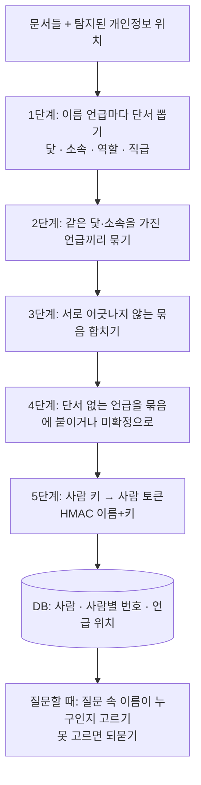

# 사람 잇기 (동명이인 구분) — 어떻게 동작하나

문서 여러 건에 나온 이름 중 **어느 것이 같은 사람인지** 정하는 단계입니다.
같은 사람이면 모든 문서에서 같은 토큰(`<PERSON_58dd…>`)이 되고, 이름만 같은 다른 사람이면 다른 토큰이 됩니다.
검색("표태혁 고객 문서"), 실명 보기, 동명이인 되묻기가 모두 이 결과를 씁니다.

- 코드: `AI/app/pii/person_resolve.py` (한꺼번에 적재), `AI/app/ingest/linking.py` (화면에서 한 건씩 올릴 때), `AI/app/rag/search.py` (질문 속 이름 고르기)
- 한 줄 요약: **모델이 확률로 맞히는 게 아니라, 같은 값(번호·소속)이 실제로 겹치는지를 보는 규칙**입니다. 애매하면 붙이지 않습니다.

---

## 0. 큰 원칙 두 가지

1. **잘못 합치는 것이 쪼개지는 것보다 위험하다**
   - 다른 사람을 한 사람으로 합치면, 남의 문서가 그 사람 기록으로 검색되고 실명까지 보일 수 있습니다.
   - 같은 사람이 둘로 쪼개지면 검색에서 일부 문서를 놓칠 뿐입니다.
   - 그래서 근거가 확실할 때만 잇고, 애매하면 "미확정"으로 둡니다.
2. **"가까운 사람"을 고르지 않는다**
   - 유사도·거리 점수가 없습니다. 같은 번호, 같은 소속처럼 **값이 똑같이 겹칠 때만** 같은 사람으로 봅니다.
   - "가깝다"를 쓰는 곳은 딱 하나, **번호가 어느 이름의 것인지** 정할 때 글 속 위치(이름 바로 뒤)를 보는 것뿐입니다.

---

## 1. 전체 흐름



---

## 2. 1단계 — 이름 언급마다 단서 뽑기

탐지기가 찾은 이름 하나하나(= 언급)에서 아래 네 가지를 뽑습니다.

### 2-1. 이름 펼치기 (먼저)
- 성 없이 이름만 쓴 표기(`태혁 님`, `서연이랑`)는 **같은 문서에 성까지 쓴 이름이 딱 하나** 있을 때 그 이름으로 바꿉니다.
  - 문서에 `표태혁`만 있으면 `태혁` → `표태혁`
  - `김태혁`과 `표태혁`이 둘 다 있으면 바꾸지 않음 (누군지 모름)
- 띄어쓰기는 지우고 비교합니다: `표 태혁` = `표태혁`

### 2-2. 닻 (가장 확실한 단서)
**이름에 딸린 전화·이메일·주민번호·계좌·카드번호**입니다. 어느 번호가 어느 이름의 것인지는 위치로 정합니다.

| 경우 | 예 | 닻 |
|---|---|---|
| 같은 줄에서 이름 바로 뒤 (사이엔 문장부호·짧은 말만) | `대상 고객: 표태혁 (9440-3474-8532-8722)` | 카드 9440… |
| | `김민준 고객 연락처 010-1234-5678` | 전화 010… |
| `항목: 이름` 줄 다음에 이어지는 `항목: 값` 줄들 | `고객명: 김민준`<br>`연락처: 010-1234-5678`<br>`카드번호: 9440-…` | 전화, 카드 (빈 줄·다른 이름에서 멈춤) |
| 표에서 이름 칸 **바로 다음 칸** | `\| 3 \| 도채슬 \| 01059411049 \| 한도 문의 \|` | 전화 010… |
| 대화에서 고객이 자기 이름을 말한 뒤, 같은 고객이 번호만 답한 줄 | `고객: 네, 박서하이에요.`<br>`상담원: 주민등록번호 말씀해 주시겠어요?`<br>`고객: 9105071356762 요.` | 주민번호 (12줄 안, 같은 화자가 다른 이름을 말하면 멈춤) |

**닻으로 안 보는 경우**
- 말한 사람 표시 뒤: `이윤서: 그 고객 연락처 010-…` → 이윤서의 번호가 아님 (남 얘기)
- 지칭어: `그 사람 연락처는 010-…` → "그 사람"이 누군지 풀지 않음
- 다음 이름이 나온 뒤의 번호, 줄이 바뀐 뒤의 번호 (위 표의 경우 말고)

번호는 비교 전에 표기를 맞춥니다: `+82 10-1234-5678` · `010.1234.5678` · `010 1234 5678` · `공일공 일이삼사 …` → 모두 `01012345678`

### 2-3. 소속
| 경우 | 예 | 소속 |
|---|---|---|
| 이름 뒤 괄호 | `상담원: 도재호 (채권관리팀)` | 채권관리팀 |
| 이름 바로 앞 조직 이름(…팀·센터·본부·지점·실) | `리스크관리팀 김성호` | 리스크관리팀 |
| 이름 앞 회사 이름 + 이름 뒤 직함 | `미르보안 이서연 책임` | 미르보안 (다른 문서에서 괄호·팀 이름으로도 확인된 이름일 때만) |

### 2-4. 역할 — 고객 / 직원 / 외부
| 역할 | 근거 | 예 |
|---|---|---|
| 고객 | 이름 뒤 `고객`·`귀하` | `표태혁 고객님`, `수신: 은진연 귀하` |
| | 앞의 고객 쪽 항목 | `고객명:`, `민원인:`, `신청인:`, `청구인:`, `양도인`, `예금주` … |
| | 표의 "고객명" 열 | `\| 고객명 \| 연락처 \|` 아래 칸 |
| 직원 | 소속이 우리 조직(…팀·센터) | `(채권관리팀)` |
| | 앞의 직원 쪽 항목 | `상담원:`, `작성자:`, `처리:`, `담당`, `결재자` … |
| | 이름 뒤 직급 | `과장`, `팀장`, `대리` … |
| 외부 | 수탁사·협력사·업체 | `수탁사 담당자: …` |

같은 문서에서 고객으로 나온 이름이 다른 자리에서 항목 이름(`보낸 사람:`)만으로 직원이 되면 고객으로 바로잡습니다 (고객이 보낸 메일의 원문 인용).

### 2-5. 직급
이름 바로 뒤 직급(`조수현 팀장`)을 따로 기억합니다. 같은 이름의 직원끼리 가르는 데 씁니다.

---

## 3. 2단계 — 같은 닻·소속을 가진 언급끼리 묶기

이름이 같고, **닻(번호)이나 소속 중 하나라도 같으면** 같은 사람 묶음에 넣습니다 (Union-Find: 같은 값을 공유하면 줄줄이 이어짐).

```
문서 A: 표태혁 · 카드 9440…            ┐
문서 B: 표태혁 · 카드 9440… · 전화 010-9946… ├─ 카드가 같음 → 한 묶음
문서 C: 표태혁 · 전화 010-9946…          ┘ (B 를 통해 전화로 이어짐)
```

```
문서 D: 도재호 (채권관리팀)   ┐
문서 E: 도재호 (채권관리팀)   ┘ 소속이 같음 → 한 묶음
```

---

## 4. 3단계 — 서로 어긋나지 않는 묶음 합치기

같은 고객이 문서마다 다른 단서만 남기는 경우가 많습니다 (한 문서엔 전화만, 다른 문서엔 카드만).
그래서 이름이 같은 묶음끼리 **어긋나는 점이 없으면** 합칩니다.

| 합치지 않는 경우 (= 다른 사람의 증거) | 예 |
|---|---|
| 역할이 다름 | 고객 도재호 ↔ 직원 도재호 |
| 같은 종류 번호가 서로 다름 | 카드 A 를 가진 김민준 ↔ 카드 B 를 가진 김민준 |
| 소속이 다름 | 채권관리팀 박형윤 ↔ 준법감시팀 박형윤 |
| 한쪽만 소속이 있고 역할이 같다고 확인 안 됨 | 소속 있는 직원 묶음 ↔ 번호만 있는 묶음 |

---

## 5. 4단계 — 단서 없는 언급 붙이기

번호도 소속도 없는 언급(`담당 도재호.`, `박서하님 카드 재발급`)은 **위에서부터 처음 맞는 것** 하나로 정합니다.

| 순서 | 조건 | 결과 (기록되는 근거) |
|---|---|---|
| 1 | 같은 문서에 같은 이름이 이미 어느 묶음으로 정해져 있음 (역할·직급이 맞을 때) | 그 묶음 (`same_doc`) |
| 2 | 이 문서 안의 번호가 같은 이름 묶음 하나의 번호와 같음 (묶음이 2개 이상일 때) | 그 묶음 (`doc_anchor`) |
| 3 | 역할(·직급)이 맞는 묶음이 딱 하나 | 그 묶음 (`role`) |
| 4 | 고객인데 문서의 고객 번호(카드·계좌·주민번호)가 기존 고객과 달라 맞는 묶음이 없음 | 그 번호로 새 사람 (`doc_id_new`) |
| 5 | 직원인데 직급이 달라 맞는 묶음이 없음 | 이름+직급으로 새 사람, 직급 없으면 미확정 |
| 6 | 역할이 다른 같은 이름만 있음 | 역할(+직급)로 새 사람 (`role_new`) |
| 7 | 같은 이름 묶음이 하나뿐이고 역할을 모름 | 그 묶음 (`unique`) |
| 8 | 그 밖 | **미확정** — 이름 기준 토큰 (`unresolved` / `name_only`) |

**고객이 셋 이상 나오는 문서**(지점업무일지, 콜백 목록)의 번호는 누구 것인지 몰라서 2·4번 판단에 쓰지 않습니다.
(예전엔 업무일지의 "표태혁 고객 …"이 같은 문서 다른 고객의 카드번호를 자기 것으로 잡아 새 사람이 됐음)

---

## 6. 5단계 — 사람 토큰 만들기

- 언급마다 정해진 키로 `HMAC("person|이름|키")` → `<PERSON_58dd…>` 토큰을 만듭니다.
  - 같은 사람 = 같은 키 = 모든 문서에서 같은 토큰
  - 동명이인 = 다른 키 = 다른 토큰
  - 미확정 = 키 없음 = 이름만으로 만든 토큰 (같은 이름의 미확정 언급끼리는 같은 토큰)
- DB 에 남는 것 (원문 이름은 금고 `vault` 에만)
  - `rag.persons`: 사람 id, 이름 토큰, 역할, 소속, 확정/미확정
  - `rag.person_attrs`: 사람별 번호 토큰 (닻) — 질문 속 번호로 사람을 고를 때 씀
  - `vault.person_mentions`: 어느 문서 몇 번째 글자가 누구인지 (원문 위치)

---

## 7. 질문할 때 — 질문 속 이름이 누구인지

질문 `고객 도재호 건만 보여줘`의 `도재호`는 같은 이름 후보 중에서 아래 순서로 고릅니다.

1. **질문 속 번호가 그 사람의 번호와 같다** (`rag.person_attrs`) — 예: `010-7114-6387 쓰는 도재호`
2. **질문에 소속 이름이 있다** — 예: `채권관리팀 도재호`
3. **역할 단어** — `고객`·`민원인` → 고객 / `직원`·`담당`·`처리한`·`과장` → 직원

고르면 그 사람 토큰이 있는 문서를 1점으로, 다른 사람이 확실한 같은 이름 문서는 0.3점, 누군지 모르는(미확정) 같은 이름 문서는 0.7점으로 검색 점수를 줍니다.

**못 고르면 되묻습니다**: "질문 속 이름과 같은 사람이 문서에 N명 있어 누구인지 정할 수 없습니다 …"
- 질문이 문서 종류를 말하고(`콜백 요청 기록`) 1위 문서가 그 종류면, **실제로 답에 쓸 문서**에 다른 사람이 섞일 때만 되묻습니다.
- 사람만 찾는 질문(`남궁하은 고객 문서만`)은 후보 전체를 보고 신중하게 되묻습니다.

---

## 8. 화면에서 한 건씩 올릴 때 (`linking.py`)

한꺼번에 적재할 때와 달리, 새 문서 1건을 **이미 DB 에 있는 사람**과 잇습니다. 문서 안에서는 위 1~4단계를 그대로 쓰고, 그 결과를 기존 사람과 맞춥니다 (번호는 토큰끼리 비교 — 원문 없이).

| 판단 | 조건 | 검수 |
|---|---|---|
| `anchor_link` | 번호가 맞는 기존 사람 1명 | 자동 |
| `aff_link` | 번호 없음, 같은 이름·같은 소속 1명 | 자동 |
| `new` | 번호(또는 소속)가 있는데 맞는 사람 없음 | 자동 |
| `unique_link` | 단서 없음, 같은 이름의 확정 인물이 1명뿐 | **검수로** (약한 판단) |
| `ambiguous` | 번호가 맞는 사람이 2명 이상 | **검수로** (검수자가 고름) |
| `unresolved` | 그 밖 | 이름 기준 토큰 |

---

## 9. 예: Holdout2 의 도재호 (동명이인)

| 문서 | 글 | 단서 | 결과 |
|---|---|---|---|
| H20001 개인정보열람청구 | `청구인: 도재호` … `연락처: 01071146387` | 역할 고객 | 고객 도재호 |
| H20589 콜백요청목록 | `\| 11 \| 도재호 \| 010-7114-6387 \|` | 고객명 열 + 같은 번호(표기만 다름) | 고객 도재호 (H20001 과 같은 사람) |
| H20022 채무조정상담 | `상담원: 도재호 (채권관리팀)` | 역할 직원 + 소속 | 직원 도재호 |
| H20022 같은 문서 | `담당 도재호.` | 단서 없음 → 같은 문서의 직원 도재호 | 직원 도재호 |
| H20376 결재보고서 | `\| 도재호 부장 \|` | 직급 → 역할 직원 | 직원 도재호 |

→ 고객 도재호 2건, 직원 도재호 9건이 서로 다른 토큰. `고객 도재호 건만 보여줘`는 H20589·H20001 을 찾음.

## 10. 예: 한 사람이 쪼개졌다가 이어진 경우 (표태혁)

| 문서 | 글 | 처음 | 고친 뒤 |
|---|---|---|---|
| H20552 콜백요청목록 | `\| 표태혁 \| 010-9946-3999 \|` | 고객 A | 고객 |
| H20424 해외결제차단해제 | `… 표태혁 고객님` | 고객 A | 고객 |
| H20168 결재보고서 | `대상 고객: 표태혁 (9440-…)` | 고객 A | 고객 |
| H20059 중도상환문의 | `보낸 사람: 표태혁` (고객이 보낸 메일 인용) | **직원**으로 봄 → 따로 | 같은 문서에 `표태혁 고객님` 이 있어 고객으로 |
| H20237 지점업무일지 | `표태혁 고객 결제 계좌 변경` | 같은 일지의 **다른 고객 카드번호**를 자기 것으로 → 따로 | 고객이 셋 이상인 문서의 번호는 안 씀 |
| H20423 지점업무일지 | `표태혁 고객 연락처 변경: …` | 위와 같은 이유로 따로 | 〃 |

→ 4명으로 나뉘던 표태혁이 한 사람이 됨.

---

## 11. 한계 (지금 못 하는 것)

| 한계 | 예 | 결과 |
|---|---|---|
| 지칭어를 풀지 않음 | `그 사람 연락처는 010-…`, `그분`, `해당 고객` | 번호가 아무에게도 안 붙음 |
| 같은 사람인데 겹치는 값이 하나도 없음 | 한 문서엔 이름만, 다른 문서엔 이름+카드, 역할도 다름 | 쪼개짐 |
| 같은 이름·같은 역할인데 단서가 없는 동명이인 | 고객 김민준 둘이 번호 없이 이름만 | 합쳐질 수 있음 (그래서 미확정으로 두는 경우가 많음) |
| 역할 판단이 틀림 | 양식이 새로우면 항목 이름을 모를 수 있음 | 쪼개지거나 잘못 붙음 |
| 소속을 잘못 읽음 | `성명: 박서하 (양도인의 배우자)` 를 소속으로 | 엉뚱한 묶음 (안 고침) |

## 12. 점수로 본 지금 상태 (사람 잇기 정답이 있는 세트)

| 세트 | 이름 언급 | 미탐 | 쪼개짐 (한 사람이 2개 이상 토큰) | 동명이인 합쳐짐 | 그 외 합쳐짐 |
|---|---|---|---|---|---|
| holdout (187건) | 560 | 0 | 11/158명 (7.0%) | 5 | 0 |
| synth2 (1,000건) | 2,730 | 0 | 70/350명 (20.0%) | 8 | 0 |
| synth3 (300건) | 890 | 0 | 43/135명 (31.9%) | 15 | 0 |

"그 외 합쳐짐"(이름이 다른 사람끼리 합쳐짐)은 0입니다. 원칙대로 합치는 쪽보다 쪼개지는 쪽으로 틀립니다.

### Holdout2 — 검색 정답으로 본 간접 점수

Holdout2 에는 "이 언급은 몇 번 사람"이라는 정답이 없습니다. 그래서 검색 정답을 대신 씁니다.

- 이름이 들어간 질문의 **정답 문서들은 같은 사람**입니다 → 그 이름이 모두 한 토큰으로 이어져야 합니다.
- **헷갈리는 문서(confusable)는 같은 이름의 다른 사람**입니다 → 대상 사람의 토큰이 거기 있으면 잘못 합쳐진 것입니다.

| 확인 | 결과 |
|---|---|
| 같은 사람이어야 하는 묶음 (정답 문서 2개 이상인 질문) | 26/28 이어짐 |
| 다른 사람이어야 하는 문서 (동명이인) | 50/50 따로 |
| 정답 문서에서 그 이름을 못 찾음 | 4 |

- 안 이어진 2개: `09:08 신혜영님 카드 재발급`, `고(故) 박형윤 님 명의 카드`. 역할 단서가 없는데 같은 이름 묶음이 둘이라 일부러 붙이지 않았습니다 (0절 원칙).
- 이름을 못 찾은 4개: 성 없는 이름만 있는 문서 3 (`세서`, `성리`, `형은`), 탐지 놓침 1 (`공지별`).
- 이 점수는 질문에 나온 사람만 봅니다. 질문에 안 나온 사람의 쪼개짐은 재지 못합니다.
