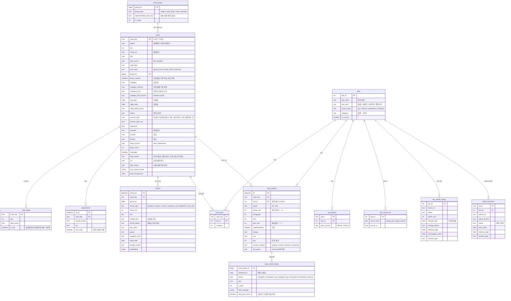

# 금융당국 회신 선례 RAG 기획안

작성일 2026-11-09 · 작성 박지훈 · 상태: 설계 확정

## 1. 한 줄 요약

은행 직원이 업무 중 "이거 해도 되나?" 싶을 때, **금융위·금감원이 비슷한 질의에 실제로 어떻게 회신했는지**를 찾아 근거와 함께 보여주는 챗봇.
조문 해설이나 확정 판단은 하지 않는다. "당국이 이렇게 적용한 선례가 있다"까지만 말하고, 최종 판단은 준법감시·법무 부서 몫으로 남긴다.

## 2. 왜 필요한가

| 지금 | 이 RAG가 있으면 |
|---|---|
| 신상품·제휴·업무 범위 검토 때 금융규제·법령해석포털에서 키워드로 검색 → 결과가 많고, 표현이 다르면 안 나옴 | 상황을 문장으로 설명하면 비슷한 회신을 의미로 찾음 |
| 특정 조문(예: 은행법 제27조의2 부수업무)이 실제로 어떻게 해석됐는지 모으려면 하나씩 열어 봐야 함 | 조문을 넣으면 그 조문을 다룬 회신을 날짜순으로 모아 줌 |
| 찾은 회신이 오래돼서 그 뒤에 법이 바뀌었는지 따로 확인해야 함 | 모든 답변에 "회신일 이후 해당 조문 개정됨" 같은 시점 표시를 자동으로 붙임 |

**사용자**: 은행 상품기획, 준법감시, 영업점 지원, 여신·외환 업무 담당 직원 (소비자용 아님)

예시 질문
- "예금 고객에게 제휴사 포인트를 지급하는 게 특별이익 제공에 해당하는지 회신 있어?"
- "은행이 자회사 펀드를 비대면으로 판매할 때 적합성 원칙 관련 비조치의견서 찾아줘"
- "은행법 제34조의2 관련 법령해석 2022년 이후 것만"
- "이 회신 이후에 관련 조문이 바뀌었어?"

### 기능

코퍼스와 인덱스는 하나만 만들고, 그 위에 기능 네 개를 올린다.

| # | 기능 | 입력 예 | 출력 | 우선순위 |
|---|---|---|---|---|
| ① | **유사 사례 검색** | 상황 설명 문장 | 비슷한 회신 top-k, 사례별 질의요지·회답 요지·회신일·링크 | 필수 |
| ② | **조문 → 사례 조회** | "은행법 제27조의2" | 그 조문을 다룬 회신 목록(날짜순), 회답 경향 요약 | 필수 |
| ③ | **시점 검증** | (①②의 모든 답변에 자동) | 회신일 이후 인용 조문·규정의 개정 여부 표시 | 필수 |
| ④ | **상품 검토 워크플로** | 신상품·서비스 설명 | 쟁점별로 쪼개서 각각 ① 검색 → 쟁점별 선례 있음/상충/없음 체크리스트 | 선택 |

하지 않는 것
- 조문 해설, "가능합니다/불가합니다" 같은 확정 판단
- 포털에 없는 판례·제재 사례 (다른 팀원 RAG 영역)

## 3. 데이터

### 3-1. 출처

| 자료 | 내용 | 이용 조건 |
|---|---|---|
| **금융규제·법령해석포털** (better.fsc.go.kr) | 법령해석·비조치의견서 회신 사례. 질의요지·회답·이유, 분야, 회신일, 회신문 hwp/hwpx | 포털 저작권정책상 무단 복제·배포 금지, 출처 표시 필요 → 3-6 |
| **국가법령정보 공동활용 OPEN API** (open.law.go.kr) | 법령 ID, 약칭, 조문별 변경 이력, 행정규칙 버전 | 인증값(OC) 필요. 법령은 저작권 보호 대상 아님 (저작권법 제7조) |
| (참고) 연도별 「법령해석·비조치의견서 사례집」 | 주요 사례 요약 | 평가 질문을 만들 때 참고만 |

공공데이터포털 15160323 「금융위원회_금융규제법령해석포털게시글정보」는 "전체 행 1"짜리 안내 파일(금융위 홈페이지 링크)이라 데이터로 쓸 수 없다.

### 3-2. 포털 데이터 구조

포털에는 회신 사례 목록이 두 개 있고, 둘 다 POST 요청 한 번으로 전체 목록을 받을 수 있다.

| 목록 | 건수 | 필드 |
|---|---|---|
| **최근회신사례** | 4,366 (법령해석 2,611 / 비조치 1,755), 2015~2026 | idx, 구분, **분야**, 제목, **일련번호**, 등록일 |
| **회신사례 통합조회** | 12,093 (현장건의 5,914 / 법령해석 2,611 / 비조치 1,688 / 2014이전 1,880) | idx, 구분, 제목, **회신일** |

두 목록의 관계
- 통합조회의 법령해석·비조치 4,299건은 최근회신사례에 모두 있다. 최근회신사례에만 있는 67건은 처리구분이 전부 `반려`다.
- 최근회신사례 날짜는 등록일이고, 실제 회신일은 통합조회 날짜 = 상세 페이지 `회신일`이다. 두 날짜는 3,293건에서 다르다. **시점 검증은 회신일 기준이다.**
- 일련번호는 `260023`처럼 앞 두 자리가 연도이고, 구분 안에서 겹치지 않는다.
- `2014이전` 구분은 회신일이 전부 `2014-12-31`(자리표시값)이고 상세 페이지 구조도 다르다.

**상세 페이지** (표의 항목명–값 쌍): 처리구분, 소관부서(쉼표 목록, 기관명 섞임), 등록자, 회신일, 첨부파일, 질의요지, 회답, 이유

**포털 분야 값의 특성**: 34%가 비어 있고, '공통'이 2016~2022년에 기본값처럼 쓰였다. 구체 분야가 붙은 건도 내용과 다른 경우가 있어("전자금융거래법 관련 문의"가 '보험') 정답으로 쓸 수 없다. 무작위 표본 판정에서 포털 값은 23건 중 15건, 인용 법령 기반 추정은 37건 중 35건이 맞았다.

### 3-3. 수집 범위

**2014 이후 법령해석·비조치의견서 4,366건.** `2014이전` 구분과 `현장건의 과제`(규제개선 건의라 적용 선례와 성격이 다름)는 제외한다. 분야로 데이터를 줄이지 않는다. 은행 직원은 공통·전자금융·보험(방카)·자본시장(펀드) 사례도 본다.

### 3-4. 코퍼스 구성

| 구분 | 건수 | 특성 | 처리 |
|---|---|---|---|
| 일반 회신 | 3,378 | 칸 길이 중앙값 질의요지 154 / 회답 166 / 이유 437자 | 검색 기본 대상 |
| 2016 규제 정비 묶음 | 885 | 2016-02-01·2016-07-08에 행정지도·모범규준 효력을 일괄 회신. 칸 길이 중앙값 약 45자, 질의요지 있는 건 349 | 별도 유형 (`doc_class`). 제목(규제 이름)이 핵심 정보 |
| 검색 제외 | 103 | 반려 67, 철회 30, 본문 없음 4, 다른 회신으로 처리 2 | 테이블에는 보관, 검색에서 제외 |

데이터 특성
- 일반 회신 269건은 회답 칸이 비어 있다("하단의 이유 참조" 같은 안내뿐이던 칸). 실제 판단이 이유 칸에 있다.
- 내용이 같은 사례가 많다. 회답+이유가 완전히 같은 묶음 143개(581건), 일반 회신 중 질의요지가 완전히 같은 묶음 61개(160건), 비조치의견서 효력·기한 연장 건 48건.
- 본문이 첨부에만 있는 건이 327건이다(거의 비조치). hwp 319, hwpx 5, pdf 2, png 1이며 pdf·png 3건은 철회 신청서다.
- 비조치 회신문은 `[별지 제4호서식]` 양식이다. 섹션 제목은 `요청대상 행위 / 판단 / 판단이유`이고 `(☑비조치 □조치 □기타)` 체크 칸이 있다.

### 3-5. 법령 데이터

| API | 쓰는 곳 |
|---|---|
| 현행법령(시행일) 목록 `eflaw` (연혁+현행 `nw=1,3`) | 법령 ID, 공식 약칭, 폐지 법령 |
| 조문별 변경 이력 `lsJoHstInf` (법령 ID + 6자리 조번호) | 법률·시행령·시행규칙의 조문 단위 개정일 |
| 행정규칙 목록 `admrul` (현행 `nw=1`, 연혁 `nw=2`) | 감독규정·시행세칙의 버전 목록. 이름이 바뀌어도 행정규칙ID로 이어짐 |
| 행정규칙 본문 | 주요 규정의 조문 단위 비교 (5-5) |

행정규칙에는 조문별 변경 이력 API가 없다. 협회·거래소 규정(`표준규정`, `금융투자회사의 영업 및 업무에 관한 규정`, `유가증권시장업무규정` 등)은 국가법령정보에 없다.

### 3-6. 저작권·수집 원칙

- 수집 전에 포털(betterfsc@korea.kr)에 **비영리 교육 프로젝트 목적 이용 문의** 메일을 보낸다.
- 원문 데이터와 DB 덤프는 **저장소에 올리지 않는다** (`data/`를 `.gitignore`에 포함). 저장소에는 코드만 둔다.
- 답변에는 원문을 길게 옮기지 않고 **요지 + 사례 번호 + 회신일 + 포털 원문 링크**를 보여준다.
- 요청 간격 1초 이상. 받은 응답은 로컬 캐시에 저장해서 같은 요청을 다시 보내지 않는다.

## 4. ERD

스키마 이름은 `interp`. PostgreSQL + pgvector + pg_trgm.



| 설계 결정 | 이유 |
|---|---|
| 기본키 `case_key = 구분 앞글자 + idx` | idx가 구분마다 따로 매겨짐 |
| 질의요지·회답·이유는 `cases` 컬럼 | 항상 세 개로 고정이고, 답변 때 사례 전체를 한 번에 꺼냄 |
| `case_groups`로 같은 내용 사례를 묶음 | 상위 결과가 같은 내용으로 채워지는 것을 막고, 평가 정답도 묶음 단위로 정함 |
| `doc_class`로 사례 유형을 구분 | 2016 규제 정비 건은 구조와 쓰임이 일반 회신과 다름 |
| `category` / `category_inferred` / `category_final` 분리 | 포털 값과 추정값의 출처를 남기고, 검색에는 최종값만 씀 |
| `case_articles.resolve_method` | 조문이 어떻게 법령에 연결됐는지 기록해 신뢰도별로 다르게 씀 (5-4, 7-5) |
| `case_laws`를 `case_articles`와 분리 | 조문 번호 없이 법령만 언급한 회신도 분야 추정과 법령 검색에 씀 |
| `law_source_ids`를 1:N으로 | 한시법 재제정처럼 한 법령에 ID가 여러 개인 경우가 있음 |
| `case_article_status.checked_on` | "회신 뒤 변경 없음"은 시간이 지나면 달라지는 판정이라 기준일이 필요 |
| `chunks`에 구분·분야·회신일을 복사 | 검색할 때 JOIN 없이 WHERE로 바로 거름 |

## 5. 데이터 파이프라인

### 5-1. 흐름

```
[회신 사례]
 목록 2개 ─▶ 상세 HTML ─▶ 파싱 ─▶ 첨부 추출 ─▶ 정제 ─▶ 조문 추출(해석 방식 기록) ─▶ 조문 품질 측정 ─▶ 분야 추정
                                                                                                        │
[법령]                                                                                                   │
 법령 ID ─▶ 조문 이력 · 행정규칙 버전 ─▶ 시점 판정(기준일) ◀────────────────────────────────────────────────┤
                                                                                                        ▼
                                    사례 묶기 ─▶ 검색 단위 생성 ─▶ 임베딩 + 형태소 색인 ─▶ DB 적재 ─▶ 평가
```

### 5-2. 단계와 산출물

단계마다 파일을 따로 남겨, 앞 단계 결과를 덮어쓰지 않는다. 코드는 저장소의 `pipeline/`에, 데이터는 `data/`에 둔다.

| 단계 | 출력 | 하는 일 |
|---|---|---|
| 01 목록 | `raw/list_*.json` → `case_list` | 두 목록을 (구분, idx)로 합침 |
| 02 상세 | `raw/detail/*.html` | 상세 페이지 캐시. 받은 건은 건너뜀 |
| 03 파싱 | `cases_parsed` | 항목명–값 쌍 파싱 |
| 04 첨부 | `raw/attachments/`, `cases_full` | 본문이 첨부에만 있는 건의 글 추출·섹션 분리 |
| 05 정제 | `cases_clean` | 표식·반복 문구 제거, 답변유형, 검색 제외 판정, `doc_class` |
| 06 조문 | `case_laws`, `case_articles`, `laws` | 법령·조문 추출, `resolve_method` 기록 |
| 07 품질 | `quality_report` | 조문·분야 표본 대조 (통과해야 다음 단계) |
| 08 분야 | `cases_enriched` | 분야 추정, 최종 분야 |
| 09 법령 | `raw/law/`, `law_source_ids`, `law_article_history`, `admrul_versions` | 법령 API 수집 |
| 10 시점 | `case_article_status` | 판정 (기준일 기록) |
| 11 묶음 | `case_groups` | 같은 내용 사례 묶기, 대표 사례 |
| 12 검색 단위 | `chunks` | 청크·머리말·형태소 분석 |
| 13 임베딩 | `embeddings` | 모델명+글 해시로 캐시 |
| 14 적재 | DB | DDL 실행 후 적재 |

매 실행마다 건수·수집일·규칙 버전을 기록한다. 새 회신은 목록 차이분만 처리하고, 법령 이력은 주기적으로 다시 받아 시점 판정을 새로 낸다.

### 5-3. 전처리 규칙

**파싱**
- HTML 주석·처리지시문 노드는 통째로 버린다 (편집기 표식 `<!--rhwp-studio-clipboard:…-->`, 워드 `[if !supportEmptyParas]`, `xml:namespace`, 한컴 `[data-hwpjson]`).
- 칸이 **단순 글**이면 원래 줄바꿈을 살린다. **한글·워드 붙여넣기 HTML**이면 조각 사이 줄바꿈을 지우고 `<br>`·문단 끝에서만 줄을 나눈다.

**첨부**
- 처리구분 완료 + 첨부 있음 + (세 칸 합 200자 미만 또는 칸 앞부분에 `(첨부|붙임)…(참조|참고)`)인 건만 읽는다.
- hwp는 OLE의 BodyText 레코드에서, hwpx는 zip의 section XML에서 문단을 뽑는다. 글자는 UTF-16으로 모아 한 번에 디코딩한다.
- 제목 줄로 섹션을 나눈다: `질의요지·요청대상 행위·대상행위` → 질의요지, `회답·판단` → 회답, `이유·판단이유` → 이유. 표 칸 때문에 여러 줄로 나뉜 제목은 합친다.
- **첫 제목 앞(담당자 이름·연락처)은 버리고**, 끝의 효력 안내문도 버린다.
- `(☑비조치 □조치 □기타)`는 빈 칸 기호가 앞에 없는 선택지 하나를 체크값으로 읽는다. 둘 이상이면 판독 불가로 둔다.

**정제**
- 기호 통일: `｢｣`→`「」`, `ㆍ･‧`→`·`, `◦`→`○`, 특수·폭 없는 공백 정리. 특수 글꼴 원문자·가운뎃점은 표준 문자로, 낫표가 깨진 `?법령명?`은 `「법령명」`으로 되돌린다.
- 정보 없는 줄은 **줄 전체가 정해진 문장 틀과 일치할 때만** 지운다. 단어로 찾으면 조건을 담은 판단 문장까지 지워진다.

| 종류 | 예 |
|---|---|
| 다른 칸을 가리키는 줄 | "하단의 이유 참조", "아래 내용을 참고하시기 바랍니다", "회답과 동일", "상동" |
| 정형 면책 문구 | "상기 의견은 질의하신 사항만을 토대로 검토한 내용이며 …" |
| 서명·날짜만 있는 줄 | "금융감독원 원장 (인)" |
| 빈칸 대신 쓴 말 | "해당 없음", "3) 해당사항 없음" |

- 연락처: "궁금하신 사항은 …로 문의" 마무리 줄은 지우고, 판단이 담긴 문장에서는 전화번호만 지운다. 연도 범위("2016-2018")는 건드리지 않는다.
- 답변유형은 원문 값을 보관하고 정해진 값만 뽑는다. 값이 문장이면 라벨만 지우고 문장은 남긴다.
- 검색 제외: 반려 / 철회(본문에 "철회" + "반려"·"운영규칙", 400자 미만) / 다른 회신으로 처리 / 본문 30자 미만.

### 5-4. 조문 추출

② 조문 조회와 ③ 시점 검증의 바탕이므로, **틀리게 붙이느니 비워 둔다.**

법령으로 인정하는 것은 「」 안의 이름(법·령·규정·세칙·규칙으로 끝남)과 사전 이름이다. 사전은 공식 약칭(API `법령약칭명`)과 수작업 약칭, 사례 본문의 `(이하 "…")` 정의로 구성한다. 띄어쓰기와 조사 '의'만 다른 표기는 같은 법령으로 묶는다. 수식어(구·현행·개정)는 뒤에 공백이 있을 때만 뗀다.

| `resolve_method` | 조건 | 예 | ② 조회 | ③ 판정 |
|---|---|---|---|---|
| `explicit` | 법령명 바로 뒤의 조문 | `은행법 제34조의2` | 사용 | 사용 |
| `context` | 가리키는 말을 문맥으로 해석 | `동법 시행령 제5조`, `같은 조 제2항` | 사용 | 사용 |
| `default` | 칸 안에 앞선 법령이 없어 사례의 주 법령으로 해석 | `감독규정 제13조` | 참고 표시 | ❔ |
| `unresolved` | 어느 법령인지 판단 불가 | | 제외 | ❔ |

오배정이 나기 쉬운 표기는 직전 법률에 붙이지 않고 따로 처리한다.
- `세칙`·`시행세칙`·`영`·`업무규정`·「규정」·「세칙」 같은 줄임 표기: 문맥의 상위 규정이 분명할 때만 연결, 아니면 `unresolved`
- 각주 표시가 붙은 표기: `업무규정*(FIU 고시) 제86조`
- 법령명이 겹치는 표기: `특정금융정보법 보고 및 감독규정`
- 인용문 안의 조문: 인용된 법령 기준으로 해석
- `§2①7` 표기: 일반 조문과 같은 방식으로 해석. `<별표> §9`는 별표 항목이라 제외
- `제` 없는 표기(`신협법 28조11항`): 금액 등과 섞이므로 법령명 바로 뒤일 때만 인정
- 절차 규정 「법령해석 및 비조치의견서 업무처리에 관한 운영규칙」은 제외

**품질 관문**: 조문 표본을 `resolve_method`별로 나눠 200개 대조하고, 법령 이력이 없는 조문도 전수 점검한다(실제로 없는 번호는 오배정 신호). 목표는 `explicit` 98% 이상, `context` 95% 이상이다. 미달하면 다음 단계로 넘어가지 않는다.

### 5-5. 시점 판정

| 대상 | 판정 | 표시 |
|---|---|---|
| 법률·시행령·시행규칙 | 조문변경일이 회신일보다 뒤인 이력 있음 | ⚠️ 회신일 이후 조문 개정 (개정일) |
| | 이력이 있고 회신일 뒤 변경 없음 | ✅ 이후 개정 없음 |
| | 조문은 개정됐지만 인용한 항·호 본문은 그대로 | ⚠️ 조문 개정 (인용 부분은 동일) |
| 본문 분리 검증을 통과한 행정규칙 | 회신 당시 버전과 현행 본문의 해당 조문 비교 | ⚠️ 또는 ✅ |
| 그 밖의 행정규칙 | 회신일 뒤 시행된 개정 버전 있음 | 🔶 규정 개정됨 (조문 변경 여부 미확인) |
| 시행 전 개정 | 공포됐지만 기준일까지 시행되지 않은 개정만 있음 | 🕒 시행 예정 개정 있음 |
| 폐지 | 회신일 뒤 법령 폐지 | ⚠️ 회신일 이후 폐지 |
| 확인할 수 없는 경우 | 법령 미확인, 협회 규정, 이력 없음, 부칙, 회신 당시 이미 폐지, 회신 당시 없던 조문 번호, `default`·`unresolved` | ❔ 확인 불가 |

- 행정규칙은 규정 단위로만 보면 거의 전부 '개정됨'으로 나와 변별력이 없다. 그래서 인용된 규정을 조문 단위로 비교하되, 본문 분리를 믿을 수 있는 규정만 쓴다. 기준은 모든 버전 분리 성공, 인용 조문 발견율 90% 이상, 인접 버전 조문 일치율 중앙값 0.8 이상이다. 통과하지 못한 규정은 🔶로 둔다.
- 조문이 개정됐다고 회신이 무효가 되는 것은 아니다. 표시 문구는 "현재 적용 여부 확인 필요"로 한다.
- 전부개정이나 조문 이동으로 번호가 달라진 경우가 있으므로 `전부개정`·`제정` 사유의 이력은 표본으로 점검한다.

## 6. 검색 단위와 임베딩

### 6-1. 검색 단위

| 단위 | 구성 | 역할 |
|---|---|---|
| **질의 카드** (`question_card`) | 제목 + 질의요지 | 직원 질문은 질의요지와 말투가 비슷함 |
| **판단 본문** (`judgment`) | 회답 + 이유를 이어 붙인 글 | 판단이 회답과 이유에 나뉘어 있어 한 단위로 검색 |
| **규제 정비 카드** (`rule_card`) | 2016 규제 정비 건 한 건 전체 | 6-1 아래 규칙 |

칸별 조각(질의요지 / 회답 / 이유, 11,183개)과 비교해 이 구성을 확정했다. 개발셋 Hit@5 0.950 → 0.971, MRR 0.857 → 0.867로 같거나 약간 높고 검색 단위가 8,973개로 20% 적다. 차이는 통계적으로 유의하지 않다(순위가 좋아진 문항 14 / 나빠진 문항 5, p=0.064).

- 900자를 넘는 칸은 `□`, `1.`, `①` 같은 맨 위 항목 경계로 600자 근처까지 묶는다. 하위 항목(`○`, `-`)은 위 항목에 붙인다. 항목 기호가 없으면 문장 끝에서 자른다.
- 빈 칸은 건너뛴다.
- 2016 규제 정비 건은 사례 하나를 `rule_card` 하나로 만든다 (제목 + 질의요지 + 회답 + 이유).
- 임베딩 글에는 머리말을 붙인다: `[구분 | 최종 분야 | 회신일] 제목`
- 검색은 조각으로 하고 답변에는 **사례 전체**를 넣는다. 같은 사례의 조각은 한 번만 넣는다.

### 6-2. 임베딩

| 항목 | 계획 |
|---|---|
| 모델 | 로컬 **`nlpai-lab/KURE-v1`**, 1024차원, 질문 접두어 없음, 최대 512토큰. 같은 청크·질문 세트로 비교해 확정: 개발셋(dev1+dev2) Hit@1 0.943 (OpenAI `text-embedding-3-small` 0.793, bge-m3 0.907), MRR 0.960 (0.867, 0.934) |
| 호출 | `embed()` 함수 하나로 감싸서 모델 교체는 `.env` 값으로 처리. 청크는 GPU(Colab) 또는 CPU로 만들 수 있다 |
| 캐시 | 모델명 + 임베딩 글 해시 |
| 저장 | `chunks.embedding` (1024차원) + HNSW (코사인) |
| 질문 쪽 | 같은 모델. 개인정보 마스킹 후 임베딩. 로컬 CPU에서 질문 1개 임베딩, 모델 로드 약 1~2분 |

## 7. RAG 구성

### 7-1. 질의 흐름

```
질문 ─▶ 개인정보 마스킹 ─▶ 질문 재작성(후속 질문) ─▶ 의도 분류(① / ② / ④ / 규제 효력)
  ─▶ 질문 분석: 조건(구분·기간) + 신호(법령·조문·분야) + 의미 부분
  ─▶ SQL 조건 + 벡터 검색 + BM25 ─▶ RRF ─▶ 신호 가산 ─▶ 리랭킹 ─▶ 사례 묶음으로 합치기
  ─▶ 답변 생성 (사례 ID 인용) ─▶ ③ 시점 표시 ─▶ 출력 검사 ─▶ 화면
```

### 7-2. 조건과 신호

값이 정확한 것만 SQL로 거르고, 추출·추정값은 점수에만 반영한다. 틀린 값으로 거르면 정답이 통째로 빠지기 때문이다.

| 필드 | 뽑는 방법 | 쓰는 방식 | 예 |
|---|---|---|---|
| 구분 | LLM (값 목록 안에서) | SQL 조건 | "비조치의견서만" |
| 기간 | 규칙 우선, 상대 날짜는 LLM | SQL 조건 | "2022년 이후" → 회신일 ≥ 2022-01-01 |
| 법령·조문 | 규칙 (5-4 재사용) | 점수 가산 | "은행법 34조의2" |
| 분야 | LLM | 점수 가산 | "보험사 겸영" |
| 의미 부분 | 나머지 | 벡터·BM25 | "제휴사 포인트 지급 특별이익" |

- LLM이 낸 값은 스키마로 검증하고, 목록에 없는 값은 버린다. SQL은 코드가 조립하고 값은 전부 파라미터로 넣는다.
- 결과 0건이면 기간 → 구분 순으로 조건을 풀고, 푼 조건을 답변에 알린다.
- 조문 조회(②)는 검색이 아니라 `case_articles`를 직접 조회한다.

### 7-3. 검색

- 키워드 검색은 `pg_trgm`과 형태소 기반 BM25(kiwi)를 평가로 비교한다.
- 후보 30개를 LLM 리랭킹한다. 효과가 없으면 뺀다.
- 결과는 `group_id`로 합친다. 대표 사례는 최신 회신이고, 나머지는 "같은 취지 N건"으로 보여준다.
- 2016 규제 정비 건은 기본 검색에서 점수를 낮추고, "이 모범규준 아직 유효해?" 같은 규제 효력 질문에서 앞으로 올린다.
- 최고 점수가 기준에 못 미치면 "관련 회신을 찾지 못했습니다"로 답한다. 기준값은 평가로 정한다.

### 7-4. 답변 프롬프트 규칙

1. 주어진 사례 안에서만 답한다. 없으면 "관련 회신을 찾지 못했습니다".
2. 문장마다 `[사례번호]`를 붙인다.
3. "가능/불가" 단정 금지. "○○ 회신에서 당국은 △△로 보았다" 형식.
4. 답변유형이 `비조치(무효)`인 사례는 "현재 효력 없음"을 함께 알린다. `doc_class`가 `extension`인 건은 효력 기간을 확인하도록 안내한다.
5. 사례끼리 결론이 다르면 다르다고 쓰고 회신일을 함께 보여준다.
6. 마지막 줄 고정 문구: "회신은 개별 사안에 대한 당국 의견이며, 최종 판단은 준법감시부서 확인이 필요합니다."

### 7-5. ② 조문 조회와 ③ 시점 표시

- ②는 `explicit`·`context`로 연결된 사례를 날짜순으로 보여주고, `default`는 "참고" 표시로 뒤에 둔다.
- ③은 답변에 쓰인 사례의 인용 조문별로 5-5의 판정을 붙인다. 사례 카드에는 가장 주의가 필요한 표시를 대표로 올린다.
- ✅를 틀리게 붙이는 것이 ❔보다 나쁘다. 근거가 부족하면 ❔로 둔다.

### 7-6. 보안

- 공개 데이터라 문서 쪽 가명처리는 필요 없다. 다만 첨부 회신문의 **담당자 이름·연락처는 적재하지 않는다.**
- **직원 질문에 고객 이름·계좌 같은 정보가 섞일 수 있으므로** 질문은 LLM·임베딩 호출 전에 개인정보 탐지·마스킹을 거친다 (실전2 탐지 코드 재사용).
- 법령 API 응답의 링크에는 인증값이 포함되므로 가린 뒤 저장한다. 키는 `.env`에만 두고 저장소에 올리지 않는다.

## 8. 기술 스택

| 항목 | 선택 | 비고 |
|---|---|---|
| DB | PostgreSQL + pgvector + pg_trgm (Docker `pgvector/pgvector`) | 팀 공통 |
| 임베딩 | `nlpai-lab/KURE-v1` 로컬 (1024차원) | 6-2 |
| LLM | `gpt-6-luna` (추론 `none` 또는 `low`로 시작, 평가로 비교) | `llm()` 함수 하나로 감싸서 교체 가능하게 |
| 키워드 | pg_trgm / kiwipiepy + BM25 | 평가로 선택 |
| 리랭커 | LLM 리랭킹 → 필요하면 bge-reranker-v2-m3 | |
| 수집·파싱 | requests + BeautifulSoup | |
| 첨부 | hwp: olefile (OLE 스트림 + zlib), hwpx: zipfile + XML | |
| 데모 | Streamlit (단독 데모) → 이후 팀 앱 `최종프로젝트/AI/app/rag/`로 이관 | |
| 검색 함수 모양 | `search(question, k) → [{doc_id, title, text, score, ...}]` | 팀 공통 규칙, 라우팅 도구 이름 `search_interpretations` |

## 9. 평가

### 9-1. 데이터 품질 (검색 평가 전 통과)

| 대상 | 방법 | 목표 (초안) |
|---|---|---|
| 조문 연결 | `resolve_method`별 표본 200개 대조, 이력 없는 조문 전수 점검 | `explicit` ≥ 0.98, `context` ≥ 0.95 |
| 분야 추정 | 표본 100건 수기 판정 (포털 값은 정답으로 쓰지 않음) | ≥ 0.90 |
| 첨부 추출 | 섹션 분리 실패 건, 표본 대조 | 실패 0 |
| 시점 판정 | 표본 30건을 법령 원문과 대조 | ✅ 오표시 0 |
| 사례 묶음 | 묶음 표본 대조 | 다른 내용이 묶인 건 0 |

### 9-2. 질문 세트

| 세트 | 만드는 법 | 개수 | 용도 |
|---|---|---|---|
| 합성 질의셋(Synthetic) | 질의요지를 LLM으로 직원 말투로 바꿔 쓰기 | 150 | 개발 중 빠른 비교 (원문과 표현이 비슷해 점수가 높게 나오므로 참고용) |
| **개발셋(Dev)** | 직접 작성한 실무형 질문 | 60 | 기법 선택의 핵심 지표 |
| 조문 조회셋 | 조문 → 정답 사례 목록 (수기 확인) | 50 | ② 정확도 |
| 답변불가셋(Unanswerable) | 코퍼스에 답이 없는 질문 | 20 | "찾지 못했습니다" 판단 |
| **테스트셋(Test)** | 직접 작성한 실무형 질문, 정답 수기 지정 | 50 | 마지막에 한 번만 |

- **정답은 사례 묶음(`group_id`) 단위**로 정한다. 같은 내용의 다른 사례를 찾아도 정답으로 인정한다.
- 질문 유형 태그: 상황 설명형 / 조문 지정형 / 조건(기간·구분) 포함형 / 후속 질문형 / 복합 쟁점형 / 규제 효력형

### 9-3. 지표

| 대상 | 지표 | 목표 (초안) |
|---|---|---|
| ① 검색 | Hit@1, Hit@5, MRR (사례 묶음 단위) | 개발셋(Dev) Hit@5 ≥ 0.8 |
| ② 조문 조회 | 정밀도, 재현율 | 정밀도 ≥ 0.95, 재현율 ≥ 0.9 |
| ③ 시점 표시 | 수기 대조 정확도, ✅ 오표시 수 | ✅ 오표시 0 |
| 답변 | 인용 사례가 실제 근거인 비율, 단정 표현 수 | 단정 0 |
| 무답 | 없는 답을 없다고 한 비율 | ≥ 0.9 |

질의 카드 + 판단 본문과 KURE-v1을 기준으로 두고, 하이브리드 → 신호 가산 → 리랭킹 순으로 하나씩 넣어 매번 점수를 기록한다. 효과 없으면 뺀다.

## 10. 챗봇 데모

**화면 구성 (Streamlit)**
- 왼쪽 사이드바: 구분, 기간, 분야 필터 (질문에서 뽑은 조건이 여기에 자동 반영되어 보임)
- 가운데: 채팅. 답변 아래 **사례 카드** — 사례번호, 구분, 답변유형, 회신일, 소관부서, 질의요지 요약, 시점 표시, "같은 취지 N건", 포털 원문 링크
- 상단 탭: 사례 검색 / 조문 조회 / 상품 검토(④, 선택)
- 디버그 펼침: 질문 분석 JSON, 실행 SQL 조건, 풀린 조건, 검색 점수

**데모 시나리오 (발표용)**
1. 상품기획 직원: "적금 가입 고객에게 제휴 카드사 캐시백 주는 이벤트, 문제된 회신 있어?" → 유사 사례 + 결론이 갈린 사례 표시
2. 후속 질문: "그중에 비조치의견서만" → 질문 재작성 + 조건 추가
3. 준법감시 직원: "은행법 제27조의2 해석 사례 최근 것부터" → ② 조문 조회 + ⚠️ 표시가 붙은 옛 회신
4. (선택) 신규 서비스 설명 붙여넣기 → ④ 쟁점별 체크리스트

## 11. 일정 (기간 확정 전 단계별 초안)

| 단계 | 할 일 | 통과 기준·산출물 |
|---|---|---|
| 0. 준비 | 포털 이용 문의, law.go.kr 인증값, 임베딩 모델·LLM 확정, DB 컨테이너, `pipeline/` 구성 | 환경 |
| 1. 수집 | 회신 목록·상세·첨부 | 실패 0 |
| 2. 정제 | 파싱, 첨부 추출, 정제, 사례 유형 | 첨부·정제 품질 통과 |
| 3. 메타데이터 | 조문 추출, 분야 추정 | 9-1 조문·분야 목표 통과 |
| 4. 법령·시점 | 법령 ID, 조문 이력, 행정규칙 버전·주요 규정 비교, 시점 판정 | ✅ 오표시 0 |
| 5. 적재·베이스라인 | 사례 묶기, 칸별 청크, 임베딩, 적재, 벡터 검색 + 답변, 질문 세트 작성 | 베이스라인 점수 |
| 6. 개선 | 질의 카드, 하이브리드, 신호 가산, 리랭킹 | 기법별 점수표 |
| 7. 기능 | ② 조문 조회, ③ 시점 표시, (④ 상품 검토) | 기능별 평가 |
| 8. 데모 | Streamlit 챗봇, 테스트셋(Test) 1회 평가 | 데모, 최종 점수 |
| 9. 통합·발표 | 팀 앱 구조로 이관, 라우팅 도구 등록, 발표 자료 | PR, 발표 |

## 12. 위험과 대응

| 위험 | 대응 |
|---|---|
| 포털 이용 허락이 안 나거나 답이 늦음 | 수집 데이터는 로컬에서만 사용·비공개, 답변에는 요지와 링크만 |
| 조문이 다른 법령에 잘못 연결됨 | `resolve_method` 기록, 불확실하면 비워 둠, 품질 관문 통과 전 다음 단계 금지 |
| 추정 분야 오류 | 필터가 아닌 점수 가산으로만 사용, 출처 컬럼 분리 |
| 같은 내용 사례가 상위를 차지 | 사례 묶음으로 합쳐 표시, 평가도 묶음 단위 |
| 2016 규제 정비 건이 검색을 흐림 | `doc_class`로 분리, 기본 검색 점수 낮춤 |
| 평가 점수가 부풀려짐 | LLM 합성 질의셋(Synthetic)는 참고용, 개발셋(Dev)와 테스트셋(Test) 중심 |
| 행정규칙 조문 이력 없음 | 주요 8개 규정은 본문 비교, 나머지는 규정 단위로 표시 |
| 협회·거래소 규정은 이력 확인 불가 | ❔로 표시 |
| 조문 번호 변경으로 이력이 어긋남 | 전부개정 이력 표본 점검, 불확실하면 ❔ |
| 회신끼리 결론이 상충 | 숨기지 않고 둘 다 보여주고 회신일 표시 |
| LLM이 단정적으로 답함 | 프롬프트 규칙 + 출력 검사(단정 표현 탐지) |

## 13. 정해야 할 것

- [ ] 프로젝트 전체 기간과 발표일 → 11장 일정에 날짜 넣기
- [x] LLM: `gpt-6-luna`로 시작
- [x] 임베딩 모델·차원: `nlpai-lab/KURE-v1`, 1024 (로컬, 같은 평가에서 OpenAI·bge-m3보다 높음)
- [x] 검색 단위: 질의 카드 + 판단 본문 (6-1)
- [ ] 데모 UI: Streamlit 단독 vs 팀 공용 앱에 바로
- [ ] ④ 상품 검토를 범위에 넣을지
- [ ] 팀원에게 데이터를 공유하는 방식: 파이프라인 재실행 vs 비공개 공유 vs 포털 허락 후 저장소
