# 데이터 ERD

`models/schema.sql` (PostgreSQL + pgvector) 기준이에요. 그림 파일은 [ERD.png](ERD.png)예요.

상품과 문서가 **N:M**이에요. 대출 상품 대부분이 공통 설명서를 함께 쓰기 때문이에요(가계대출 설명서 하나에 상품 85개). 그래서 금리·수수료·혜택·청크는 상품이 아니라 **문서**에 붙고, 상품 기준으로 볼 때는 뷰 `product_rate`, `product_chunk`를 써요.

```mermaid
erDiagram
    product ||--o{ product_document : "연결"
    document ||--o{ product_document : "연결"
    document ||--o{ doc_rate : "금리"
    document ||--o{ doc_fee : "수수료"
    document ||--o{ doc_benefit : "혜택"
    document ||--o{ chunk : "검색 청크"
    document ||--o{ document_clause : "포함"
    common_clause ||--o{ document_clause : "공통 조항"
    product ||--o{ rate_notice_product : "연결"
    rate_notice ||--o{ rate_notice_product : "고시 금리 행"

    product {
        TEXT product_id PK "분류-구분-사이트번호"
        TEXT product_name
        TEXT category "저축·대출·기타·복합"
        TEXT sub_category
        BOOL dup_name
    }
    product_document {
        TEXT product_id PK,FK
        TEXT doc_id PK,FK
        TEXT role "explainer·terms"
    }
    document {
        TEXT doc_id PK "D001~D247"
        TEXT title
        TEXT doc_type "설명서·특약·약관·약정서·투자설명서"
        INT n_products "1이면 전용, 2 이상이면 공유"
        JSONB detail "LLM 추출 상세"
        DATE info_base_date "기준일"
        TEXT review_no "심의필 번호"
    }
    doc_rate {
        BIGINT rate_id PK
        TEXT doc_id FK
        TEXT rate_kind "기본·우대·최고·중도해지"
        NUMERIC rate_min_max
        TEXT condition
        INT section_seq "근거 섹션"
        TEXT source_text "근거 원문"
    }
    doc_fee {
        BIGINT fee_id PK
        TEXT doc_id FK
        TEXT fee_kind
        NUMERIC amount_rate_pct
        TEXT source_text "근거 원문"
    }
    doc_benefit {
        BIGINT benefit_id PK
        TEXT doc_id FK
        TEXT requirement "충족 조건"
        TEXT benefit
        TEXT source_text "근거 원문"
    }
    chunk {
        BIGINT chunk_id PK
        TEXT doc_id FK
        INT_ARRAY section_seqs "출처 섹션"
        INT page
        TEXT content "원문"
        VECTOR embedding "1024차원"
        TSVECTOR tsv "키워드 검색"
    }
    document_clause {
        TEXT doc_id PK,FK
        BIGINT clause_id PK,FK
    }
    common_clause {
        BIGINT clause_id PK
        TEXT title
        TEXT content "여러 문서에 반복되는 조항"
        VECTOR embedding
    }
    glossary_term {
        TEXT term PK
        TEXT definition
        VECTOR embedding
    }
    rate_notice_product {
        TEXT page_group PK
        TEXT page_product PK
        TEXT product_id PK,FK
        TEXT match_method
    }
    rate_notice {
        BIGINT notice_id PK
        DATE as_of
        TEXT kind "예금·대출"
        TEXT page_product
        NUMERIC base_rate_spread
        NUMERIC min_max_rate
    }
    discontinued_product {
        BIGINT discontinued_id PK
        TEXT product_name
        TEXT category
        BOOL also_on_sale
    }
```

## 테이블

| 묶음 | 테이블 | 건수 | 내용 |
|---|---|---|---|
| 상품·문서 (중심) | `product` | 391 | 상품공시의 판매 중 상품. 같은 이름이 여러 번 있어 `product_id`(분류-구분-사이트번호)로 구분 |
| | `document` | 247 | 설명서·특약·약관·약정서·투자설명서. `n_products`가 1이면 상품 전용, 2 이상이면 공유 문서 |
| | `product_document` | 1,056 | 상품↔문서 연결 (N:M). `role` = 설명서(explainer) 또는 약관·특약(terms) |
| LLM 추출 값 | `doc_rate` · `doc_fee` · `doc_benefit` | 839 · 176 · 226 | 설명서에서 뽑은 금리·수수료·혜택. 항목마다 근거 섹션(`section_seq`)과 원문(`source_text`)을 함께 저장해 코드로 환각을 검사 |
| 검색 대상 | `chunk` | 2,218 | 정형 문구가 아닌 섹션을 묶은 검색 단위. 벡터(`embedding`)와 키워드(`tsv`) 둘 다 |
| | `common_clause` · `document_clause` | 216 · 1,428 | 여러 문서에 반복되는 조항을 한 번만 저장하고 어느 문서에 들어 있는지 연결 (검색 결과가 같은 조항으로 덮이지 않게) |
| | `glossary_term` | 23 | 설명서 부록의 용어 안내 |
| 보조 목록 | `rate_notice` · `rate_notice_product` | 405 · — | 금리안내 화면의 고시 금리와 상품 연결 |
| | `discontinued_product` | 1,338 | 판매 중지 목록. 설명서가 없어 `product`와 키로 잇지 않고 이름 대조에만 씀 |

## 뷰

| 뷰 | 내용 |
|---|---|
| `product_rate` | 상품 → 연결된 설명서 문서의 금리 (`product_document` ⋈ `doc_rate`, role = explainer) |
| `product_chunk` | 상품 → 연결된 모든 문서의 청크 (`product_document` ⋈ `chunk`) |

## 참고

- 임베딩 차원은 스키마 파일에 1536으로 적혀 있지만, 적재할 때(`analysis/s9_load_db.py`) `.env`의 `EMBED_DIM`으로 바꿔요. 지금은 KURE-v1이라 1024예요.
- 지금 RAG 실행 코드(`analysis/s12_retrieval.py`)는 DB가 아니라 같은 내용을 `data/chunks/*.jsonl`·`data/meta/*.csv`에서 메모리로 읽어요. 추출 표(`doc_rate` 등)와 고시 금리는 답변 경로에서 아직 쓰지 않아요.
