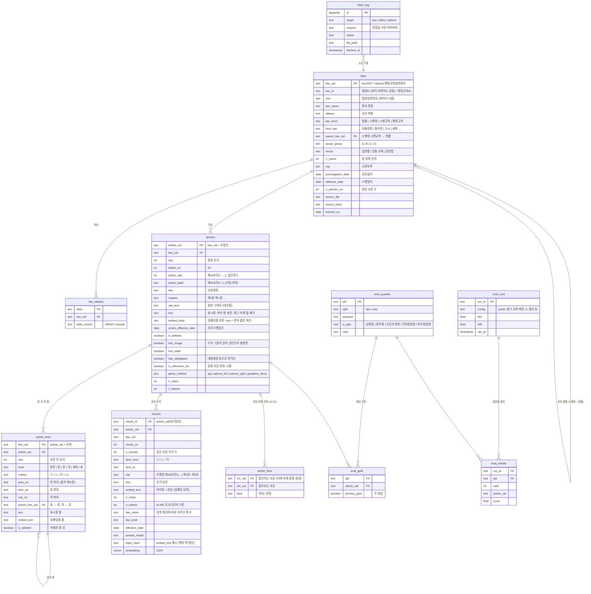

# 금융권 법령 RAG 기획안 (기획안.md)

작성일 2026-11-13 · 상태: **규칙 7 채택, 개선 ③(5-6-6)·①(5-6-7) 시험·비교 중** · 버전 v0.20

> 이 문서가 모든 단계(수집 → 전처리 → 파싱 → 청크 → 임베딩 → 적재 → 성능 평가 → 데모)의 **기준**이다.
> 기준을 바꿔야 하면 **이 문서를 먼저 고치고**(맨 끝 [변경 기록](#변경-기록)에 무엇을·왜 남김) 그다음 코드를 고친다.
> 단계별 결과 보고는 이 문서의 절 번호와 맞춰 `reports/5-1_수집.md`, `reports/5-2_전처리.md` … 로 남긴다.

---

## 1. 무엇을 만드나

**금융권 법령 RAG.** 국가법령정보센터 Open API로 금융권에서 쓰는 법령을 받아 와서, 질문하면 관련 조문을 찾아 근거로 보여 준다.

- 사용자: 은행·금융회사 직원, 팀원 (법률 전문가가 아님)
- 하는 것: 질문 → 관련 조문 검색 → (다음 단계에서) 조문을 근거로 쉬운 말 답변 + 출처
- 하지 않는 것: 조문에 없는 내용 지어내기, "됩니다/안 됩니다" 같은 법률 판단 확정, 판례·유권해석·제재 사례 (다른 팀원 RAG 영역)

**이번 범위: LLM 답변 생성 직전, 리트리버(검색기)까지.** 검색이 정답 조문을 가져오는지부터 확인한다. 답변 생성은 5-6 판단 기준을 통과한 뒤 붙인다.

> **리트리버(retriever)**: 질문을 받아 DB에서 관련 조각을 찾아 순위대로 돌려주는 부분. LLM은 이 결과만 보고 답한다. 여기서 틀리면 답도 틀린다.

### 1-1. 지난 작업과의 관계

`최종프로젝트/법령RAG/`의 코드·DB·결과물은 **쓰지 않고 새로 만든다.** 가져온 것은 원본 데이터와 설정 파일뿐이다 (2026-11-13 복사, 원래 폴더는 그대로 둠).

| 가져온 것 | 위치 (`최종프로젝트2/`) | 내용 |
|---|---|---|
| 1차 원본 (11/03~11/09) | `data/source/api/` 중 `index_before_csv_1111.jsonl`의 259건 | 금융위 소관 전부 + 개인정보·외국환 등 |
| 추가 원본 (11/11) | `data/source/api/` (`index.jsonl` 419건), `api/law_future/` 4건 | 팀 법령 목록(CSV) 현행 271개, 금감원 세칙, 업권별·공통·일반 44개 법률 |
| 원본 PDF 6개 | `data/source/raw/` | 개인정보 보호법·외국환거래법 등 (5-1 조문 수 대조용으로만 씀) |
| 팀 법령 목록 | `data/source/laws_api_found_team.csv`, `target_laws.json` | 수집 대상 목록 (괄호 숫자 = 팀 목록의 회신 사례 수) |
| 설정 | `.env`, `.gitignore` | 값은 화면·파일에 찍지 않는다 |

지난 작업에서 확인된 사실 중 이 기획에 반영한 것 (코드는 안 가져오고 교훈만):
- `lawService.do?target=law&MST=…`는 시행 예정 개정이 있으면 **예정판**을 준다 → 현행판은 `target=eflaw` + `efYd=현행 시행일자`로 받는다 (5-1)
- 행정규칙 본문은 조문 목록으로 오는 것(96개 중 78개)과 조문으로 안 나뉜 **한 덩어리**로 오는 것(18개)이 섞여 있다 → 덩어리를 조문으로 나누는 파싱 단계가 필요하다 (5-2-3)
- 한국어 법령은 KURE 토크나이저 기준 **1토큰 ≈ 1.8자**였다 (5-3에서 다시 잰다)
- 검색 1위 실패의 상당수는 **법률↔시행령↔고시 위계 혼동**이었다 → 메타데이터에 법령 구분을 반드시 남긴다

---

## 2. 원하는 답변 모양

```
[답변]
은행이 금융상품을 팔 때는 상품의 중요한 내용을 고객이 이해할 수 있도록 설명해야 하고,
고객이 이해했다는 것을 서명 등으로 확인받아야 합니다. …

[근거 조문]  (형식 예시)
- 금융소비자 보호에 관한 법률 제19조(설명의무) 제1항
- 금융소비자 보호에 관한 법률 시행령 제13조(설명의무) 제1항
```

- 답변 본문은 쉬운 말로. 문장마다 어느 조문에서 나왔는지 알 수 있게 한다.
- 근거 조문 형식: **`법령명 제O조(조문제목) 제O항`** (호·목까지 특정되면 `제O항 제O호`). 조각이 조문 전체면 항은 생략한다.
- 근거를 찾지 못하면 **"관련 조문을 찾지 못했습니다"** 라고 답한다. 지어내지 않는다.
- 이번 범위에서는 답변 대신 **검색된 조문 + 출처 형식**까지 보여 준다 (5-7).

### 2-1. 평가·데모에 쓸 예시 질문

| # | 질문 | 예상 근거 (확인 전 가설) |
|---|---|---|
| 1 | 은행이 고객에게 금융상품을 판매할 때 설명해야 하는 의무는 어떤 법에 있어? | 금융소비자보호법 설명의무 |
| 2 | 금융회사가 고객 신용정보를 제3자에게 제공하려면 어떤 조건이 필요해? | 신용정보법 개인신용정보 제공·활용 동의 |
| 3 | 전자금융사고가 나면 손해배상 책임은 누가 져? | 전자금융거래법 금융회사의 책임 |
| 4 | 예금자보호 한도는 1인당 얼마야? | 예금자보호법 + 시행령 (금액은 시행령) |
| 5 | 대부업자가 받을 수 있는 최고 이자율은? | 대부업법 + 시행령 |
| 6 | 고객 금융거래 정보를 수사기관에 줄 수 있는 경우는? | 금융실명법 비밀보장 예외 |
| 7 | 자금세탁이 의심되는 거래는 어디에 언제까지 보고해야 해? | 특정금융정보법 의심거래 보고 |
| 8 | 보험 청약을 철회할 수 있는 기간은? | 금융소비자보호법 청약철회 |
| 9 | 개인정보가 유출되면 정보주체에게 언제 알려야 해? | 개인정보 보호법 유출 통지 |
| 10 | 가상자산사업자는 이용자 예치금을 어떻게 보관해야 해? | 가상자산이용자보호법 예치금 보호 |
| 11 | 은행이 대주주에게 해 줄 수 있는 신용공여 한도는? | 은행법 대주주 신용공여 한도 |
| 12 | 신용카드 회원을 모집할 때 금지되는 행위는? | 여신전문금융업법 모집 방법 |

(질문은 사용자가 더 추가한다. 예상 근거는 5-6 평가셋을 만들 때 원문으로 확정한다.)

---

## 3. 데이터 범위 (확정안)

### 3-1. 법령 목록

| 묶음 | 법령 | 비고 |
|---|---|---|
| **A. 핵심 44개 법률** (평가 중심) | 아래 표 | 사용자가 준 15개 후보는 전부 이 안에 있다 |
| **B. A의 하위 법령** | A 법률마다 시행령(대통령령)·시행규칙(총리령·부령) | 금액·기간·절차 같은 구체 기준은 대부분 시행령에 있다 (예: 예금자보호 한도) |
| **C. 감독규정·시행세칙** | 행정규칙 중 **고시·세칙** (예: 은행업감독규정, 은행업감독업무시행세칙) | 실무 질문의 답이 감독규정에 있는 경우가 많다. 조문 분리 품질 관문(5-2-3)을 통과한 규정만 넣는다 |
| **D. 그 밖에 받은 법령** | 팀 목록(CSV) 현행 271개 + 금융위 소관 중 A·B·C 외 | 적재는 하되 평가 질문은 A·B·C 중심 (범위는 받은 법령 전부로 한다는 기존 팀 결정 유지) |

A. 핵심 44개 법률 (괄호 = 팀 목록의 회신 사례 수, 우선순위 참고용)

| 업권별 (13) | 공통 규제 (16) | 일반법·인접 (15) |
|---|---|---|
| 자본시장법(769) | 신용정보법(295) | 상법(103) |
| 여신전문금융업법(314) | 전자금융거래법(293) | 개인정보 보호법(98) |
| 보험업법(307) | 금융회사지배구조법(160) | 민법(52) |
| 은행법(159) | 금융실명법(111) | 전자서명법(40) |
| 대부업법(142) | 특정금융정보법(108) | 행정절차법(31) |
| 상호저축은행법(110) | 금융소비자보호법(102) | 공정거래법(30) |
| 금융지주회사법(74) | 금융산업구조개선법(56) | 정보통신망법(28) |
| 신용협동조합법(29) | 금융위원회설치법(42) | 근로자퇴직급여 보장법(22) |
| 온라인투자연계금융업법(20) | 외부감사법(39) | 전자문서법(18) |
| 가상자산이용자보호법(18) | 개인금융채권관리법(27) | 신탁법(15) |
| 부동산투자회사법(16) | 외국환거래법(22) | 공인회계사법(14) |
| 농업협동조합법(12) | 전기통신금융사기피해환급법(18) | 채무자회생법(12) |
| 신용보증기금법(10) | 기업구조조정촉진법(16) | 클라우드컴퓨팅법(11) |
| | 자산유동화법(14) | 전자상거래소비자보호법(11) |
| | 유사수신행위규제법(11) | 표시광고법(10) |
| | 예금자보호법(10) | |

정식 법령명은 `data/source/target_laws.json`에 있다. 44개 모두 원본에 법률 본문이 있음을 확인했다 (2026-11-13). 5-1에서 API로 확인한 결과 현행 시행령이 있는 법률 43개(민법만 없음)·시행규칙이 있는 법률 19개이고 모두 받았다 (은행법 시행규칙은 현행 법령으로 존재하지 않음).

### 3-2. 범위 결정

| 질문 | 결정 | 이유 |
|---|---|---|
| 법률만? 시행령·시행규칙까지? | **시행령·시행규칙까지 포함** | 법률은 "대통령령으로 정한다"고 넘기는 경우가 많아 법률만으로는 금액·기간·절차 질문에 답이 없다 |
| 행정규칙(감독규정)까지? | **고시·세칙만 포함**, 훈령·예규·공고는 제외 | 감독규정은 실무 기준이다. 훈령·공고는 공무원 내부 운영 규칙(위원회 운영규정 등)이라 질문과 관계가 적고 검색을 흐린다 |
| 현행만? | **현행만** (기준일에 시행 중인 판) | 연혁(옛 판)을 넣으면 같은 조문이 여러 판으로 경쟁한다. 시행 예정판(`law_future/`)은 보관만, 폐지 법령은 제외 |
| 부칙 | **제외** | 시행일·경과조치라 질문의 답이 되는 경우가 드물고 "제1조(시행일)"이 수백 개 생긴다 |
| 별표·서식 | **이번에는 제외**, 개수만 기록 | 표·서식이라 조문 단위 검색에 맞지 않는다. Hit@5 실패 원인이 별표로 확인되면 그때 기획안을 고쳐 넣는다 |
| 장·절 제목 | 검색 단위로 안 쓰고 **메타데이터로만** | 제목만 있는 줄이라 내용이 없다 |
| 삭제된 조문 (`제5조 삭제 <2010.3.31>`) | 행은 남기고 **검색에서 제외** | 내용이 없다. 조문 수 대조에는 필요해서 행은 보관 |
| 대법원규칙 (`법원인사사무규칙`) | **제외** | 지난 팀 목록에서 D로 들어온 법원 내부 인사 규칙. 금융 질문과 관계없다 (5-1 이후 결정) |
| `제N조` 없는 지침 (`1. 목 적` 형식, 예: 신용협동조합인가지침) | **맨 위 번호 항목을 조문처럼 한 단위로** | 조문 번호가 없어도 맨 위 항목이 같은 역할을 한다. 출처는 `신용협동조합인가지침 1.(목적)` |
| 준용규정처럼 조문 번호 나열이 대부분인 조문 | **넣고 표시만** (`is_reference_list`) | 미리 빼면 과적합 위험. 검색을 흐리는지는 5-6에서 확인 |

> **시행일자**: 법령이 실제로 효력을 갖기 시작하는 날. 공포(발표)일과 다를 수 있다. "현행"은 기준일 현재 시행 중인 판.
> **행정규칙**: 법률·시행령이 아니라 행정기관이 정한 규칙. 고시(감독규정 등)·훈령·예규·공고가 있다.

---

## 4. 전체 구조

### 4-1. RAG 구조

```
[적재]  원본 API JSON ─▶ 전처리·파싱 ─▶ 조문 표 ─▶ 청크 ─▶ 임베딩(코랩 GPU, KURE-v1) ─▶ PostgreSQL + pgvector
[검색]  질문 ─▶ 임베딩(로컬 CPU, KURE-v1) ─▶ 벡터 검색 top-50 조각 ─▶ 조문 단위로 합치기 ─▶ top-5 조문 (+ 출처)
[다음]  top-5 조문 ─▶ LLM 1회 호출 ─▶ 쉬운 말 답변 + 근거 조문 / 근거 부족 시 "관련 조문을 찾지 못했습니다"
```

리트리버 기본값 (베이스라인)
- **벡터 검색만** 쓴다. 키워드(BM25)·하이브리드·질문 바꾸기·재순위는 기본으로 넣지 않는다 (팀 결정). 5-6에서 Hit@5 실패 원인이 확인될 때만 기획안을 고쳐서 넣는다.
- 조각으로 찾고 **조문 단위로 합친다**: 조문 점수 = 그 조문 조각 중 가장 높은 점수. 평가·출력은 조문 단위.
- 메타데이터 필터는 선택 기능으로만 둔다 (예: "시행령에서만"). 기본 검색은 필터 없음.
- 검색 함수 모양 (팀 공통): `search(question, k) → [{doc_id, title, text, score, ...}]`
  - `doc_id` = 조문 ID, `title` = `은행법 제34조의2(제목)`, 출처 문자열·항 범위·시행일자 포함

> **임베딩**: 글을 숫자 벡터(여기선 1024개 숫자)로 바꾸는 것. 뜻이 비슷한 글은 벡터 방향이 비슷하다.
> **코사인 유사도**: 두 벡터 방향이 얼마나 같은지 (1에 가까울수록 비슷).

### 4-2. 기술 선택

| 항목 | 선택 | 이유 |
|---|---|---|
| 임베딩 | `nlpai-lab/KURE-v1` (1024차원) **고정** | 사용자 확정. 다른 모델과 비교하지 않음 |
| 조각 임베딩 | 코랩 GPU | 이 컴퓨터는 GPU 없음 (CPU로는 수만 조각에 수 시간) |
| 질문 임베딩 | 로컬 CPU, 같은 모델 | 질문 하나는 CPU로 1초 안쪽 |
| 벡터DB | **PostgreSQL + pgvector** (Docker `pgvector/pgvector`) | 5-5 참고 |
| 데모 | **Streamlit** 한 페이지 | 5-7 참고 |
| 수집 | Python `requests` (+ 로컬 캐시) | |
| LLM (다음 단계) | `.env`의 `LLM_MODEL`, 답변 1회 호출 | 일부러 여러 번 부르지 않는다 |

### 4-3. 폴더 구조

```
최종프로젝트2/
├─ 기획안.md               ← 이 문서
├─ .env / .gitignore
├─ docker-compose.yml      ← DB 컨테이너 (team4-lawrag2-db, 127.0.0.1:5435)
├─ db/init/01_init.sh      ← 처음 한 번: vector 확장, lawrag 스키마, 검색 전용 계정
├─ data/
│  ├─ source/              ← 원본 (읽기 전용, 덮어쓰지 않음)
│  └─ work/                ← 단계별 산출물 (01_fetch/, 02_clean/, 04_chunks/, 05_embed/)
├─ pipeline/               ← 단계별 코드 01_fetch.py … 06_load.py
├─ colab/kure_embed.ipynb  ← 조각 임베딩
├─ retriever/search.py     ← search(question, k)
├─ eval/                   ← 평가 질문·정답, 평가 코드, 질문별 결과표
├─ reports/                ← 단계별 점검 결과 (5-1_수집.md …)
└─ app/app.py              ← Streamlit 데모
```

- `data/`는 저장소에 올리지 않는다 → **`.gitignore`에 `data/` 추가 필요** (지금 복사한 `.gitignore`에는 `.env`만 막혀 있음. 0단계에서 추가)
- 단계마다 결과를 새 파일로 남기고 앞 단계 결과를 덮어쓰지 않는다. 매 실행마다 건수·실행일·규칙 버전을 기록한다.

---

## 4-4. ERD

스키마 이름 `lawrag`. 검색에 꼭 필요한 테이블은 `laws`·`articles`·`chunks` 세 개이고, 나머지는 수집 기록·평가용이다.



| 설계 결정 | 이유 |
|---|---|
| `laws`에 `law_id`와 `mst`를 따로 | 법령ID는 판이 바뀌어도 같고, MST(일련번호)는 판마다 다르다. 현행판 확인·재수집에 둘 다 필요 |
| `law_level`과 `kind_raw` 분리 | 검색·필터는 4단계(법률/시행령/시행규칙/행정규칙)로, 원래 종류(총리령·부령·고시·세칙)는 기록용 |
| `parent_law_uid` | "이 시행령은 어느 법률의 것인가". 위계 혼동 실패를 분석하고, 나중에 "법률 + 같은 시행령" 묶어 보여 줄 때 씀 |
| `articles`에 글 세 층 (`raw_text` / `text` / `embed_body`) | 원문 대조용, 사용자에게 보여 주는 글, 임베딩용 글을 나눈다. 검색에 좋은 손질(한자 괄호 제거 등)은 임베딩용에만 하고 보여 주는 조문은 원문과 같게 유지 |
| `article_lines` (줄 단위 구조) | 항·호·목과 상위 줄을 기록해 두면 5-3에서 경계로 정확히 자르고, 출처 `제O항 제O호`를 추측 없이 만들고, 뒤쪽 조각에 상위 문장을 붙일 수 있다 |
| `has_*` / `is_reference_list` 표시 | 지우지 않고 표시만 해서 5-6 실패 분석에 쓴다 (예: 수식 그림 조문, 위임 조문의 위계 혼동) |
| `chunks`에 법령명·구분·시행일자 복사 | 검색 SQL 하나로 출처까지 바로 꺼냄 (JOIN 없이 WHERE 필터 가능) |
| `chunks.cite` | 출처 문자열을 적재 때 미리 만들어 둬서 데모·평가가 같은 형식을 씀 |
| `input_hash` | 코랩에서 만든 벡터가 지금 조각과 같은 글로 만든 것인지 확인 |
| `eval_*` 테이블 | 실행마다 질문별 1~5위를 남겨 "어떤 조문을 찾았는지" 표로 비교 (5-6). 처음엔 CSV로 시작해도 됨 |

---

## 5. 단계별 계획과 판단 기준

모든 단계는 **"끝나면 판단 기준 표로 스스로 점검 → 결과 보고 → 멈춤"** 순서다. 기준 하나라도 실패하면 다음 단계로 넘어가지 않고 원인을 보고한다.

### 0단계. 준비 (수집 전)

| 할 일 | 확인 | 결과 (2026-11-13) |
|---|---|---|
| `.gitignore`에 `data/`, `outputs/`, `*.npz` 추가 | `git status`에 `data/`가 안 보임 | ✅ `.gitignore`·`기획안.md`만 보임 |
| `.env` 확인: `LAW_API_OC`, LLM 키·모델, DB 접속값, `EMBED_MODEL`, `EMBED_DIM` | 값은 출력하지 않고 "있음/없음"만 확인 | ✅ 전부 있음, `gpt-6-luna` 호출 가능 (모델 목록 조회) |
| 원본 복사 확인 | 원래 폴더와 파일별 해시 비교, JSON 파싱 | ✅ 452개 모두 같음, 442개 파싱 성공 |
| KURE-v1 길이 한계 확인 | `max_seq_length`, `model_max_length` 기록 → 5-3 근거 | ✅ 8192토큰, CLS 풀링 + 정규화, 1024차원 |
| 질문 임베딩 (로컬 CPU) | 같은 모델로 질문 1개 | ✅ 로드 1.0초, 질문 1개 0.83초 (`transformers`, CLS 풀링 = 코랩 `sentence-transformers`와 같은 방식) |
| DB 컨테이너 (`pgvector/pgvector:pg16`, 포트 5435) | `CREATE EXTENSION vector` 성공 | ✅ `team4-lawrag2-db` healthy, PostgreSQL 16.15 · pgvector 0.8.7, 스키마 `lawrag` |
| DB 동작 시험 | 1024차원 벡터 넣기 + HNSW 색인 + 검색, 검색 전용 계정 | ✅ 자기 자신 유사도 1.0000, `law_reader` 읽기만 되고 쓰기는 막힘, 접속 0.03~0.05초 (시험 테이블은 지움) |

### 5-1. 데이터 수집

**방침**: 가져온 원본(`data/source/api/`)을 캐시로 쓰고, **현행판이 바뀌었거나 빠진 것만 API로 새로 받는다.** 원본 파일은 덮어쓰지 않고 새로 받은 것은 `data/work/01_fetch/`에 둔다.

호출하는 API (기본 주소 `https://www.law.go.kr/DRF/`, 모든 요청에 `OC=<인증값>&type=JSON`)

| 목적 | 호출 | 주요 파라미터 |
|---|---|---|
| 법령 이름 → 현행 판 찾기 | `lawSearch.do` | `target=law`, `query=<정식 법령명>`, `nw=3`(현행), `display=100`, `page` |
| 하위 법령 찾기 | `lawSearch.do` | `target=law`, `query=<법률명> 시행령` / `<법률명> 시행규칙`, `nw=3` → 응답의 `법령명한글`이 정확히 같은 것만 |
| 법령 본문 (현행판) | `lawService.do` | `target=eflaw`, `MST=<법령일련번호>`, `efYd=<현행 시행일자>` (※ `target=law`는 예정판을 줄 수 있어 안 씀) |
| 행정규칙 찾기 | `lawSearch.do` | `target=admrul`, `query=<규정명>`, `nw=1`(현행) |
| 행정규칙 본문 | `lawService.do` | `target=admrul`, `LID=<행정규칙ID>` (현행판) |

수집 규칙
- 요청 간격 1초 이상, 실패 시 3번까지 재시도, 받은 응답은 파일로 캐시 → 같은 요청을 다시 보내지 않는다.
- 인증값(`OC`)은 로그·파일·화면에 찍지 않는다 (응답 속 링크에 들어 있으면 가린 뒤 저장).
- 기준일 = 수집 실행일. 원본의 `시행일자`가 API 현행 시행일자와 다르면 다시 받는다. **판 번호(MST)가 같아도** 시행일자가 다르면 다시 받는다 (단계적 시행: 한 번 개정된 법이 조문마다 다른 날 시행되어, 앞 날짜 기준 파일에는 늦게 시행된 조문 내용이 빠질 수 있음).
- 수집 목록은 원본 `index.jsonl`이 아니라 **파일을 직접 읽어** 만든다. 같은 법령의 파일이 여러 판이면 API 현행판 하나만 쓴다.
- 결과를 **CSV로 변환해 보여 준다**: `data/work/01_fetch/laws.csv`(법령 목록), `articles_raw.csv`(법령명, 법령구분, 조문번호, 조문제목, 본문, 시행일자).

**판단 기준 (5-1)**

| # | 기준 | 통과 조건 |
|---|---|---|
| 1 | 목록 수 = 받은 수 | 범위 표(3장)의 법령 수 = 본문 파일 수 = JSON 파싱 성공 수. 차이 0 (차이가 있으면 법령별 사유 표) |
| 2 | 핵심 44개 법률 | 44/44 본문 있음 |
| 3 | 하위 법령 | 44개 법률마다 API에 있는 시행령·시행규칙 수 = 받은 수 (법률별 표: 법률 / 시행령 있음·받음 / 시행규칙 있음·받음) |
| 4 | 현행판 | 받은 판의 시행일자 ≤ 기준일, 그리고 API `nw=3` 현행 시행일자와 같음. 예정판 0건 |
| 5 | 조문 수 | 법령별 `조문여부=조문` 수(원본) = CSV 조문 행 수. **법령별 조문 개수 표**로 비교, 차이 0. 대상은 법령 + 조문 목록으로 온 행정규칙 (한 덩어리로 온 행정규칙은 5-2-3에서 셈) |
| 6 | 원문 대조 | 무작위 5개 법령 + PDF 있는 법령: 국가법령정보센터 화면(`lsInfoR.do`)의 조문 **번호 목록**과 하나씩 대조. 화면에만 있는 조문은 시행일이 기준일 뒤인 것(시행 예정)만 허용. PDF는 목차·예정 조문이 섞여 참고만 |
| 7 | 원본 목록 차이 설명 | 원본 `index.jsonl` 419건과 파일 438건(법령 286 + 행정규칙 152)의 차이 원인을 표로 설명. 0단계에서 본 차이 19건: 목록에 없는 하위 법령 15건(예: 신탁법 시행령, 부동산투자회사법 시행규칙), 목록보다 새 판 4건(개인정보 보호법 시행령, 상호저축은행법 시행령, 외국환거래규정, 증권의 발행 및 공시 등에 관한 규정) → **수집 목록은 `index.jsonl`이 아니라 파일 기준으로 다시 만들고, 같은 법령이 두 판이면 기준일에 시행 중인 판 하나만** 쓴다 |
| 8 | 비밀값 | 저장한 파일 전체에서 인증값 문자열 0건 |

### 5-2. 전처리 (+ 파싱)

**목표: 청크가 경계로 정확히 잘리고, 벡터에는 법 내용만 들어가고, 사용자에게는 원문과 같은 조문이 보이게 한다.**
5-1 원문(`articles_raw.csv`, 법령 380개·조문 26,933개)을 실제로 재서 정한 규칙이다 (2026-11-13 측정, 숫자는 측정값. 법원인사사무규칙을 빼기 전 26,963개 기준으로 잰 값도 있으나 차이는 30개 조문).

#### 5-2-0. 전처리 원칙

1. **구조를 살린다.** 항·호·목을 이어 붙인 글이 아니라 **API JSON의 `항`·`호`·`목` 칸에서 직접 줄을 만들고**, 줄마다 단계·번호·상위 줄을 기록한다 (`article_lines`). 5-3은 이 줄 단위로 자르고, 출처 `제O항 제O호`도 여기서 만든다.
2. **글을 세 층으로 나눈다.**

   | 층 | 만드는 법 | 쓰는 곳 |
   |---|---|---|
   | `raw_text` | 원문 그대로 | 원본 대조·검증 |
   | `text` | 조문 머리 떼기 + 태그·삭제 줄 제거 + 공백·기호 통일 | **사용자에게 보여 주는 조문**, (다음 단계) LLM 근거 |
   | `embed_body` | `text` + 한자 괄호 제거 | **임베딩만** (5-3에서 머리말을 붙여 `embed_text`) |

3. **정해진 모양과 일치할 때만 지운다.** 단어로 찾아 지우면 조건을 담은 문장까지 지워진다. 지우는 모양은 5-2-2의 목록으로 고정하고, 목록에 없는 `<…>`·`[…]`는 남긴다 (계산식 `[(A + B - C) × D]`처럼 내용인 경우가 있음).
4. **지우지 않고 표시만 할 것은 표시만.** 검색을 흐릴 수 있는 것도 미리 빼지 않고 표시를 달아 5-6에서 확인한다 (과적합 방지).

#### 5-2-1. 구조 만들기 (줄 단위)

| 대상 | 방법 | 측정 |
|---|---|---|
| 법령 (법률·시행령·시행규칙) | JSON `조문내용` → 본문 줄, `항[].항내용` → 항 줄, `호[].호내용` → 호 줄(상위 = 항), `목[].목내용` → 목 줄(상위 = 호). 호·목 안의 `1)`·`가)`는 세목 줄 | 줄 시작 기호가 항 54,122 · 호 58,621 · 목 9,449 · 세목 916. 기호 없는 줄 774개는 거의 표 |
| 조문 머리 | 첫 줄의 `제N조(제목)`을 떼서 `article_label`·`title`로. 본문에는 내용만 | 첫 줄이 머리뿐인 조문 14,434개(54%), 나머지는 머리 + 첫 문장이 한 줄 |
| ① 없는 조문 | 항이 하나뿐 → 항 번호 없음. 출처는 `제O조`까지 | 9,849개 |
| 행정규칙 (조문 목록으로 온 78개) | 목록 한 칸 = 조문 하나. 장·절 제목 칸(376개)은 `chapter`로 | 조문 2,679개 |
| 행정규칙 줄바꿈 넣기 | **행정규칙 조문에는 줄바꿈이 하나도 없다** (2,679개 전부, 그중 1,418개는 `…수집한다.② 제1항에도…`처럼 항이 한 줄에 붙음). 아래 규칙으로 줄을 나눈 뒤 법령과 같은 줄 구조로 만든다 | |
| ┗ 항 | 문장 끝(`다.`, `.`, `:`) 바로 뒤의 `②`~`⑳` 앞에서 줄 바꿈. **①부터 차례로 이어질 때만** | |
| ┗ 호 | `다음 각 호`·`다음과 같다` 뒤에 나오는 `1.` `2.` `3.` … 앞에서 줄 바꿈. **번호가 1부터 1씩 늘 때만** (행정규칙에 `2016. 3. 12.` 같은 날짜가 3,843곳 있어서 번호 순서를 안 보면 날짜에서 잘림) | |
| ┗ 목 | 호 줄 안에서 `가.` `나.` `다.` … 차례일 때만 | |
| ┗ 마침표 없는 경계 (v0.8) | **항(②…)은 앞이 문장 끝이 아니어도 다음 번호면 자른다** (호 목록 끝 `…거래 중지② …`처럼 마침표 없이 다음 항이 오는 경우가 많음). 본문 속 참조(`제①항`, `①부터`, `① 및`)는 제외, `삭제` 뒤는 참조로 보지 않음. **호·목도 첫 번호를 찾은 뒤에는** 앞 항목이 마침표 없이 끝나도(`…있을 것2. …`) 다음 번호면 자른다. 원문에서 항 번호 하나가 빠진 경우(①→③) +2까지, ① 없이 ②부터 시작하는 조문도 인정. 태그 안(`<…>`, `[…]`)에서는 자르지 않음. 전각 꺾쇠 태그 `〈…〉`는 `<…>`로, 원문 오타 `ⓛ`는 `①`로 | 처음 규칙(문장 끝 뒤에서만)으로는 행정규칙 474개 조문에서 항 1,017곳이 안 나뉨 |
| ┗ 글자에 붙은 목 (v0.9) | 목의 첫 `가.`가 글자 바로 뒤에 붙어도(`…다음 각 목에 해당하는 사항가. 조치의…`) **뒤에 `나.`가 이어질 때만** 목으로. 글자 뒤 `다.`가 `한다.`·`된다.`처럼 문장 끝이면 다목으로 보지 않음 | 행정규칙 호 줄 607개에 목이 붙어 있었음 → 31개 (남은 것은 목 안에 또 `가. 나.` 목록이 있는 2단 목록 등) |
| 행정규칙 (한 덩어리로 온 18개) | `제N조`, `제N-M조`, `제N조의M` 바로 뒤에 `(제목)`이 붙은 곳에서 조문을 나누고(본문 속 참조 `제3조제1항에 따라`는 괄호 제목이 없어 안 나눔), 그다음 위 줄바꿈 규칙 | 금융투자업규정(35만 자)·보험업감독규정·외국환거래규정 등 |
| ┗ 조문 머리 판정 (v0.8) | 조문 머리 = **괄호 제목 바로 뒤가 본문 시작**(①, 태그, 띄어 쓴 글, 다음 조문 머리)일 때만. 괄호 바로 뒤에 조사·쉼표·`제N항/호`가 붙으면 본문 속 참조(`제2-6조(…한한다), 제7-13조`, `제2조(정의)에 따른`). 앞은 처음·문장 끝·장 제목·글자·제목 없는 조문 머리(`제2-14조의2`), 따옴표·숫자 뒤는 ①이 이어질 때만 | 참조 하나를 머리로 잘못 잡으면 번호 증가 규칙 때문에 뒤 조문이 줄줄이 합쳐짐 (외국환거래규정 제2-4조~제2-5조의2가 제2-3조에 합쳐졌었음). 반대로 마침표 없이 붙은 진짜 머리(`…있을 것제1-4조의2(…)①`)를 놓쳐 조문 약 160개가 앞 조문에 합쳐졌었음 |
| `제N조` 없는 지침 (`1. 목 적` 형식) | 맨 위 번호 항목(`1.`, `2.` …, 장 제목 다음에 1부터 이어지는 것)을 조문처럼 한 단위로. `article_label = "1."`, 출처 `신용협동조합인가지침 1.(목적)` | 신용협동조합인가지침 등 |
| ┗ 지침 세부 (5-2에서 확정) | 제목이 번호 앞에 붙는 형식(`목적1. 이 기준은`)·장 제목 바로 뒤 번호(`제1장 총칙1.`)도 인정. 그림 속 항목 때문에 번호가 비는 경우(1 → 4 → 6)는 앞보다 크고 20 이내면 인정. 인정 못 한 번호의 글은 **앞 항목에 합쳐져 남음** (손실 없음). 번호 항목도 없는 짧은 공지는 규정 전체를 한 단위(`whole_body`) | 11개 지침·공지 |

행정규칙 나누기 관문 (규정별): ① 나눈 조문·줄을 이어 붙이면 원문과 같음 (글자 손실 0) ② 조문번호·항·호 번호가 차례로 증가 ③ 조문 1개 이상. **통과 못 한 규정은 이번 적재에서 빼고 목록을 보고한다.**

#### 5-2-2. 지우는 것 (모양 목록) / 남기는 것

| 구분 | 모양 (측정 건수) | 처리 |
|---|---|---|
| 개정 이력 태그 | `<개정 2020.3.24>` (법령 19,289 · 행정규칙 1,410), `<신설 …>` (4,600 · 492), `<신설 … 개정 …>`, `<단서신설 …>`, `<전문개정 …>`, `<…고시 제2009-2호, 2009. 2. 4. 개정>` | 지움 |
| 행정규칙 꼬리표 | `[본조신설 …]` (116), `[본항신설 …]`, `[본호신설 …]`, `[전문개정 …]`, `[전면개정 …]`, `[제N조에서 이동 <…>]`, `<종전의 제N호에서 이동>`, `[시행일: 지난 날짜]` | 지움. `[시행일: 기준일 뒤]`가 붙은 부분은 시행 전이므로 그 줄을 검색에서 뺌 |
| 삭제 조문 | 머리를 뗀 본문이 `삭제`(`삭 제`)뿐 — **1,821개** | 행은 남기고 `is_deleted=true`, 검색 제외 |
| 삭제 이력 태그 | `<삭제 2010. 3. 31.>`, `<본호 삭제 …>`, `<…고시 제2009-2호, … 삭제>`, `<단서삭제 …>`, `<2002. 9.13, 조제목 삭제 …>` (행정규칙 약 230) | 줄에 이 태그밖에 없으면 `삭제`로 바꿔 **삭제 줄**로, 내용이 있으면 태그만 지움 (5-2에서 추가) |
| 본문 없는 조문 | 머리(`제24조`, `제4-29조(신용거래 등의 제한)`)만 있고 본문 없음 — 32개 | `skip_reason=본문 없음`으로 검색 제외 (5-2에서 추가) |
| 삭제된 항·호·목 | `② 삭제 <2015.7.24>`, `3. 삭제` | 그 줄만 `is_deleted`. **번호는 다시 매기지 않는다** (출처 번호가 원문과 같아야 함) |
| 그림 | ``, `</img>` (423) | 태그 지움, `has_image=true` (수식이 그림이라 글만으로는 내용이 다 안 보임) |
| 표 | 선 문자 `┌─┬┐│└` (표 줄 774) | 선만 있는 줄 지움, 칸은 ` | `로 이어 한 줄. `has_table=true` |
| 장·절·관 제목 | `조문여부=전문` 2,665 + 행정규칙 376 | 본문에서 빼고 `chapter` |
| 공백·기호 | 연속 공백, 폭 없는 공백, 전각 공백, `｢｣`, `ㆍ･‧` | 공백 하나, `「」`, `·`로 통일 |
| **`embed_body`에서만** 지움 | 한자 괄호 `병과(竝科)` (3,438곳) → `병과` | 질문에는 한자가 없어 벡터만 흐림. **`text`(보여 주는 조문)에는 남김** |
| **남김** | 본문 문장, 숫자·금액·기간, `다만,` 단서, 괄호 속 정의(`이하 "…"라 한다`), 다른 조문 참조, 계산식 대괄호, `<별표 3>`·`<별지 제1호서식>`(괄호만 빼고 "별표 3"으로 — "별표를 보라"는 정보) | 그대로 |

#### 5-2-3. 표시 (지우지 않음)

| 표시 | 조건 (측정) | 쓰는 곳 |
|---|---|---|
| `has_delegation` | `대통령령으로 정하`·`총리령으로 정하`·`○○부령으로 정하`·`고시로 정하` 등 (대통령령만 6,824개 조문) | 법률↔시행령 위계 혼동 분석 (5-6), 나중에 법률·시행령 묶어 보여 주기 |
| `is_reference_list` | 준용규정처럼 본문 대부분이 조문 번호 나열 (예: 농업협동조합법 제161조 1,944자). 기준: 본문에서 `제N조` 참조가 차지하는 글자 비율 ≥ 50% | 검색을 흐리는지 5-6에서 확인 |
| `has_image` / `has_table` | 위 5-2-2 | 실패 분석 |

#### 5-2-4. 반드시 보존할 메타데이터

| 필드 | 출처 (API) |
|---|---|
| 법령명 | `기본정보.법령명_한글` / `행정규칙기본정보.행정규칙명` |
| 법령 구분 | `법종구분` → 법률 / 시행령(대통령령) / 시행규칙(총리령·부령) / 행정규칙 |
| 조문번호 (+가지번호) | `조문번호`, `조문가지번호` → `제34조의2` (지침은 `1.`) |
| 조문제목 | `조문제목` (행정규칙은 머리의 괄호 제목) |
| 항·호·목 | 줄마다 `para_no`·`item_no`·`sub_no` (`article_lines`) |
| 시행일자 | 법령 `시행일자` + 조문 `조문시행일자` |
| 장·절 | `조문여부=전문` 줄 / 행정규칙 장 제목 칸 |
| (추가) 법령ID·MST·소관부처·공포일자 | 재수집·출처 링크·분석용 |

**판단 기준 (5-2)**

| # | 기준 | 통과 조건 |
|---|---|---|
| 1 | 빈 조문 | 검색 대상 조문 중 `text` 빈 것 0건 |
| 2 | 메타데이터 누락 | 법령명·법령구분·조문번호·시행일자 누락 0건 (조문제목은 원본에 없는 경우만 허용, 건수 보고) |
| 3 | 구조 | 법령: `article_lines`의 항·호·목 줄 수 = JSON의 `항`·`호`·`목` 개수 (100% 일치) |
| 4 | 행정규칙 나누기 | 규정별 관문(5-2-1) 통과/제외 표. 통과 규정 3개를 원문과 조문 수·항 수 대조. **줄 가운데 남은 항 기호(②~⑳, 본문 속 참조 제외) 0** (원문에 같은 항 번호가 두 번 나온 경우는 예외 목록) |
| 5 | 남은 태그 | `text`에서 5-2-2 지우는 모양 정규식 검색 0건. 남은 `<…>`·`[…]`는 종류별 목록으로 보고 (내용인지 눈으로 확인) |
| 6 | 원본 대조 | `text`의 모든 줄이 `raw_text` 안에 있음 (공백·기호 통일만 허용). 전처리가 **새로 만든 글 0** |
| 7 | 세 층 | `embed_body`에 한자 괄호 0건, `text`에는 원래 개수(3,438) 그대로 |
| 8 | 삭제 | 삭제 조문 1,821개 = `is_deleted` 조문 수. 검색 대상에 `삭제 <` 남은 것 0 |
| 9 | 조문 수 보존 | 5-1 조문 수 − 삭제 = 검색 대상 조문 수 (법령별 표). 한 덩어리 행정규칙 18개·지침은 나눈 수를 따로 |
| 10 | 청크 준비 | 900자 넘는데 항·호·목·문장 경계가 없는 조문 목록 (행정규칙 줄바꿈 후 측정, 예상 약 6개) |
| 11 | 전/후 샘플 | 유형별 각 2건(개정 태그, 삭제 항, 표, 그림, 한자, 행정규칙 줄바꿈, 한 덩어리 행정규칙, 지침, 준용 목록) 전/후 표를 보고서에 첨부, 눈으로 확인 |

결과 CSV: `data/work/02_clean/articles.csv` (법령명, 법령구분, 조문번호, 조문제목, 장절, 표시용 본문, 시행일자, 삭제여부, 표시들), `data/work/02_clean/article_lines.csv` (조문, 순서, 단계, 기호, 항·호·목 번호, 상위 줄, 표시용 줄)

### 5-3. 청크

#### 5-3-1. KURE-v1이 읽을 수 있는 길이

- KURE-v1은 bge-m3(XLM-RoBERTa 계열)를 한국어로 더 학습한 모델이다. 최대 입력은 **8192토큰**이다 (0단계 확인: `max_seq_length` 8192, `model_max_length` 8192, 문장 벡터는 CLS 토큰 + 길이 1로 정규화).
- 즉 **길이 한계 때문에 잘라야 하는 경우는 거의 없다.** 자르는 이유는 한계가 아니라 **벡터 하나에 여러 주제가 섞이는 것**을 막기 위해서다. 항이 10개인 조문을 통째로 벡터 하나로 만들면, 그중 한 항만 묻는 질문과의 유사도가 낮아진다.
- 한계를 넘는 입력은 모델이 **뒤를 조용히 잘라 버린다** → 안전 상한(아래)을 넘는 조각이 0이어야 한다.

> **토큰**: 모델이 글을 읽는 단위 (낱말 조각). 이번 데이터 측정(5-2 전, 태그만 대충 뺀 조문 25,812개)에서 **1토큰 ≈ 1.78자**.

#### 5-3-2. 자르는 규칙

자르는 단위는 5-2의 **`article_lines` 줄**이다. 길이는 `text`(머리 뗀 표시용 본문) 기준으로 잰다.

1. **조문 하나 = 기본 한 조각.** 평가·출처가 조문 단위이고, 조문은 법이 정한 의미 단위다.
2. 조문 본문이 **900자를 넘으면** 항 → 호 → 목 → 세목 줄 경계 순서로, **가장 위 단계 경계에서 먼저** 나눈다. 항 하나가 900자를 넘으면 그 항의 호·목 경계로 내려가 나누고, 뒤쪽 조각에는 그 항 첫 줄을 '이어서'로 붙인다. 줄 경계가 없으면 문장 끝에서 나눈다.
   - 문장 나누는 자리: 줄바꿈, `다.` 뒤, 숫자가 아닌 글자 뒤의 `.`·`;`·`:` 뒤, 한 줄 안 번호 목록의 **번호 앞**(` 5. `). **번호 바로 뒤(`1.` 다음)에서는 자르지 않는다** (번호와 내용이 떨어짐, 5-3 점검에서 발견)
   - 한 문장이 600자를 넘어도 **900자 이하면 자르지 않는다** (문장 중간 잘림 방지). 900자를 넘는 한 문장, 또는 512토큰을 넘는 한 문장만 쉼표 → 공백에서 자르고 보고서 예외 목록에 남긴다
3. 나눈 형제 줄을 **600자 근처까지 이어 묶는다** (600자를 넘기 전에 끊음). 하위 줄(호·목)은 상위 줄(항)과 같은 조각에 둔다.
4. 200자 미만 조각은 앞 조각에 붙인다 (합쳐 900자 이하). 앞에 붙일 수 없으면(맨 앞 조각, 앞이 문장 조각, 합치면 900자 초과) **뒤 조각에** 붙인다. **50자 미만**은 합쳐서 900자를 넘어도 머리말 포함 512토큰 안이면 붙인다. 50자 미만 문장 조각도 앞(안 되면 뒤) 문장 조각에 붙인다. 조문 원래 길이가 짧은 것은 그대로.
5. 안전 상한: 머리말 포함 **512토큰**을 넘는 조각은 **먼저 줄 단위로 다시 묶고**, 한 줄이 혼자 넘을 때만 그 줄을 문장으로 나눈다 (줄을 알아야 출처를 정확히 만듦). 나눈 뒤 마지막 조각이 100자 미만이면 앞 조각의 끝 줄을 넘겨 고르게 하고, 생긴 짧은 조각은 토큰을 확인해 이웃에 붙인다. 뒤쪽 조각의 '이어서'는 상위 줄을 끝까지(`③ … > 3. …`), 맨 위 줄이 속한 항만
6. 삭제된 줄(`is_deleted`)·시행 전 줄은 조각에 넣지 않는다.
7. **정의 조문은 정의 하나 = 조각 하나** (v0.14, v0.15에서 단위를 '호' → '정의 줄'로 바꿈). 조문제목이 정확히 `정의` · `용어의 정의` · `정의 등`인 조문(모든 법령 공통, 238개)에서 **용어를 정의하는 줄**(따옴표 속 용어 + `~란` · `~이라 함은` · `~라 함은` · `~이라 한다`, 예: `5. "업무집행책임자"란 …`, `② "외국계 금융회사"라 함은 …`)과 그 아래 줄(목·세목, 정의에 딸린 목록)을 하나의 조각으로 만든다. 정의 줄이 없는 조문은 일반 규칙대로
   - 첫 줄(`이 법에서 사용하는 용어의 뜻은 다음과 같다.`)은 첫 호 조각에 붙이고, 뒤 호 조각에는 '이어서'로 붙인다
   - 호가 아닌 줄(호 없는 항, 단서 등)은 일반 규칙(1~6)대로 묶는다
   - 정의 조각은 규칙 4(짧은 조각 붙이기)를 적용하지 않는다 (짧은 정의 하나가 그 자체로 검색 단위)
   - v0.15: 처음 규칙('호 하나 = 조각 하나')은 항마다 용어를 정의하고 호는 그 용어에 딸린 목록인 조문(예: `① "금융회사"라 함은 다음 각 호와 같다. 1. 은행 2. 보험회사…`)에서 목록 항목을 하나씩 조각으로 만들고 정의 항들은 뭉쳐 버림 → 위치(호)가 아니라 내용(정의 줄)으로 단위를 정함
   - 이유: 용어 수십 개가 한 벡터에 섞이면 한 용어만 묻는 질문과 유사도가 낮아진다(정의 조문 '희석'). 특정 질문·법령이 아니라 **정의 조문의 구조**에 대한 규칙이다. dev 분석에서 발견(용어 정의 한 줄만 임베딩하면 유사도 0.66 → 0.84 등)
   - 과적합 방지: 규칙은 제목만으로 정하고 법령·조문 이름은 쓰지 않는다. 채택 여부는 dev 전체 + 유형별(어떤 유형도 내려가지 않을 때만) + 사람이 쓴 예시 질문 12개로 한 번만 판단, 최종 확인은 새 검증 세트(사용자가 만드는 중)로 한 번

**900자 / 600자를 고른 근거** (임의 숫자가 아니라 아래 측정으로 확정한다)
- **측정 (2026-11-13, 삭제 뺀 조문 25,812개, 태그만 대충 뺀 글)**

  | 백분위 | 50% | 75% | 85% | 90% | 95% | 99% | 최대 |
  |---|---|---|---|---|---|---|---|
  | 글자 | 250 | 528 | 765 | 983 | 1,397 | 2,835 | 16,565 (소득세법 시행령 제167조의3, 표) |
  | 토큰 | 142 | 294 | 425 | 542 | 782 | 1,608 | 8,945 |

  | 기준 | 600자 | 700자 | 800자 | **900자** | 1,000자 | 1,200자 |
  |---|---|---|---|---|---|---|
  | 이하인 조문 비율 | 78.7% | 82.9% | 86.0% | **88.4%** | 90.3% | 93.1% |

- **900자**: 조문의 88.4%가 나뉘지 않고 통째로 남는다 (900자 ≈ 497토큰). 구분별로 나뉘는 비율은 법률 9.3%, 시행령 20.4%, 시행규칙 11.7%, 행정규칙 9.5%. 여러 항이 섞인 긴 조문만 나뉜다.
- **600자**: ≈ 337토큰 + 머리말 30~60토큰 → 나뉜 조각도 512토큰 안전 상한 안에 여유 있게 들어간다.
- **확정 절차**: 5-2 전처리 뒤(머리 떼고 태그 지운 `text`)에 같은 분포를 다시 낸다. 900자가 85~90% 지점 근처면 그대로, 크게 다르면 그 지점으로 바꾸고 기획안을 고친다.
- 512토큰 상한을 쓰는 이유: 짧은 질문과 비교할 벡터는 짧고 한 가지 주제일 때 잘 맞고, 모델 한계(8192)보다 훨씬 안쪽이라 잘림 걱정이 없다.

#### 5-3-3. 청크 메타데이터와 머리말

- 조각의 `text`는 표시용 줄(`article_lines.text`)을 이은 것, 임베딩 입력 `embed_text`는 **머리말 + 임베딩용 줄(`article_lines.embed_text`, 한자 괄호 뺀 것)**:
  ```
  [금융소비자 보호에 관한 법률 | 법률 | 제19조(설명의무)]
  ① 금융상품판매업자등은 일반금융소비자에게 …
  ```
- 나뉜 뒤쪽 조각은 소속 상위 항목을 머리말에 한 줄 붙인다: `[은행법 | 법률 | 제2조(정의) | 이어서: ① … > 9.]` (`가.`로 시작해서 무엇에 속하는지 모르는 조각을 없앤다)
- 이유: 짧은 조각도 "어느 법의 무슨 조문인지"가 벡터에 들어가고, 같은 내용의 법률·시행령 조문을 구분하는 데 도움이 된다.
- 조문 머리는 5-2에서 본문에서 뗐으므로 머리말에만 한 번 들어간다 (같은 정보가 두 번 들어가지 않음).
- 조각마다: `article_uid`, `chunk_no`/`n_chunks`, `item_from`~`item_to`, `cite`(출처 문자열), 법령명, 법령구분, 시행일자, 글자 수, 토큰 수.
- `cite`는 조각에 든 줄의 `para_no`로 만든다: 항 하나면 `제2항`, 여러 항이면 `제1항~제3항`, 조문 전체이거나 ① 없는 조문이면 항 생략.

**판단 기준 (5-3)**

| # | 기준 | 통과 조건 |
|---|---|---|
| 1 | 길이 분포 | 글자·토큰의 최소/평균/중앙값/95%/최대를 표로 (법령구분별로도) |
| 2 | 안전 상한 | `embed_text` 512토큰 초과 0건 |
| 3 | 문장 중간 잘림 | 문장으로 나눈 조각(마지막 제외)의 끝이 문장 끝·줄 끝·한 줄 안 번호 항목 경계가 아닌 것 0건. 예외(900자 넘는 한 문장, 512토큰 넘는 한 문장, 표)는 목록으로 |
| 4 | 너무 짧은 조각 | 50자 미만 조각 수 보고. 나눠서 생긴 50자 미만 중 앞뒤에 붙일 수 있었던 것 0건 (붙이면 512토큰을 넘거나 이웃이 문장 조각인 것은 예외 목록). 정의 호 조각(규칙 7)은 설계상 짧을 수 있어 제외 |
| 5 | 손실 없음 | 조문별로 조각 본문을 이어 붙이면 전처리 본문과 같음 (모든 조문) |
| 6 | 머리말 | 머리말 없는 조각 0, 뒤쪽 조각 중 상위 줄(항) 없이 호·목으로 시작하는데 '이어서' 표시가 없는 것 0 (항·본문 줄로 시작하는 조각은 그 자체로 완결) |
| 7 | 나눔 비율 | 나뉜 조문 비율 보고 (예상 10~15%, 규칙 7 이후 정의 조문 192개만큼 늘어 약 13~16%). 크게 벗어나면 5-3-2 확정 절차로 |
| 8 | 표본 | 나뉜 조문 10개를 원문과 나란히 놓고 경계가 자연스러운지 확인 |
| 9 | 출처 정확도 | 나뉜 조각의 출처 항 범위(처음~끝)가 조각 본문에 실제로 있는 항과 같음 ('이어서'로 시작하는 조각은 그 항 포함, 삭제된 항은 빠져도 됨). 0건 |

결과 CSV: `data/work/04_chunks/chunks.csv` (chunk_id, 출처, 법령구분, 조각 본문, 글자 수, 토큰 수)

### 5-4. 임베딩 (KURE-v1, 코랩)

모델은 KURE-v1으로 고정하고 다른 임베딩 모델과 비교하지 않는다.

절차 (v0.10 확정)
1. 로컬: `python pipeline/colab_bundle_04.py` → `data/work/05_embed/kure_input.zip` (조각 입력 `chunks_input.jsonl` + `manifest.json`: 조각 수, 파일 지문, 청크 규칙 버전, 2-1 예시 질문 12개)
2. 코랩: `colab/kure_embed.ipynb` 열기 → 런타임 → GPU(T4 이상) → 모두 실행 → zip 올리기 → 끝나면 `kure_vectors.npz` 자동 내려받기
3. 임베딩 계산 (노트북 4번 셀, 로컬 질문 임베딩과 **같은 코드**)
   ```python
   from transformers import AutoTokenizer, AutoModel
   tok = AutoTokenizer.from_pretrained("nlpai-lab/KURE-v1")
   model = AutoModel.from_pretrained("nlpai-lab/KURE-v1").to("cuda").eval().half()   # GPU 속도용 fp16
   enc = tok(texts, padding=True, truncation=True, max_length=512, return_tensors="pt").to("cuda")
   vec = F.normalize(model(**enc).last_hidden_state[:, 0].float(), dim=-1)          # CLS 토큰 → 길이 1
   ```
   - `sentence-transformers` 대신 `transformers`로 직접 계산: KURE-v1의 설정(풀링 = CLS, 그다음 Normalize)과 같은 계산이고, **로컬 CPU 질문 임베딩과 한 줄도 다르지 않게** 하려는 것 (v0.4 계획에서 바꿈)
   - 질문 앞에 붙이는 접두어(prefix) 없음. 질문·조각 모두 같은 방식. 길이를 1로 맞춰 코사인 유사도 = 내적
   - 길이순으로 묶어 계산(패딩 줄여 빠르게) → 원래 순서로 되돌림
4. 노트북이 스스로 확인: 파일 지문·조각 수·조각마다 입력 글 해시·chunk_id 중복(다르면 멈춤), 512토큰 초과 0, 기준 1·3·4, 예시 질문 12개 맛보기 검색
5. 로컬: `kure_vectors.npz`를 `data/work/05_embed/`에 넣고 `python pipeline/embed_check_04.py` → 기준 1~6 점검, `reports/5-4_임베딩.md`
6. 노트북은 로컬에서도 돈다 (`LOCAL_TEST_N=30`로 앞 30조각만, CPU). 넘기기 전에 이렇게 끝까지 돌려 확인함

> **fp16**: 숫자를 절반 정밀도로 계산해 GPU에서 빠르게. 결과가 fp32와 거의 같은지 확인한다.

**판단 기준 (5-4)**

| # | 기준 | 통과 조건 |
|---|---|---|
| 1 | 개수 | 벡터 수 = 조각 수, chunk_id 짝 모두 맞음 |
| 2 | 짝 확인 | 벡터의 `input_hash` = 지금 조각의 `embed_text` 해시 (다르면 적재 중단) |
| 3 | 모양 | 차원 1024, NaN·0벡터 0건, 길이(norm) 1 ± 0.001 |
| 4 | 정밀도 | 조각 20개: GPU fp16 vs fp32 코사인 ≥ 0.999 |
| 5 | 로컬 일치 | 조각 5개: 코랩 벡터 vs 로컬 CPU 벡터 코사인 ≥ 0.999 (질문을 CPU로 만들어도 같은 공간인지) |
| 6 | 맛보기 | 2-1 예시 질문 12개를 로컬 CPU로 임베딩해 코랩 벡터에서 검색 → 1~5위 조각이 말이 되는지 눈으로 (질문 1개 임베딩 시간도 기록) |

### 5-5. 적재 (벡터DB)

**선택: PostgreSQL + pgvector** (Docker `pgvector/pgvector`)

| 이유 | 설명 |
|---|---|
| 팀 공통 | 다른 팀원 RAG와 같은 DB·같은 검색 함수 모양 → 나중에 팀 앱 통합이 쉬움 |
| 메타데이터 + 벡터를 한 SQL로 | `WHERE law_level = '시행령' ORDER BY embedding <=> 질문벡터 LIMIT 50` |
| 규모 | 조각 수만 개 수준 → pgvector로 충분히 빠름. 1024차원은 HNSW 색인 한도(2,000) 안 |
| 비교 | FAISS(빠르지만 메타데이터 필터·저장을 따로 만들어야 함), Chroma(간단하지만 팀 DB와 따로 놂) |

> **pgvector**: PostgreSQL에 벡터 칸과 "가까운 벡터 찾기"를 더해 주는 확장. **HNSW**: 모든 행과 거리를 재지 않고 가까운 후보를 빨리 찾는 색인.

- 저장 필드: 4-4 ERD의 `laws`, `law_aliases`, `articles`, `chunks` (평가 테이블은 CSV로 시작해도 됨)
- 색인: `chunks.embedding` HNSW(`vector_cosine_ops`), `chunks(law_level)`, `chunks(article_uid)`
- 컨테이너: `team4-lawrag2-db` (`pgvector/pgvector:pg16`, `127.0.0.1:5435`, 볼륨 `team4-lawrag2_pgdata`). 예전 법령RAG 컨테이너(`team4-lawrag-db`, 5434)와 따로 쓴다.
- 계정: 적재는 관리자 계정(`POSTGRES_USER`), 검색·데모는 **`law_reader`(SELECT 권한만, 비밀번호 `LAW_PASSWORD`)**. 접속값은 `.env`에만.
- 접속 주소는 `127.0.0.1` (Windows에서 `localhost`는 접속에 약 2초 걸렸던 적이 있음).
- 적재 (v0.12): `python pipeline/load_05.py` → DB(`law_rag`)를 **지우고 새로 만든 뒤**(확장·스키마·권한 포함) `laws` → `law_aliases` → `articles` → `article_lines` → `chunks` 순으로 COPY, 그다음 색인·ANALYZE. 몇 번을 돌려도 같은 결과
  - 벡터 짝 확인: `kure_vectors.npz`의 chunk_id·input_hash가 `chunks.csv`와 다르면 적재하지 않음 (5-3을 다시 돌렸다면 5-4 임베딩도 다시)
  - `chunks.chunk_id`는 `article_uid#조각번호` 글자 키 (ERD 초안의 bigserial 대신, 5-3 산출물과 같은 키)
  - HNSW 색인은 `m=16, ef_construction=64`, **병렬 없이** 빌드 (도커 공유 메모리 64MB 때문에 병렬 빌드 실패, 약 7분)
  - 검색 전용 계정 권한은 테이블을 만든 **뒤** `GRANT SELECT ON ALL TABLES` (기본 권한 설정은 앞으로 만들 테이블에만 적용됨)
  - 검색은 `SET hnsw.ef_search = 100` (예시 질문 12개에서 전수 비교 top-5와 12/12 같아지는 가장 작은 값, 질문당 약 3ms)
- **v0.31: `article_links` 추가** — 5-6-6 위임·준용 연결(`data/work/06_links/article_links.csv`, `pipeline/links_06.py`)을 `chunks` 다음에 COPY. 기본키 `(src_uid, dst_uid)`, 두 칸 모두 `articles` 외래키, 색인 `article_links(dst_uid)`. 검색 코드는 CSV 대신 이 표를 읽는다 (서버 시작 때 한 번 읽어 메모리에 둠). 적재 규칙 이름 `5-5 v2 (기획안 v0.31)`

**판단 기준 (5-5)**

| # | 기준 | 통과 조건 |
|---|---|---|
| 1 | 행 수 | DB `laws`·`articles`·`chunks` 행 수 = CSV 행 수 |
| 2 | 법령별 | 법령별 조각 수 DB = CSV (표, 차이 0) |
| 3 | 빈 값 | `embedding`·`cite`·`law_name`·`law_level` NULL 0건 |
| 4 | 색인 | HNSW 색인 있음, `EXPLAIN`에서 색인 사용 확인 |
| 5 | 검색 일치 | 예시 질문 5개: DB 검색 top-5 = 메모리(numpy) 전수 비교 top-5 (HNSW 근사 때문에 다르면 `ef_search` 조정) |
| 6 | 연결 표 (v0.31) | `article_links` 행 수·종류별 수 = CSV, 양 끝 조문이 모두 `articles`에 있음, 검색 전용 계정이 읽힘 |

### 5-6. 성능 평가 (리트리버만, LLM 없음)

#### 5-6-1. 평가 질문-정답 세트

| 세트 | 개수 | 용도 |
|---|---|---|
| **개발셋 dev1·dev2·dev3** | **각 50 (150)** | 결과를 보고 원인을 따지는 세트 (v0.11: 60 → 150) |
| **테스트셋 test1·test2·test3** | **각 50 (150)** | 마지막에 **세트마다 한 번만** 돌림 (결과를 보고 고치면 과적합) (v0.11: 40 → 150) |
| 답변불가셋 (선택) | 10 | 범위 밖 질문 → 다음 단계 "찾지 못했습니다" 기준점수 정할 때 |

- **최소 60문항(dev 40 + test 20)**, 목표 100문항. 60문항이면 1문항 = 약 1.7%p라 기법 차이를 어느 정도 볼 수 있고, 그 밑이면 한두 문항으로 점수가 크게 흔들린다.
- 만드는 법: ① 2-1 예시 질문 + 사용자 질문 ② AI가 핵심 44개 법률 중심으로 질문 초안과 정답 후보 조문을 원문에서 찾아 표로 제시 ③ **사용자가 정답을 확인·수정해서 확정** (모델이 정답을 혼자 정하지 않음)
- 정답 확인 순서 (v0.13): AI 초안 → AI가 질문·정답 조문 원문·검색 1~3위를 대조해 판정(O / 정답 추가 / 주·부 바꿈 / 정답 바꿈 / 질문 모호)과 근거를 `eval/gold_check_<세트>.csv`에 적음 → **사용자가 `사용자 확인` 칸을 채워 확정** → 그 뒤에만 `gold.csv`에 반영 (AI가 혼자 고치지 않음)
- 질문은 조문 문장을 베끼지 않고 **직원이 실제로 묻는 말투**로 쓴다 (조문 문장을 그대로 쓰면 점수가 부풀려짐).
- 정답: 질문마다 정답 조문 1~3개. 같은 내용이 법률과 시행령에 나뉘어 있으면 둘 다 정답, 그중 하나를 `주 정답`으로 표시.
- 유형 태그: 상황형(일상어) / 용어형(법률 용어) / 조문지정형("은행법 34조의2") / 하위법령형(금액·기간 → 시행령) / 복수법령형
- 핵심 44개 법률과 감독규정이 고르게 들어가게 법령별 개수를 표로 관리한다.

#### 5-6-2. 지표

| 지표 | 뜻 |
|---|---|
| **Hit@1** | 1등으로 찾은 조문이 정답 조문 중 하나인 비율 |
| **Hit@5** | 상위 5개 조문 안에 정답 조문이 하나라도 있는 비율 |
| (참고) 법령 Hit@5 | 상위 5개 안에 정답 **법령**이 있는 비율 — 법은 맞혔는데 조문이 틀린 건지 구분용 |

- 조각이 아니라 **조문 단위**로 센다 (같은 조문의 조각 여러 개는 하나로 합친 뒤 순위).

#### 5-6-3. 질문별 결과표 (수치만 보지 않는다)

`eval/results_<run_id>.csv`

| 질문 | 유형 | 정답 조문 | 1위 | 2위 | 3위 | 4위 | 5위 | 정답 순위 | Hit@1 | Hit@5 | 실패 원인 |
|---|---|---|---|---|---|---|---|---|---|---|---|
| 예금자보호 한도는? | 하위법령형 | 예금자보호법 시행령 제O조 | … | … | … | … | … | 3 | X | O | |

- 1~5위 칸에는 `법령명 제O조(제목)` + 점수를 적는다.
- 실패 원인 분류 (Hit@5 실패만): 전처리(본문이 깨짐·빠짐) / 청크(답이 다른 조각과 섞이거나 잘림) / 질문(모호, 범위 밖) / 위계 혼동(법률↔시행령↔감독규정) / 비슷한 조문 경쟁(다른 법의 같은 내용) / 범위(정답 법령이 없음·별표에 있음)

#### 5-6-4. 판단 기준

| 기준 | 내용 |
|---|---|
| 통과 | **dev Hit@5 ≥ 0.80** (초안 목표. 베이스라인을 본 뒤 사용자와 확정) |
| Hit@1 | 기록하되 목표를 두지 않는다. 법령 특성상 비슷한 조문(법률·시행령·감독규정)이 함께 나와 낮을 수 있다 |
| 하지 않는 것 | Hit@1을 올리려고 특정 질문에 맞춘 규칙을 계속 추가하지 않는다 (과적합) |
| 원인 분석 대상 | **Hit@5에서도 못 찾은 질문만.** 원인을 위 분류로 나누고, 같은 원인이 여러 문항에 걸칠 때만 고친다 |
| 고칠 때 | 기획안 먼저 수정 → 코드 수정 → dev 전체 다시 재고 전/후 표 비교 (한 번에 하나씩) |
| 테스트셋 | 마지막에 한 번. 그 결과로는 고치지 않는다. **잠금(v0.13)**: `pipeline/evaluate_06.py`가 잰 test 세트를 `eval/test_lock.json`에 기록(날짜·실행 이름·점수·질문과 정답의 지문)하고, 잠긴 세트가 들어간 실행은 시작하지 않고 멈춘다. 푸는 옵션은 없음(사람이 잠금 파일을 직접 지워야 함). test1은 2026-11-13 `baseline`으로 잠김 |

> **과적합**: 평가 질문에만 맞춰 고쳐서 점수는 오르지만 새 질문에는 효과가 없는 상태.

#### 5-6-5. 규칙 수정 채택 조건 (v0.17, 사용자 지정 — 세 가지를 **모두** 만족해야 채택)

| # | 조건 | 어떻게 확인하나 |
|---|---|---|
| 1 | **과적합 방지** | 규칙은 일반 구조(제목·문장 모양·법령 위계)로만 쓰고 법령·조문·질문 이름을 쓰지 않는다. test 실패에서만 보인 원인은 고치지 않는다 (dev 실패에도 같은 원인이 있을 때만). 판단은 dev 한 번 + 예시 질문 12개. 최종 확인은 **아직 열지 않은 새 test 세트**로 한 번 (test1~6은 모두 잠김 → 새 세트를 먼저 만들어 둔다) |
| 2 | **답변 시간 최대 10초** | 질문 입력 → 답변 완료까지(서버 시작 때 하는 모델 로드는 제외, 미리 올려 둠). dev 질문 전부를 재서 **최대값 ≤ 10초**. 2026-11-13 기준 검색 한 번 평균 0.20초·최대 0.38초(dev4 20문) → LLM 몫은 약 9.5초. LLM 호출을 늘리는 안은 시간까지 같이 잰다 |
| 3 | **품질은 절대 내려가지 않는다** | 바꾸기 전과 후를 같은 dev 질문으로 비교. ① dev 전체 Hit@1·Hit@5가 내려가지 않음 ② 유형별·난이도별로도 내려가지 않음 ③ **문항 단위: 바꾸기 전 LLM에게 넘기던 후보 안에 있던 정답이 후보 밖으로 밀려난 문항 0** (하나라도 있으면 채택 안 함) ④ Hit@1이 나빠진 문항이 있으면 목록을 보여 주고 사용자가 판단 ⑤ LLM 답변 단계가 생긴 뒤에는 답변 평가(근거 조문 인용이 맞는지, 답이 맞는지)도 바꾸기 전보다 내려가지 않음 |

- 현재 채택된 규칙 7은 조건 3-③에 걸리는 문항이 1개 있다: dev5-044 (정답이 5위 → 6위). 후보를 10개 넘기는 구조라면 후보 안에 남지만, 5개만 넘기면 조건 위반이므로 후보 수를 정할 때 함께 해결한다.

#### 5-6-6. 개선 ③ 위임·준용 연결 (v0.18, 시험 중 — 채택 전)

**왜**: dev4~6 Hit@1 실패 24문항 중 위계 혼동(법 ↔ 시행령 ↔ 감독규정이 서로 자리를 뺏음)이 10문항, '정답 표시는 법인데 실제 답은 시행령' 5문항, 준용 조문 1문항. test에서도 같은 사유가 나왔다 (WORKLOG 30). 법령은 위임 관계가 문장에 적혀 있으므로("법 제16조제2항에 따른", "대통령령으로 정하는") 그 연결을 이용한다.

**연결 만들기** (`data/work/06_links/article_links.csv`, 5-2 조문 표에서 만듦)

| 단계 | 규칙 (일반 구조만, 법령·조문 이름을 쓰지 않음) |
|---|---|
| 1. 약칭 풀기 | 각 법령 본문의 `「법명」(이하 "X"이라 한다)`, `같은 법 시행령(이하 "영"이라 한다)` 정의를 읽는다. 시행령·시행규칙은 정의가 없으면 기본값: "법" = 상위 법률(`parent_uid`), "영" = 같은 법률의 시행령, "규칙" = 같은 법률의 시행규칙 |
| 2. 참조 찾기 | 본문의 `법 제N조(의M)`, `영 제N조`, `규칙 제N조`, `「법명」 제N조`, `같은 법 제N조`(바로 앞 「」의 법). 우리 DB에 있는 법령·조문만 |
| 3. 연결 종류 | **위임**: 아래 위계 조문(시행령·시행규칙·행정규칙) → 자기 위의 법령(1번으로 푼 법·영·규칙) 조문을 가리키는 참조. **준용**: "준용" 문장 안의 참조. 그 밖의 일반 인용은 너무 많아 쓰지 않는다 |

**검색에서 쓰기**
- **순위는 바꾸지 않는다** — 1~5위는 지금과 똑같다 (Hit@1·Hit@5 변화 0 → 조건 3-①~④를 구조적으로 지킴).
- 1~5위 조문마다 연결된 조문 중 **같은 검색 후보(조각 50개를 조문으로 합친 목록) 안에 있는 것만** 점수 순으로 최대 2개, 전체 최대 5개를 '함께 볼 조문'으로 붙인다. 이미 1~5위에 있으면 붙이지 않는다. 후보 안으로 제한하는 이유: 질문과 관계없는 연결 조문까지 붙으면 LLM 입력이 길어져 시간·품질이 나빠진다.
- 연결 조회는 DB 한 번 (LLM 호출 없음).

**측정** (dev1~6, test는 쓰지 않음)
- 새 지표 **근거 묶음 Hit** = 정답이 1~5위 또는 '함께 볼 조문' 안에 있는 비율 (LLM이 읽게 될 묶음에 정답이 들어가는가)
- 비교: ⓐ 1~5위만 ⓑ 1~10위 ⓒ 1~5위 + 연결. 문항당 평균 조문 수·글자 수(답변 시간 대용)도 같이 본다
- 문항 단위로 ⓐ에서 정답이 묶음에 있던 문항이 ⓒ에서 빠지는 일은 구조상 없음 (확인만)
- **채택 판단**: 5-6-5 세 조건 + ⓒ가 ⓐ보다 근거 묶음 Hit가 오르고, 늘어나는 글자 수 대비 효과가 ⓑ(그냥 10개)보다 나을 때. ⓑ와 비슷하면 "후보 수만 늘리면 된다"로 결론 내고 ③은 채택하지 않는다
- **시험 결과 (2026-11-16, dev1~6 300문항)**: ⓐ 0.967 → ⓒ **0.980** (새로 들어온 문항 4, 빠진 문항 0), ⓑ 0.983. 문항당 글자 ⓐ 1,851 → ⓒ 2,564(+39%) / ⓑ 3,749(+103%). Hit@1·Hit@5 그대로(0.857·0.967), 유형·난이도 모두 하락 0. 연결 붙이는 시간 문항당 0.2ms. → 채택 기준 통과, **사용자 결정 대기**
- 시험 중에는 연결을 CSV에서 읽는다. 채택하면 5-5 적재에 `article_links` 표를 더한다

#### 5-6-7. 개선 ① LLM 근거 선택 (v0.19, 시험 중 — ③과 비교)

**무엇**: 답변을 만드는 LLM 호출 **한 번** 안에서, 넘겨받은 후보 조문 중 근거 조문을 골라 순서대로 적고 답변도 함께 쓰게 한다. 추가 호출은 없다 (4-1 LLM 최소 원칙).

**프롬프트 규칙** (일반 지시만, 특정 법령·질문·유형 이름을 넣지 않음)
- 후보 조문만 근거로 쓴다. 후보마다 번호·법령명·조문 제목·본문(검색된 조각)
- 출력은 JSON: `{"근거": [후보 번호, 가장 직접적인 것부터 최대 3개], "답변": "…"}`
- 고르는 기준: 질문의 조건(대상·금액·기간·예외 등)에 직접 답하는 조문을 먼저. 위임으로 연결된 법·시행령이 함께 있으면 구체적 기준을 정한 쪽을 먼저

**비교** (dev1~6 300문항, test는 쓰지 않음)

| 안 | LLM에 넘기는 후보 | 1위 정답률 |
|---|---|---|
| ③만 | (LLM 없음) 1~5위 + 연결 | 검색 1위 그대로 |
| ①만 | 1~10위 | LLM이 고른 첫 근거 |
| ①+③ | 1~5위 + 연결 조문 | LLM이 고른 첫 근거 |

- 지표: **1위 정답률**(첫 근거가 정답), **근거 안 정답률**(고른 근거 중 정답), 근거 묶음 Hit(넘긴 후보 안 정답), **답변 시간**(검색 + LLM, 문항별 최대·평균), 입력 글자 수, JSON 형식 오류 수
- 품질 조건(5-6-5): 검색 1위가 정답이던 문항을 LLM이 다른 조문으로 바꾼 수를 따로 센다. 0이 아니면 목록을 보여 주고 사용자가 판단
- 시간 조건: 문항별 최대 ≤ 10초. 측정은 동시에 여러 문항을 보내지 않고 한 번에 하나씩
- 답변 내용 자체의 품질 평가는 답변 단계(5-8 예정)에서 따로 한다. 여기서는 근거 선택만 본다

**추론 강도 시험 (v0.21, 시험 중)**
- 왜: ①만 107문항 중간 집계(WORKLOG 34)에서 평균 4.2초·최대 11.1초, **10초 초과 3문항 → 조건 2 위반**. LLM 시간은 출력 토큰 수와 상관 0.98이고 초과 3문항은 추론 토큰 592~734개
- 무엇: 같은 프롬프트·같은 후보(1~10위)에서 LLM 요청의 **추론 강도(`reasoning_effort`)만** 낮춘다. 프롬프트·후보·검색은 바꾸지 않는다 (특정 질문에 맞춘 것이 아닌 설정값 하나)
- 측정: 기본 설정으로 이미 잰 **같은 107문항**(dev1 50 · dev2 50 · dev3 7)을 다시 돌려 문항 단위로 비교. 결과 파일 `eval/select_only1_<강도>_dev.jsonl`. LLM 호출은 문항당 한 번 그대로 (측정용 재실행 1회)
- 채택 판단 (5-6-5): ① 문항별 최대 ≤ 10초 ② 1위 정답률·근거 안 정답률이 기본 설정보다 내려가지 않음 (전체·유형별) ③ 기본 설정에서 맞던 문항이 틀리게 바뀌면 목록을 보여 주고 사용자가 판단. 품질이 내려가면 추론 강도는 기본으로 두고 다른 방법(출력 길이 상한, 후보 글자 수 줄이기)으로 시간을 맞춘다
- 주의: LLM 출력은 같은 설정으로 다시 돌려도 조금 달라질 수 있어 1~2문항 차이는 설정 효과로 단정하지 않는다
- **시험 결과 (2026-11-17, `reasoning_effort=low`, 107문항, 후보는 107문항 모두 기본 설정 때와 같음)**: 시간 평균 4.20 → **2.26초**, 최대 11.1 → **3.8초**, 10초 초과 3 → **0** (조건 2 통과). 근거 안 정답률 0.972 → 0.972 (문항 단위 변화 0). **1위 정답률 0.925 → 0.916** (맞음 → 틀림 3: dev1-016·017·033, 틀림 → 맞음 2: dev2-008, dev3-004 — 5문항 모두 정답이 근거 안에 있고 순서만 바뀜). 유형별로는 하위법령형만 0.941 → 0.882 (1문항, dev1-017), 나머지 같음. 평균 추론 토큰 129 → 5, 답변 길이 168 → 167자, 빈 근거 1 → 1, 형식 오류 0. → 1위 정답률이 1문항 내려가 조건 3-①·②를 엄밀히는 넘지 못함 (재실행 흔들림 범위 안인지는 구분 못 함). **사용자 결정 대기**
- **흔들림 확인 (2026-11-17, 기본 설정으로 같은 107문항 2차 실행, `--tag run2`)**: 기본 1차 0.925 → 기본 2차 **0.916** (맞음 → 틀림 2: dev1-017·033, 틀림 → 맞음 1: dev3-004, 첫 근거가 달라진 문항 5). 근거 안 정답률 0.972 → 0.981 (dev1-022 1문항). 하위법령형도 기본 2차에서 0.882. → **같은 설정끼리도 1위 정답이 1문항 흔들리고, low(0.916 · 0.972)는 그 범위 안.** 기본 2차와 low의 차이는 1위 정답 맞음 → 틀림 1(dev1-016) · 틀림 → 맞음 1(dev2-008), 근거 안 1(dev1-022). 시간은 기본 2차 평균 3.19초 · 최대 7.5초(10초 초과 0)로 1차(최대 11.1초)와 달랐음 — 추론 토큰은 비슷(124)하므로 API 응답 속도가 때에 따라 다름. low는 평균 2.26초 · 최대 3.8초. **사용자 결정 대기**

**dev7·test7 추론 켬/끔 비교 (v0.22, 사용자 지정)**
- 무엇: 처음 보는 dev7·test7 100문항을 ①만(1~10위) 구성으로, 추론 기본값(켬)과 `low`(끔에 가까움, 107문항에서 평균 추론 5토큰) 두 설정으로 잰다
- 방법: 문항마다 검색은 한 번, 같은 후보로 LLM을 두 설정으로 **연달아** 호출 (API 속도가 때에 따라 달라 107문항 시험에서 같은 설정의 최대 시간이 11.1초 vs 7.5초였음 → 같은 때에 재야 시간 비교가 공정). 먼저 부르는 설정은 문항마다 번갈아 바꿈 (뒤에 부르는 쪽이 입력 캐시 덕을 볼 수 있어서). `--pair low --sets dev7 test7 --tag set7`
- **test7은 이 측정으로 잠근다** (5-6-4: 세트마다 한 번). 두 설정을 한 실행에서 함께 재고, 끝나면 `eval/test_lock.json`에 검색 Hit@1·Hit@5와 실행 이름을 적는다. 잠긴 뒤에는 이 코드도 test7을 다시 재지 않는다. test7 결과로는 검색·프롬프트를 고치지 않는다
- 주의: 설정 고르기에 test7을 쓰는 셈이므로, 고른 설정의 최종 확인은 남은 test8~10으로 한다
- **결과 (2026-11-17, 100문항, 후보는 두 설정이 문항마다 같음)**: 검색만 1위 정답 0.86 · 5위 안 1.00. LLM 1위 정답률 켬 **0.97** / 끔 **0.98** (dev7 0.98 / 0.98, test7 0.96 / 0.98). 근거 안 정답률 둘 다 **1.00**. 켬에서 맞고 끔에서 틀린 문항 **0**, 반대 1 (test7-028, 순서만 다름). 유형·난이도별로 끔이 내려간 곳 0. 시간 켬 평균 3.91초 · 최대 9.87초 / 끔 평균 3.05초 · 최대 5.29초, 10초 초과 둘 다 0. 평균 추론 토큰 132 / 7, 답변 길이 164 / 164자, 빈 근거·형식 오류 0. **test7 잠김** (검색 Hit@1 0.88 · Hit@5 1.00). → 끔(low)이 5-6-5 세 조건을 모두 통과, **사용자 결정 대기**
- **dev8·test8로 한 번 더 (v0.23, 사용자 지정)**: 같은 방법(`--pair low --sets dev8 test8 --tag set8`)으로 100문항을 더 잰다. 세트 7이 쉬운 편(검색 5위 안 1.00)이었으므로 다른 세트에서도 같은지 확인. **test8도 이 측정으로 잠근다** → 남는 최종 확인용 test는 9·10
- **세트 8 결과 (2026-11-17, 100문항)**: 검색만 1위 0.83 · 5위 안 0.97 · 10위 안 0.99. LLM 1위 정답률 켬 **0.94** / 끔 **0.93** (dev8 0.94 / 0.88, test8 0.94 / 0.98). 근거 안 정답률 켬 0.98 / 끔 0.99. 켬 O → 끔 X 3 (dev8-023·026·033, 셋 다 정답이 근거 2번째), 켬 X → 끔 O 2 (test8-033·042). 유형별로 복수법령형이 1.00 → 0.938(1문항), 난이도 보통이 1.00 → 0.975(1문항) 내려감, 나머지는 같거나 오름. 시간 켬 평균 3.95초 · 최대 **13.96초 · 10초 초과 2문항**(dev8-033, dev8-037) / 끔 평균 2.48초 · 최대 5.78초 · 초과 0. **test8 잠김** (검색 Hit@1 0.84 · Hit@5 0.96)
- **세트 7·8 합 (200문항)**: 1위 정답률 켬 0.955 / 끔 0.955 (켬 O → 끔 X 3, 켬 X → 끔 O 3), 근거 안 정답률 켬 0.990 / 끔 0.995 (끔에서 빠진 문항 0), 10초 초과 켬 2 / 끔 0. → 끔(low)은 전체·근거 안 기준으로 하락이 없고 시간 조건을 지키는 유일한 설정이지만, dev8 한 세트(3문항)와 유형 1문항 하락이 있어 조건 3-②·④에 따라 **사용자 판단 대기**
- **채택 (v0.24, 2026-11-17 사용자 결정)**: 답변 LLM 호출의 추론 강도는 **`low`** 로 한다. 근거: 세트 7·8 200문항에서 1위 정답률 0.955 = 0.955, 근거 안 정답률 0.990 → 0.995(빠진 문항 0), 10초 초과 켬 2 → 끔 0 (최대 5.78초). dev1~3 107문항에서도 기본 설정 재실행 흔들림 범위 안. 남긴 사실: dev8 한 세트는 1위 정답 3문항 낮았고(test8은 2문항 높음) 복수법령형·난이도 보통이 1문항씩 내려가 5-6-5 조건 3-②를 문자 그대로는 넘지 못함 — 사용자가 목록을 보고 채택. 측정 코드 기본값도 `low` (`--effort default` 로 모델 기본값). 답변 글 내용의 품질은 답변 평가 단계에서 다시 확인하고, 내려가면 이 설정부터 되돌린다

**후보 구성 비교: ①만 vs ①+③ (v0.25)**
- 무엇: LLM에 넘기는 후보를 **①만 = 검색 1~10위** 와 **①+③ = 검색 1~5위 + 위임·준용 연결 조문(5-6-6)** 중 무엇으로 할지 정한다. 추론 강도는 채택값 `low`
- 세트: 처음 보는 **dev9·dev10 100문항** (③ 규칙을 만들 때 본 dev4~6은 쓰지 않음). test9·10은 최종 확인용으로 남긴다
- 방법: 문항마다 검색 한 번 → 두 후보 묶음으로 LLM을 연달아 호출 (먼저 부르는 구성은 문항마다 번갈아). `--pair-arms --sets dev9 dev10 --tag set910`
- 지표: 1위 정답률, 근거 안 정답률, 묶음 정답률(넘긴 후보 안에 정답), 문항당 후보 수·입력 글자, 시간(평균·최대·10초 초과), 빈 근거·형식 오류
- 채택 판단 (5-6-5): ① 두 구성 모두 최대 ≤ 10초 ② 1위 정답률·근거 안 정답률·묶음 정답률을 전체·유형별·난이도별로 비교 ③ **문항 단위로 한 구성에서만 후보 밖으로 빠지는 정답**(①만은 6~10위 정답을 잡고, ①+③은 10위 밖 연결 조문을 잡음)을 목록으로 ④ 차이가 재실행 흔들림(107문항에서 3문항) 안이면 입력이 짧은 쪽을 우선. 사용자가 결정
- **결과 (2026-11-17, dev9·dev10 100문항, 추론 low)**: 검색만 1위 0.91 · 5위 안 0.96. **1위 정답률 ①만 0.95 = ①+③ 0.95**, 근거 안 정답률 0.96 / 0.97, 묶음 정답률 0.97 / 0.97. 문항 단위: ①만에서만 맞음 1 (dev9-033, 정답이 검색 8위 → ①+③ 후보에 없어 근거를 비움), ①+③에서만 맞음 1 (dev10-028, 정답이 검색 13위인 시행령 → 연결 조문으로 들어옴), 근거 안만 ①+③이 맞음 1 (dev10-049). 문항당 후보 10.0 / 6.9개, 입력 4,557 / 3,365자(-26%). 시간 평균 2.66 / 2.86초, 최대 6.73 / 6.45초, 10초 초과 0 / 0 (입력이 짧아도 시간은 줄지 않음). 유형별: 상황형 0.942 / 0.923, 조문지정형 0.917 / 1.00, 난이도 어려움 0.967 / 0.933, 쉬움 0.933 / 0.967 (모두 1문항 차이). → **두 구성은 비김. 서로 다른 문항을 하나씩 놓쳐, 어느 쪽을 골라도 다른 쪽이 잡던 정답 1개가 후보 밖으로 빠짐 (조건 3-③).** 둘을 합친 구성(1~10위 + 연결 조문)은 구조상 두 문항을 모두 후보에 넣지만 아직 재지 않음. **사용자 결정 대기**
- **합친 구성 (v0.26)**: 후보 = **검색 1~10위 + (1~5위에 연결된 조문 중 1~10위에 없는 것)**. ①만과 ①+③의 후보를 모두 포함하므로 두 구성이 잡던 정답은 구조상 후보 안에 남는다 (조건 3-③). 확인할 것은 후보가 늘어 LLM 선택이 나빠지는지와 시간. 같은 dev9·dev10 100문항, 추론 low, `--arm union --sets dev9 dev10 --tag set910`. 앞 두 구성과 따로 재므로 시간은 참고로만 보고(10초 초과 여부만 판단), 정답 비교는 문항 단위로 한다
- **합친 구성 결과 (2026-11-17, 같은 100문항)**: 후보가 100문항 모두 ①만·①+③의 후보를 포함함을 확인. **1위 정답률 0.96** (①만 0.95, ①+③ 0.95), 근거 안 정답률 0.97 (0.96 / 0.97), 묶음 정답률 0.98 (0.97 / 0.97). 문항 단위 1위 정답: 두 구성이 하나씩 놓치던 dev9-033(검색 8위)·dev10-028(검색 13위, 연결 조문)을 **둘 다 맞힘**, 세 구성에서 갈린 문항은 이 둘뿐 → ①만·①+③에서 맞던 문항 중 합친 구성에서 틀린 문항 **0**. 근거 안 정답은 dev10-049 하나만 ①+③에서만 맞음(①만도 틀리던 문항, 정답 검색 2위). 유형·난이도별 1위 정답률은 어느 칸에서도 두 구성의 높은 쪽과 같음. 문항당 후보 11.3개(10~15) · 입력 5,184자(①만보다 +14%). 시간 평균 2.43초 · 최대 4.67초 · 10초 초과 0, 빈 근거·형식 오류 0. → 5-6-5 세 조건 통과(①만 대비 하락 0), **사용자 결정 대기**. 채택하면 5-5 적재에 `article_links` 표를 더한다 (지금은 CSV에서 읽음)

**합친 구성 dev9·test9 측정 + 답변 정확도 (v0.27, 사용자 지정)**
- 무엇: 합친 구성(1~10위 + 연결 조문, 추론 low)으로 dev9·test9 100문항을 재고, 순위 지표와 답변 정확도를 함께 본다. 목표(사용자): **답변이 되도록 1위 근거에서 나오게**
- **test9는 이 측정으로 잠근다** → 남는 최종 확인용 test는 10 하나. `--arm union --sets dev9 test9 --tag set9`
- 순위 지표 (조문 단위, 정답 조문 중 가장 높은 순위 기준)
  | 지표 | 뜻 |
  |---|---|
  | Hit@1 · Hit@5 | 1위 / 5위 안에 정답 조문이 있는 비율 |
  | MRR | 정답 조문 순위의 역수(1위 = 1, 2위 = 0.5, …, 목록에 없으면 0)의 평균 — 사용자가 말한 'mmr'을 이 지표로 봄 |
  - **검색만**: 벡터 검색 순위 그대로
  - **LLM 선택 후**: LLM이 고른 근거(최대 3개, 고른 순서)를 맨 앞에 두고, 나머지 후보는 원래 순서로 뒤에 붙인 순위. Hit@1 = 첫 근거가 정답
- 답변 정확도 (`pipeline/eval_answer_06.py`, 5-8 답변 평가의 첫 형태)
  - 채점 기준 자료: 정답 조문 전체 글 + 평가셋의 출제 메모(질문을 만들 때 적은 기대 답 요지)
  - 판정: **정확**(질문의 핵심을 정답 조문과 어긋남 없이 답함) / **부분**(핵심 일부만 답하거나 일부가 다름) / **틀림**(핵심이 정답 조문과 다름) / **답없음**(후보에 답이 없다고 함)
  - 방법: LLM 채점 1회(문항당, 추론 기본값 — 측정용이라 시간 제한 없음) → **정확이 아닌 문항 전부와 정확 표본을 AI가 원문과 대조해 검토**하고 판정을 고친 것은 따로 표시. 사람 확인 전의 AI 판정임을 결과에 밝힌다
  - 같이 보는 것: 첫 근거가 정답인 문항과 아닌 문항의 답변 정확도 차이 (1위 근거에서 답이 나오는지)
- **결과 (2026-11-17, dev9·test9 100문항, 합친 구성 · 추론 low)**
  | | Hit@1 | Hit@5 | MRR |
  |---|---|---|---|
  | 검색만 (전체) | 0.87 | 0.97 | 0.922 |
  | LLM 선택 후 (전체) | **0.92** | **0.99** | **0.953** |
  | 검색만 → LLM 선택 후 (dev9) | 0.94 → 0.98 | 0.98 → 1.00 | 0.963 → 0.990 |
  | 검색만 → LLM 선택 후 (test9) | 0.80 → 0.86 | 0.96 → 0.98 | 0.882 → 0.917 |
  - 근거(최대 3개) 안 정답 0.96, 후보 안 정답 1.00. 시간 평균 2.38초 · 최대 4.93초 · 10초 초과 0. 빈 근거·형식 오류 0. **test9 잠김**
  - LLM이 1위를 바로잡은 문항 10, 검색 1위 정답을 다른 조문으로 바꾼 문항 5 (test9-007·017·019·022·045 — 3문항은 시행령·감독규정을 먼저 두고 정답을 2번째에, 1문항은 같은 내용의 다른 법, 1문항은 이웃 조문). 난이도 보통만 Hit@1 0.925 → 0.90으로 1문항 내려감, 어려움은 0.733 → 0.90
  - **답변 정확도 (AI 판정, AI가 정확이 아닌 11문항 전부를 원문과 대조 — 판정 변경 0): 정확 89 · 부분 10 · 틀림 1** (dev9 45·4·1, test9 44·6·0)
  - 정확이 아닌 11문항의 원인: **조문의 한 조각만 넘겨서 답이 든 다른 항·호를 못 봄 4** (dev9-001·016·047, test9-030), 목록의 세부 항목 일부 누락 5 (dev9-013·040, test9-011·029·035), 정답인 시행령이 후보에 없음 1 (test9-040), 이웃 조문을 근거로 답함 1 (test9-007)
  - 정답 조문이 여러 조각인 13문항은 정확 9(69%), 한 조각인 87문항은 정확 80(92%) → 다음 개선은 '조문 글 넘기는 방식'
  - 첫 근거가 정답인 92문항: 정확 82 · 부분 9 · 틀림 1. 첫 근거가 정답이 아닌 8문항: 정확 7 · 부분 1 (같은 내용의 다른 조문을 근거로 맞게 답한 경우 포함)

#### 5-6-8. LLM에 넘기는 조문 글 (v0.28, 시험 중)

**왜**: 지금은 후보 조문마다 **점수가 가장 높은 조각 하나의 글만** 넘긴다. dev9·test9 답변 채점(5-6-7)에서 정확이 아닌 11문항 중 4문항이 '답이 든 다른 항·호가 넘어가지 않음'이었고(dev9에 3문항), 정답 조문이 여러 조각인 13문항의 정확 비율은 69%(한 조각인 87문항은 92%)였다.

**규칙** (조문 길이만 보는 일반 규칙, 검색 순위·후보 구성은 그대로)

| 조문 | 넘기는 글 |
|---|---|
| 조각이 하나 (전체 조문의 87%) | 지금과 같음 |
| 조각이 여럿이고 조문 전체가 **2,000자 이하** (여러 조각 조문의 82%) | 조문 전체 (조각을 순서대로 이어 붙임) |
| 조각이 여럿이고 2,000자 초과 | 검색에 걸린 그 조문의 조각 전부를 순서대로 (떨어진 조각 사이에는 `(중략)`) |

- 2,000자 기준: 여러 조각 조문의 글자 수 중앙값 1,245 · 90% 2,607. 한 조문이 입력을 지나치게 차지하지 않으면서 대부분의 조문을 통째로 넘기는 선
- 구현: `retriever/search.py`의 `with_full_text()` — 후보 조문들의 조각을 DB에서 한 번 더 읽음 (LLM 호출 추가 없음)

**측정** (dev9 50문항, 합친 구성 · 추론 low — test는 쓰지 않음)
- 전 = 5-6-7의 dev9 결과(`select_union_low_set9`), 후 = `--text full --tag full9`. 답변은 같은 채점 코드로
- 지표: 답변 정확/부분/틀림, LLM 선택 후 Hit@1·Hit@5·MRR, 근거 안 정답률, 입력 글자, 시간(평균·최대·10초 초과)
- 채택 판단 (5-6-5): 최대 ≤ 10초, 순위 지표와 답변 정확 수가 내려가지 않음, 문항 단위로 나빠진 문항은 목록으로 (전·후에 넘긴 글이 같은 문항의 변화는 재실행 흔들림으로 구분)
- **결과 (2026-11-17, dev9 50문항)**: 답변 정확/부분/틀림 **45/4/1 → 47/3/0**. LLM 선택 후 Hit@1 0.98 → 1.00, Hit@5 1.00 = 1.00, MRR 0.990 → 1.000, 근거 안 1.00 = 1.00. 입력 5,059 → 7,218자(+43%), 시간 평균 2.38 → 2.31초 · 최대 4.20 → 4.52초, 10초 초과 0. 한 조각만 넘기던 3문항(dev9-001·016·047) 모두 정확으로, dev9-013도 정확으로. 정확 → 부분 2문항(dev9-008·039)은 정답 조문이 한 조각이라 넘긴 글이 같음: 008은 답변 문장이 거의 같아 채점 흔들림, 039는 과반수 계산 실수로 두 방식을 5번씩 다시 돌려 전 1/5 · 후 0/5 틀림 → 방식과 무관. → 조건 통과로 봄, **사용자 결정 대기**. 채택하면 답변 단계 코드는 `with_full_text()`를 거친 후보를 넘긴다
- 같이 드러난 것: 추론 `low`에서는 숫자 계산이 든 질문의 답이 같은 입력에도 흔들릴 수 있음 (dev9-039). 답변 평가를 넓힐 때 계산형 질문을 따로 본다

#### 5-6-9. 과적합 점검: 합친 구성 + 조문 글 방식 (v0.29, 사용자 지정 — 채택 전 확인)

**걱정되는 점** (있는 그대로)
- 합친 구성(5-6-7 v0.26)은 dev9·dev10 결과를 본 뒤에 만들었고, 효과를 보인 두 문항(dev9-033, dev10-028)이 바로 그 세트에 있다
- 조문 글 방식(5-6-8)은 dev9·test9 답변 오류를 보고 만들었고, dev9로 확인했다. 고쳐진 3문항은 규칙을 만들게 한 바로 그 문항이다 → **지금까지의 확인은 모두 '본 세트 안'**

**점검 1. 안 쓴 세트로 전후 비교** — dev7·dev8 100문항 (추론 켬/끔 비교에만 썼고, 후보 구성·조문 글·답변 채점에는 한 번도 안 씀)
- 문항마다 검색 한 번 → 세 구성을 연달아 호출 (순서는 문항마다 돌림), 추론 low
  | 구성 | 후보 | 넘기는 글 |
  |---|---|---|
  | A (바꾸기 전) | 1~10위 | 최고점 조각 하나 |
  | B | 합친 구성 | 최고점 조각 하나 |
  | C (채택하려는 것) | 합친 구성 | 조문 전체 / 걸린 조각 전부 |
- 지표: LLM 선택 후 Hit@1·Hit@5·MRR, 근거 안 정답률, 답변 정확/부분/틀림(같은 채점 코드), 시간
- 과적합이 아니라는 판단 기준: ① C가 A보다 Hit@1·MRR·답변 정확 수에서 **내려가지 않음** (전체, 유형별·난이도별은 2문항 이상 하락이 없을 것 — 1문항은 재실행 흔들림 범위) ② A에서 맞던 문항이 C에서 틀리면 원인을 문항별로 확인 (넘긴 글·후보가 같으면 흔들림) ③ dev9에서 본 효과(여러 조각 조문의 답변 오류 감소)가 **같은 방향으로** 보이는지. 효과가 0이고 하락도 없으면 '해는 없으나 효과는 확인 안 됨'으로 적는다
- `--configs --sets dev7 dev8 --tag ofit78`

**점검 2. 규칙·기준값 자체**
- 규칙에 법령·조문·질문 이름이나 평가 문항에서 온 조건이 없는지 코드로 확인
- 기준값 2,000자: 평가 문항이 아니라 전체 조문 분포에서 정했는지, 값을 1,500·3,000으로 바꿔도 dev 전체(500문항)의 '정답 조문 글이 통째로 넘어가는 비율'이 크게 달라지지 않는지 (기준값에 민감하면 문항에 맞춘 값일 위험)
- 평가 문항과 무관한 구조 지표: dev1~10 500문항에서 정답 조문 글 중 LLM이 볼 수 있는 비율 (전 → 후)

**최종 확인**: 남은 test10은 건드리지 않는다. 답변 단계 코드가 확정된 뒤 한 번만 잰다

**결과 (2026-11-17)**
- 점검 1 (dev7·dev8 100문항, 검색만 Hit@1 0.83 · Hit@5 0.99)
  | | A 바꾸기 전 | B 합친 구성 | C 합친 구성 + 조문 글 |
  |---|---|---|---|
  | LLM 선택 후 Hit@1 / Hit@5 / MRR | 0.93 / 0.99 / 0.959 | 0.95 / 0.99 / 0.969 | **0.97 / 0.99 / 0.981** |
  | 답변 정확 / 부분 / 틀림 | 90 / 10 / 0 | 88 / 12 / 0 | **91 / 9 / 0** |
  | 정답 조문이 여러 조각인 13문항의 정확 | 8 | 6 | **10** |
  | 최대 시간 / 10초 초과 | 7.01초 / 0 | 6.32초 / 0 | 5.45초 / 0 |
  - A → C Hit@1: 맞음 → 틀림 **0**, 틀림 → 맞음 4. 답변: 정확 → 아님 3 (dev7-014·018은 정답 조문이 한 조각이라 넘긴 글이 같음 → 흔들림, dev7-041은 C의 답이 시행령 한도까지 맞게 썼으나 채점자가 '대통령령 한도' 표현을 요구), 아님 → 정확 4
  - 유형·난이도별 답변 정확 하락은 최대 1문항 (복수법령형 13 → 12, 쉬움 29 → 28). 세트별로 dev7은 47 → 45 (위 2문항 흔들림 포함), dev8은 43 → 46
  - B만으로는 답변 정확이 2문항 낮았고(후보가 늘어 한 조각 글이 더 짧게 섞임), C에서 회복 → **두 변경은 함께 채택해야 함**
- 점검 2: 규칙 코드에 법령·조문·세트 이름 없음. 기준값 1,500·2,000·3,000자 어느 것이든 dev1~10의 여러 조각 정답 조문 104개가 모두 통째로 넘어감 (기준값에 민감하지 않음). **평가셋은 조문을 90~1,200자로 골라 만들어(`gold_06.py`) 정답 조문이 모두 1,198자 이하** → 2,000자 초과 갈래(걸린 조각 전부)는 정답 조문에서 한 번도 평가되지 않음 (전체 조문 중 1,500자 초과 4.4%, 최대 15,930자)
- **판단: 과적합 아님.** 규칙을 만들 때 본 세트(dev9·dev10)에서 보인 효과(1위 근거 개선, 여러 조각 조문의 답변 개선)가 안 쓴 dev7·dev8에서 같은 방향으로 나왔고, 문항 단위 Hit@1 하락 0. 남은 한계: 긴 조문(2,000자 초과) 질문은 평가셋에 없어 검증 안 됨, 답변 채점은 ±2~3문항 흔들림

**채택 (v0.30, 2026-11-17 사용자 결정 '함께 채택')**: LLM에 넘기는 후보는 **합친 구성(검색 1~10위 + 1~5위에 연결된 조문 중 1~10위에 없는 것) + 조문 글 규칙(5-6-8)**. 두 가지를 함께 쓴다 (합친 구성만 쓰면 답변 정확이 내려감, 5-6-9 B). 구현은 `retriever/search.py`의 `answer_candidates(question)` 하나로 모음 — 답변 단계 코드와 측정 코드가 같은 함수를 쓴다. 남긴 사실: 두 규칙은 dev9·dev10·test9를 본 뒤 만들었고, 안 쓴 dev7·dev8에서 재현을 확인함. 2,000자 초과 갈래는 평가셋에 해당 정답이 없어 검증 안 됨. 연결 자료는 아직 CSV(`data/work/06_links/article_links.csv`)에서 읽음 → 데모 전에 DB 적재(5-5)로 옮긴다

### 5-8. 답변 단계 코드 (v0.31)

`retriever/answer.py` — 데모·팀 서비스·평가가 같이 쓰는 답변 함수. 채택된 구성(5-6-7·5-6-8·5-6-9)을 그대로 쓴다.

```
answer(question) → {"question", "answer", "sources": [근거 조문], "found", "candidates", "timing", "usage", "error"}
```

| 단계 | 내용 |
|---|---|
| 1. 후보 | `answer_candidates(question)` (검색 → 합친 구성 → 조문 글 규칙) |
| 2. LLM 한 번 | 5-6-7과 같은 지시문·같은 입력 모양, 추론 `low`, JSON `{"근거": [...], "답변": "..."}` |
| 3. 근거 | 고른 번호 순서대로 후보에서 꺼냄: 출처(`cite`), 법령명·조문, 구분, 시행일자, 본문, 국가법령정보센터 링크 |
| 4. 답변 불가 | 근거가 비면 `found=false`, 답변은 LLM이 쓴 '후보에 답이 없다'는 글 그대로. 점수 기준값으로 미리 막는 것은 답변불가셋으로 정하기 전이라 하지 않음 |
| 5. 오류 | LLM 오류(429·5xx는 측정 코드와 같이 두 번까지 다시 보냄)나 JSON 형식 오류면 `error`에 적고 답변은 '답변을 만들지 못했습니다' — 추가 호출로 고치지 않음 (LLM 최소 호출 원칙) |
| 6. 시간 | 검색·LLM·전체 초. `warmup()`으로 서버 시작 때 모델·연결 자료를 미리 올림 (시간에서 뺌) |

- 측정 코드(`pipeline/eval_select_06.py`)는 지시문·입력 만들기·LLM 호출을 이 파일에서 가져다 쓴다 → 잰 것 = 실제 동작
- 원문 링크: 법령은 `https://www.law.go.kr/법령/<법령명>/<제O조>`, 행정규칙은 `https://www.law.go.kr/행정규칙/<규칙명>` (조문 단위 주소가 없음)
- 판단 기준: ① 예시 질문 12개 모두 오류 없이 답 ② 최대 시간 ≤ 10초 ③ 같은 질문의 후보가 측정 결과(5-6-9 C)와 같음
- **결과 (2026-11-17, DB 새로 적재한 뒤)**: ① 12/12 오류 없음, 모두 근거 있음 ② 평균 2.46초 · 최대 3.48초 (검색 0.11~0.16초) ③ dev7·dev8 100문항 중 99문항 같음. 다른 1문항(dev8-017)은 **검색 순위 8~10위가 바뀐 것** — DB를 새로 만들며 HNSW 색인을 다시 지어 근사 검색 결과가 조금 달라짐 (연결 표·조문 글 규칙 차이 아님, 5-5 기준 5는 12/12 통과). `warmup()` 17.4초(모델 로드). 범위 밖 질문('오늘 서울 날씨')은 근거 없음·`found=false`로 답함, 빈 질문은 LLM을 부르지 않음. 결과 `eval/answer_examples_12.json`

#### 5-8-1. 답변불가셋과 기준점수 (v0.32)

**왜**: 지금은 범위 밖 질문도 검색·LLM을 다 거친 뒤 LLM이 '없다'고 판단해야 걸러진다. LLM이 후보 중 비슷한 조문으로 그럴듯하게 답할 위험(환각)이 있고, 걸러질 질문에도 LLM 시간이 든다.

**답변불가셋** `eval/unanswerable.csv` — AI가 작성, 40문항, 유형마다 10 (5개 `na_dev` · 5개 `na_test`로 번갈아 나눔)

| 유형 | 예 | 왜 답이 없나 |
|---|---|---|
| A. 법·금융과 무관 | 날씨, 요리, 운동 | 법령 질문이 아님 |
| B. 금융 사실·시세·추천 | 오늘 환율, 특정 은행 금리, 주식 추천 | 법령에 없는 시장 정보·조언 |
| C. DB에 없는 법 분야 | 음주운전 면허 기준, 저작권 보호기간, 국민연금 수령 나이 | 그 법령(법률·시행령·행정규칙 모두)이 DB에 없음 — 질문 쓰기 전 `laws` 표에서 확인 |
| D. 외국 법·제도 | 미국 SEC, EU, 일본 | 한국 법령만 있음 |

**측정**
- 답변 가능 쪽: dev1~10 500문항의 **검색 1위 점수**(조문 점수 = 그 조문 조각 중 최고 코사인) — LLM 없음
- 답변불가 쪽: 40문항 검색 1위 점수 + `answer()` 결과 (`found`, 답변) — LLM 40회 (측정용)

**기준점수 정하기** (과적합을 피하려고 정하는 세트와 확인하는 세트를 나눔)
- 정하는 세트: 답변 가능 **dev1~5** 250문항 + `na_dev` 20
- 규칙(미리 정함): **t = 답변 가능 dev1~5의 1위 점수 최솟값 − 0.01**. 답변 가능 질문은 하나도 막지 않는 쪽으로만 정한다 (5-6-5 조건 3: 품질 하락 없음)
- 확인하는 세트: 답변 가능 **dev6~10** 250문항(막힌 문항 0이어야 함) + `na_test` 20(막힌 비율). 하나라도 막히면 t를 쓰지 않고 그 사실을 기록
- 쓰는 법: 1위 점수 < t → LLM을 부르지 않고 '관련 조문을 찾지 못했습니다' (`found=false`, 시간 절약). t 이상 → 지금처럼 LLM이 판단
- 지표: 답변불가 40문항 중 (기준점수로 막힘 / LLM이 '없다'고 함 / **LLM이 근거를 대며 답함 = 환각**), 답변 가능 문항 중 막힌 수
- **결과 (2026-11-17)**: 답변 가능 dev1~5 1위 점수 최솟값 0.5438 → **t = 0.5338**. 확인: 답변 가능 dev6~10 250문항 중 막힘 **0** (최솟값 0.548), 답변불가 na_dev 10/20 · **na_test 12/20 막힘**. 유형별 1위 점수 중앙값 A 0.416 · B 0.498 · C 0.578 · D 0.584 (답변 가능 중앙값 0.755) → A·B는 대부분 막히고 C·D(법 같은 질문)는 대부분 t를 넘음
  - 답변불가 40문항 합계: 기준점수로 막힘 22 · LLM이 '없다'고 함 14 · LLM이 근거를 단 채 답함 4 (기준점수 없이 LLM만이면 35 · 5)
  - 근거를 단 4문항(na-C09·D01·D05·D06)도 답변 첫 문장은 모두 '후보 조문에는 … 없다'이고, 뒤에 비슷한 한국 조문을 '참고'로 붙이며 근거 칸에 넣음 → 답 내용을 지어낸 것은 아니나 `found=true`로 나옴. D06('중국 사람의 연간 환전 한도')은 한국 외국환거래규정의 외국인 한도로 답해 질문을 다르게 읽음
  - **답변 코드에 반영**: `retriever/answer.py` `MIN_SCORE = 0.5338`, 1위 점수 미만이면 LLM 없이 '관련 조문을 찾지 못했습니다' (`below_min_score=true`, 검색 시간만 약 0.1초). 예시 질문 12개의 1위 점수 최솟값 0.686으로 막히지 않음
  - 한계: 답변 가능 문항과의 여유가 0.014(dev6~10 최솟값 0.548)로 좁음 — 평가셋 질문은 정답 조문을 보고 쓴 것이라 실제 사용자 질문은 점수가 더 낮을 수 있음. '참고 조문을 근거 칸에 넣는' 문제는 지시문 3번을 고쳐야 하며, 지시문 변경은 답변 가능 문항 재측정이 필요해 이번에는 하지 않음

#### 5-8-2. 지시문 3번 시험 (v0.35, 시험 중)

**왜**: 답변불가 40문항 중 4문항(5-8-1)에서 LLM이 답변에는 '후보에 없다'고 쓰면서 비슷한 한국 조문을 '참고'로 근거 칸에 넣어 `found=true`가 됐다. 데모에서는 답이 없다는 답변 아래에 근거 조문이 붙어 보인다.

**바꾸는 것**: 지시문 3번 한 줄 (검색·후보·글 규칙·추론 강도는 그대로)

| | 3번 |
|---|---|
| v1 (지금) | 후보에 답이 없으면 근거를 비우고 답변에 그렇게 쓴다. |
| v2 (시험) | 질문에 직접 답하는 조문이 후보에 없으면 근거를 비운다. 비슷한 조문을 참고로 설명하더라도 근거에는 넣지 않는다. |

**측정**
| 대상 | 문항 | 비교 | 용도 |
|---|---|---|---|
| 답변 가능 dev7·dev8 | 100 | v1 = 5-6-9의 C 결과 / v2 = 새로 잼 | 품질이 내려가지 않는지 (주 판단) |
| **새 답변불가 `na_new`** | 20 | v1·v2 둘 다 새로 잼 | 효과 확인 — v2를 만들 때 안 본 질문. 이 결과를 보기 전에 AI가 써 둠 (유형 A~D 5개씩) |
| 기존 답변불가 40 | 40 | v1 = 5-8-1 결과 / v2 = 새로 잼 | 참고 (문제 4문항이 나온 세트라 효과의 근거로는 약함) |
- 답변불가 쪽은 기준점수(5-8-1)를 거친 실제 `answer()`로 잰다 → 지표는 `found=true`(근거를 단 채 답함) 수
- **채택 조건**: ① dev7·dev8에서 **근거를 비운 문항이 v1보다 늘지 않음**(하나라도 늘면 채택 안 함) ② LLM 선택 후 Hit@1·MRR·답변 정확 수가 내려가지 않음(유형·난이도별 2문항 이상 하락 없음, 1문항은 흔들림 범위) ③ `na_new`에서 `found=true`가 v1보다 줄어듦 ④ 최대 시간 ≤ 10초
- **결과 (2026-11-17)**
  | | v1 (지금) | v2 (시험) |
  |---|---|---|
  | dev7·dev8 근거를 비운 문항 | 0 | 0 |
  | LLM 선택 후 Hit@1 / MRR | 0.97 / 0.981 | 0.96 / 0.976 |
  | 답변 정확 / 부분 / 틀림 | 91 / 9 / 0 | 91 / 8 / 1 |
  | 문항당 근거 수 | 1.40 | 1.33 |
  | 새 답변불가 `na_new` 20: 근거 단 채 답함 | **0** | **0** (막힘 10 · 없다고 함 10, 두 판 같음) |
  | 기존 답변불가 40 (기준점수 거침): 근거 단 채 답함 | 4 | 2 (C09·D05 고쳐짐, D01·D06 남음) |
  | 최대 시간 | 5.45초 | 5.28초 |
  - Hit@1 맞음 → 틀림 1 (dev8-023: 법·시행령 순서만 바뀜, 답변은 둘 다 정확). 답변 정확 → 아님 5 · 아님 → 정확 5 — 바뀐 문항 대부분 답변 문장이 거의 같아 채점 흔들림. 다만 dev7-034는 v2가 근거를 3개 → 1개로 줄임(법 제17조를 뺌)
  - 유형·난이도별 답변 정확: 하위법령형 16 → 14, 쉬움 28 → 26 (각 2문항 하락), 상황형 47 → 49
  - **판단: 채택 안 함.** ③ 안 본 `na_new`에서 효과 0 (v1도 문제가 없었음) — 효과는 문제를 본 세트에서만 보임. ② 유형·난이도 2문항 하락이 미리 정한 기준에 걸림(흔들림으로 보이나 기준대로 판단). v2는 근거를 덜 다는 쪽으로 움직여 정당한 근거도 빼는 사례가 있음. **지시문은 v1 유지** (`retriever/answer.py` `PROMPT = "v1"`, v2 글은 기록으로 `SYSTEMS`에 남김)

#### 5-8-3. test10 최종 측정 (v0.37)

- **한 번만** 잰다 (5-6-4). 끝나면 `eval/test_lock.json`에 잠김 → 잠긴 test 1~10, 남은 test 없음. 이 결과로는 아무것도 고치지 않는다
- 구성 (확정): 검색(KURE-v1 + pgvector) → 합친 후보(1~10위 + 1~5위 연결 조문) → 조문 글 규칙 → LLM 한 번(추론 low, 지시문 v1) + 답변불가 기준점수 0.5338
- 실행: `eval_select_06.py --arm union --text full --sets test10 --tag final10` → `eval/select_union_low_final10.jsonl`, 채점 `eval_answer_06.py --run union_low_final10`
- 지표: 검색만 Hit@1·Hit@5·MRR / LLM 선택 후 Hit@1·Hit@5·MRR / 근거 안 정답률 / 답변 정확·부분·틀림 / 시간(평균·최대·10초 초과) / **기준점수에 막히는 문항**(실제 `answer()`라면 '찾지 못했습니다'가 되므로 틀린 것으로 셈) / 유형·난이도별
- 참고로 함께 적는 값: 같은 구성으로 잰 dev7·dev8(5-6-9 C)
- **결과 (2026-11-17, test10 50문항 — 최종, 잠김)**
  | | Hit@1 | Hit@5 | MRR |
  |---|---|---|---|
  | 검색만 | 0.88 | 0.96 | 0.919 |
  | **LLM 선택 후 (최종 시스템)** | **0.94** | **0.98** | **0.957** |
  | (참고) dev7·dev8 같은 구성 | 0.97 | 0.99 | 0.981 |
  - 답변 **정확 46 · 부분 3 · 틀림 1** (AI 채점). 근거 안 정답률 0.96, 후보 안 정답률 0.98. 시간 평균 2.40초 · 95% 2.93초 · **최대 5.25초**, 10초 초과 0. 빈 근거·오류 0. **기준점수에 막힌 문항 0** (1위 점수 최소 0.618)
  - LLM이 1위를 바로잡음 4 (test10-011 검색 8위 → 1위 등), 검색 1위 정답을 바꿈 1 (test10-049: 감독규정 제9조를 먼저, 시행령은 2번째 — 답변은 정확)
  - 유형별 LLM 후 Hit@1: 상황형 0.769 → 0.923, 하위법령형·조문지정형·용어형 1.00, 복수법령형 1.00 → 0.875 (위 1문항). 난이도: 쉬움 0.933 · 보통 1.00 · 어려움 0.867
  - 틀림 1 (test10-036): 정답 조문(특정금융정보법 제9조 외국환거래자료 통보)이 검색 조각 50개 밖 — 질문에 법령 이름·'금융정보분석원' 같은 단서가 없어 외국환거래규정의 다른 통보 조항으로 답함. 부분 3: 조치 요건 표현(011), 기본 요율 빠짐(037), 첨부 의무 표현(040)
  - 이 결과로는 아무것도 고치지 않는다 (5-6-4). 잠긴 test 1~10, 남은 test 없음

#### 5-8-4. 조문별 답변 형식 (v0.41, 시험 중)

**왜 (사용자 요청)**: 데모 답변을 근거 법 조문별로 나눠 보여 주기. 지금은 답변 2~4문장 한 덩어리에 조문 이름이 섞여 있다.

**바꾸는 것**: 지시문의 **출력 형식 한 줄만** (규칙 1~3은 v1 그대로, 검색·후보·글 규칙·추론 강도 그대로) → 지시문 `v3`

| | 출력 형식 |
|---|---|
| v1 (지금) | `{"근거": [번호...], "답변": "2~4문장, 근거 조문을 '법령명 제N조' 형태로 밝힘"}` |
| v3 (시험) | `{"근거": [번호...], "답변": "질문에 대한 결론 1~2문장", "조문별": [{"번호": 근거 번호, "설명": "그 조문이 이 질문에 대해 정한 내용 1~2문장"}]}` — 조문별은 근거 순서대로, 근거마다 하나 |

- 화면: [답변] 결론 → [근거 조문] 카드마다 그 조문의 설명을 먼저 보여 주고 출처·링크·본문
- 채점·평가용 답변 글 = 결론 + 조문별 설명을 이은 것 (`compose()`) — v1과 같은 채점 코드로 비교
- 측정: 답변 가능 dev7·dev8 100문항 (v1 결과는 5-6-9 C에 있음). LLM 호출은 질문당 한 번 그대로
- **채택 조건 (5-6-5)**: ① LLM 선택 후 Hit@1·MRR·근거 안 정답률이 내려가지 않음, 근거를 비운 문항이 늘지 않음 ② 답변 정확 수가 내려가지 않음(유형·난이도별 2문항 이상 하락 없음) ③ 출력이 길어져도 최대 ≤ 10초 ④ JSON 형식 오류·조문별 누락(근거는 있는데 그 설명이 없음) 0. 못 미치면 지시문은 v1로 두고, 화면에서만 근거 카드를 나눠 보여 주는 방법으로 돌린다
- **결과 (2026-11-17, dev7·dev8 100문항)**
  | | v1 (지금) | v3 (조문별) |
  |---|---|---|
  | LLM 선택 후 Hit@1 / MRR | 0.97 / 0.981 | **0.94 / 0.964** |
  | 근거 안 정답률 · 근거 비운 문항 | 0.99 · 0 | 0.99 · 0 |
  | 답변 정확 / 부분 / 틀림 | 91 / 9 / 0 | **94 / 4 / 2** |
  | 평균 / 최대 시간 | 2.60 / 5.45초 | 3.31 / 7.15초 |
  | 평균 출력 토큰 · 답변 글자 | 132 · 167 | 188 · 294 |
  | JSON 오류 · 조문별 누락 | 0 · 0 | 0 · 0 |
  - Hit@1 맞음 → 틀림 3 (dev8-023·026·037), 틀림 → 맞음 0 — **3문항 모두 법과 시행령 순서만 바뀜** (v3가 시행령을 먼저 둠, 정답 표시는 법). 023·026은 답변 정확, 037은 '부분'. 조문지정형 Hit@1 1.00 → 0.917, 어려움 0.967 → 0.90
  - 답변 정확 → 아님 2 (dev8-028 채점 흔들림, 037), 아님 → 정확 5. 틀림 2(dev7-008, dev8-039)는 v1에서도 '부분'이던 문항으로 답변 내용이 거의 같음
  - **판단: 미리 정한 조건 ①(Hit@1·MRR 하락 없음)에 걸림** → 기준대로라면 채택 안 함. 다만 하락 3문항은 지시문 규칙 2('구체적 기준을 정한 쪽을 먼저')를 더 따른 결과이고 정답 표시(법 vs 시행령)와 엇갈린 것. 답변 정확은 +3. **사용자 결정 대기**. 그동안 `PROMPT = "v1"` 그대로, 데모는 조문별 설명이 있을 때만 조문별로 보여 줌(v1이면 지금처럼 근거 카드)
- **정리 (v0.43)**: 사용자 요청은 LLM 형식 변경이 아니라 '기존 답변에서 줄바꿈으로 조문만 구분'이었음 → **v3 채택 안 함, 지시문 v1 유지.** 대신 화면에서만 나눔: `demo/answer_format.py`의 `split_by_article()` — 답변을 문장으로 나누고, 다른 조문(`제N조`)을 말하는 문장이 나오면 새 문단, 조문을 말하지 않는 문장은 앞 문단에 붙임. LLM 답변 글은 바꾸지 않으므로(글자 그대로, 예시 12개에서 확인) 평가·품질에 영향 없음
- ~~v0.44~~ **(v0.45에서 되돌림)**: 답변 문단마다 괄호 속 출처 `(법령명 제N조…)`는 원래 색, 나머지 답 글은 빨간 굵은 글씨 (`demo/answer_format.py` `emphasize()`, Streamlit `:red[**…**]`). 마크다운으로 읽힐 글자는 그대로 보이게 처리. 예시 답변 12개에서 색을 넣어도 글자가 그대로임을 확인

#### 5-8-5. 핵심 구절 표시 (v0.45, 시험 중)

**왜 (사용자 요청)**: 데모 답변에서 질문에 대한 **핵심 단어·구절만** 빨간색으로. (v0.44의 '괄호 밖 답 글 전부 빨간색'은 되돌림)

**방법**: 무엇이 핵심인지는 질문을 읽어야 정해지므로, 답변을 쓰는 **같은 LLM 호출**에서 함께 받는다 (호출 수 그대로)
- 지시문 `v4` = v1 그대로 + 출력 JSON에 `"핵심": ["답변 글에 나온 그대로의 핵심 단어·구절 1~3개 (금액·기간·비율·대상·기관 등 질문이 물은 값)"]` 한 칸
- 화면: 답변 글에서 `핵심`에 든 구절과 **글자가 똑같은 곳만** 빨간색 (`:red[…]`). 답변에 없는 구절은 무시 → 답 글은 바뀌지 않음
- 측정: dev7·dev8 100문항 v4 (v1 = 5-6-9 C). 채점은 답변 글만 (핵심 칸은 표시용)
- **채택 조건 (5-6-5)**: ① LLM 선택 후 Hit@1·MRR·근거 안 정답률 하락 없음, 근거 비운 문항 증가 없음 ② 답변 정확 하락 없음 (유형·난이도 2문항 이상 하락 없음) ③ 최대 ≤ 10초 ④ 핵심 구절이 답변 글에서 찾아지는 비율 ≥ 90%, JSON 오류 0
- **결과 (2026-11-17, dev7·dev8 100문항)**
  | | v1 (지금) | v4 (핵심 구절 칸) |
  |---|---|---|
  | LLM 선택 후 Hit@1 / MRR | 0.97 / 0.981 | 0.96 / 0.976 |
  | 답변 정확 / 부분 / 틀림 | 91 / 9 / 0 | 90 / 10 / 0 |
  | 평균 / 최대 시간 | 2.60 / 5.45초 | 2.78 / 7.09초 |
  | 출력 토큰 평균 | 132 | 약 160 |
  | 핵심 구절이 답변 글에 그대로 있음 | — | 165 / 204 = **80.9%** |
  | 빨간색이 하나라도 칠해지는 답변 | — | 92 / 100 |
  - Hit@1 맞음 → 틀림 1 (dev8-023: 법·시행령 순서, 앞선 시험들에서도 매번 뒤바뀌던 문항). 답변 정확 → 아님 6 · 아님 → 정확 5 (대부분 채점 흔들림으로 보이나 확인 안 함). 유형별 조문지정형 12 → 10, 하위법령형 16 → 14 (각 2 하락)
  - 핵심 구절 예: '전체 채권액의 100분의 50을 초과하는 채권', '최근 3개월 연속 증가', '상품분류점검위원회'. 못 찾은 19%는 LLM이 답변 문장을 조금 바꿔 옮긴 것 (예: '권한을 표시하는 증표를 지니고 관계인에게 내보여야 한다')
  - (비교) LLM 없이 숫자 규칙(금액·비율·기간)만 쓰면 칠해지는 답변 38 / 100
  - **판단: 미리 정한 조건 ①(Hit@1 1문항)·②(유형별 2문항)·④(80.9% < 90%)에 걸림 → 기준대로라면 채택 안 함. 사용자 결정 대기**. 그동안 `PROMPT = "v1"`, 데모는 핵심 구절이 없으면 평소처럼 표시
  - **채택 (v0.47, 2026-11-17 사용자 결정 'v4 켜기')**: 기본 지시문 `PROMPT = "v4"`. 위 세 조건을 문자 그대로는 넘지 못한 사실을 남김 (Hit@1 하락 1문항은 매번 뒤바뀌던 dev8-023, 답변 정확 변화는 6↓·5↑). **test10 최종 점수(5-8-3)는 v1으로 잰 값**이라 지금 실제 동작과 다름 — 같은 구성의 v4 참고값은 dev7·dev8 Hit@1 0.96 · 답변 정확 90/100

#### 5-8-6. 답변 길이 제한 없애기 (v0.48, 시험 중)

**왜 (사용자 요청)**: "문장에 제약을 두지 말고 길이는 상관없어. 정확성 높고 가독성만 좋으면 돼." 5-8-5 이후 점검(WORKLOG 58)에서 답변 누락은 짧음보다 '2~4문장' 압축 때문으로 보였다 — 정답 조문 800자 이상에서 정확 아님 23%, 빠진 것은 목록 일부·조건·예외·위임된 값

**바꾸는 것**: 지시문 `v5` = v4의 규칙 1~3·핵심 칸 그대로, `답변` 설명만 바꿈 (일반 지시, 법령·질문 이름 없음)
- 길이·문장 수 제한 없음. 질문이 물은 것에 빠짐없이 답한다
- 정확성: 숫자·기간·금액·비율과 '이상/초과/이하/미만', 주체·대상·조건·예외는 조문 표현을 그대로 쓴다. 조문에 목록이 있고 질문이 그 목록을 물으면 항목을 빠뜨리지 않는다. 후보 조문에 없는 내용은 쓰지 않는다
- 가독성: 결론을 첫 문장에. 항목이 셋 이상이면 줄을 바꿔 `- `로 나열. 문장 끝에 근거 조문을 `(법령명 제N조)`로
- 화면: 줄바꿈·목록을 그대로 보이게 (`demo/answer_format.py`), 핵심 구절 빨간색은 그대로

**측정**: dev7·dev8 100문항, v5 vs 지금(v4, 5-8-5 결과). 채점은 같은 코드
**채택 조건**: ① 답변 정확 수가 v4보다 늘고, 유형·난이도별 2문항 이상 하락 없음 ② LLM 선택 후 Hit@1·MRR·근거 안 정답률 하락 없음(1문항은 흔들림 범위로 보고 목록 제시) ③ 최대 ≤ 10초 ④ JSON 오류 0
- **결과 (2026-11-17)** — dev7·dev8은 v4 결과와 비교, dev9·dev10(지시문 결정에 쓴 적 없음)은 v4·v5를 같은 때 나란히 잼
  | | dev7·8 v4 | dev7·8 v5 | dev9·10 v4 | dev9·10 v5 |
  |---|---|---|---|---|
  | 답변 정확 / 부분 / 틀림 | 90 / 10 / 0 | **94 / 5 / 1** | 87 / 11 / 1 (+답없음 1) | **92 / 7 / 1** |
  | LLM 선택 후 Hit@1 / MRR | 0.96 / 0.976 | 0.95 / 0.971 | 0.95 / 0.965 | 0.95 / 0.965 |
  | 근거 안 정답률 | 0.99 | 0.99 | 0.97 | 0.98 |
  | 답변 글자 평균 · 목록 답변 | 162 · 0 | 217 · 15 | 158 · 0 | 204 · 20 |
  | 평균 / 최대 시간 | 2.78 / 7.09초 | 3.05 / 8.15초 | 2.68 / 6.09초 | 2.93 / 8.00초 |
  | 핵심 구절 일치 | 80.9% | 88.5% | 77.2% | 85.7% |
  - 답변 정확: dev7·8 좋아짐 7 · 나빠짐 3, dev9·10 좋아짐 7 · 나빠짐 2. 좋아진 문항은 목록·요건·예외·'이상/초과' 누락이 고쳐진 것 (예: 실손보험 서류 전송 거부 사유 4개를 모두 나열). 유형·난이도별 답변 정확 하락 0 (두 세트 모두)
  - Hit@1: dev7·8 맞음 → 틀림 1 (dev8-023과 같이 매번 뒤바뀌던 dev8-026), dev9·10 1↓·1↑ (같음)
  - 남은 오류 예: dev7-038 '10년의 범위에서 금융위원회가 정하는 기간'을 '10년'으로, dev10-023 시행령 사유 4개 중 1개 누락
  - **판단: 두 세트 모두 채택 조건 통과 → 채택 (v0.49)**. `PROMPT = "v5"`. 데모 점검 5개 기준 다시 통과 (최대 5.92초). 데모 화면은 `render_answer()`로 줄바꿈·목록을 살려 표시

### 5-7. 데모

**Streamlit 한 페이지** (설치·실행이 가장 간단하고, 팀이 이미 써 봄)

```
┌───────────────────────────────────────────────┐
│ 질문 입력: [ 예금자보호 한도는 얼마야?        ] [검색] │
│ (선택) 법령구분 필터: □법률 □시행령 □시행규칙 □행정규칙 │
├───────────────────────────────────────────────┤
│ [답변]  (이번 범위: "LLM 답변은 다음 단계" 안내)      │
│ [근거 조문]                                      │
│  1. 예금자보호법 시행령 제O조(조문제목) 제O항           │
│     점수 0.71 · 시행 2025-09-01 · [원문 링크]        │
│     본문 ……                                     │
│  2. 예금자보호법 제O조(조문제목) ……                 │
├───────────────────────────────────────────────┤
│ ▸ 디버그: 조각별 점수, 조각 본문, 실행 시간           │
└───────────────────────────────────────────────┘
```

- **v0.39 (구현 기준)**: 화면은 `demo/app.py`, 답변·근거는 `retriever/answer.py`의 `answer()` **하나만** 부른다 (평가와 같은 함수 → 평가와 화면 결과가 같음)
  - [답변]: LLM 한 번(채택 구성, 5-8). 근거가 없거나 기준점수(0.5338) 미만이면 '관련 조문을 찾지 못했습니다'
  - [근거 조문]: LLM이 고른 순서대로 출처(`cite`) · 법령 구분 · 시행일자 · 검색 순위(연결 조문이면 '연결') · 원문 링크 · 본문(펼치기)
  - (선택) 법령구분 필터: 고르면 그 구분의 조각만 검색 (`answer(..., levels=)`). 평가는 필터 없이 했으므로 기본은 필터 없음
  - 예시 질문 버튼(2-1의 12개), [디버그] 펼치기: 넘긴 후보 목록(번호·점수·검색 순위·글 방식), 시간(검색·LLM·전체), 토큰
  - 서버 시작 때 `warmup()`을 한 번 (`st.cache_resource`) → 첫 질문도 모델 로드 없이
- 원래 계획의 '이번 범위: 검색 top-5만 / LLM 답변은 다음 단계'는 5-8 답변 단계가 생겨 위로 바꿈

**판단 기준 (5-7, v0.39)**

| # | 기준 | 통과 조건 |
|---|---|---|
| 1 | 동작 | 2-1 예시 질문 12개 모두 화면에서 오류 없이 답변·근거 표시 |
| 2 | 출처 형식 | 표시된 출처가 모두 `법령명 제O조(조문제목)[ 제O항]` 형식, 원문 링크 열림 |
| 3 | 평가와 일치 | 화면의 근거·후보 = 같은 질문의 `answer()` 결과 (같은 함수 사용, 후보 목록이 같은지 확인) |
| 4 | 속도 | 질문 → 답변 표시 10초 이내 (5-6-5 조건 2, 모델 로드 제외) |
| 5 | 답변불가 | 범위 밖 질문(예: 날씨)에 '관련 조문을 찾지 못했습니다' |

- **결과 (2026-11-17)**: 기준 1~5 모두 통과 — `demo/check_demo.py`가 Streamlit AppTest로 화면을 실제 실행해 점검 (`eval/demo_check.json`)
  - ① 예시 12개 버튼 모두 오류 없이 답변·근거(1~3개) ② 출처 모두 `법령명 제O조(조문제목)[ 제O항]` 형식, 법령 링크는 해당 조문으로(예: 대부업법 시행령 제5조), 행정규칙 링크는 규칙 본문으로 열림 (브라우저로 확인) ③ 12개 모두 화면 후보 = `answer()` 후보 ④ 답변 1.63~6.61초 (최대 6.61초) ⑤ '내일 서울 날씨 어때?' → LLM 없이 '관련 조문을 찾지 못했습니다' (0.15초)
  - 실행: `python -m streamlit run 최종프로젝트2/demo/app.py --server.port 8504` (저장소 `.claude/launch.json`의 `lawrag2-demo`). 첫 화면은 모델 로드로 약 50초 (Streamlit 안에서는 단독 실행 13초보다 느림)

---

## 6. 진행 규칙

1. 이 기획안을 사용자가 확인한 뒤에 데이터 수집을 시작한다.
2. 데이터를 받으면 CSV로 변환해서 보여 준다 (법령명, 법령구분, 조문번호, 조문제목, 본문, 시행일자 등).
3. 각 단계가 끝나면 5장의 판단 기준으로 스스로 점검한 결과를 표로 보여 주고 **멈춘다.**
4. 기준을 바꿔야 하면 기획안부터 고치고, 무엇을 왜 바꿨는지 [변경 기록](#변경-기록)에 남긴다.
5. 모르는 용어가 나오면 한두 줄로 쉽게 설명한다.
6. LLM 호출은 기능에 필요한 최소만. 점수를 위해 호출 수를 늘리는 안은 먼저 묻는다.
7. 원본(`data/source/`)은 덮어쓰지 않는다. 비밀값은 화면·파일·로그에 찍지 않는다.

## 7. 산출물

| 절 | 산출물 |
|---|---|
| — | `기획안.md` (이 문서) |
| 5-1 | `data/work/01_fetch/laws.csv`, `articles_raw.csv`, `reports/5-1_수집.md` (법령별 조문 수 표) |
| 5-2 | `data/work/02_clean/articles.csv`, `article_lines.csv`, `reports/5-2_전처리.md` (전/후 샘플, 행정규칙 통과표) |
| 5-3 | `data/work/04_chunks/chunks.csv`, `reports/5-3_청크.md` (길이 분포, 나뉜 조문 표본) |
| 5-4 | `colab/kure_embed.ipynb`, `data/work/05_embed/kure_vectors.npz`, `reports/5-4_임베딩.md` |
| 5-5 | DDL, 적재 코드, `reports/5-5_적재.md` |
| 5-6 | `eval/queries.csv`, `eval/gold.csv`, `eval/results_<run_id>.csv`, `reports/5-6_평가.md` |
| 5-7 | `app/app.py`, 실행 방법, 화면 캡처 |

## 8. 일정 (단계 순서, 날짜는 확정 후)

| 단계 | 할 일 | 끝 조건 |
|---|---|---|
| 0 | 준비 (0단계 표) | 환경 확인 |
| 1 | 5-1 수집 | 5-1 기준 통과 + CSV 확인 |
| 2 | 5-2 전처리·파싱 | 5-2 기준 통과 |
| 3 | 5-3 청크 | 길이 분포로 900/600 확정, 5-3 기준 통과 |
| 4 | 5-6-1 평가셋 작성 (3단계와 같이 진행 가능) | 사용자 정답 확정 |
| 5 | 5-4 임베딩 (코랩) | 5-4 기준 통과 |
| 6 | 5-5 적재 | 5-5 기준 통과 |
| 7 | 5-6 평가 | dev 결과표 + 실패 원인 표 |
| 8 | 5-7 데모 | 5-7 기준 통과 |
| 9 | (다음 범위) LLM 답변 연결, 테스트셋 1회 | |

## 9. 위험과 대응

| 위험 | 대응 |
|---|---|
| 원본이 오래돼 그 사이 개정됨 | 5-1에서 현행 시행일자와 대조해 바뀐 것만 다시 받음 |
| 예정판을 현행으로 착각 | `target=eflaw` + `efYd`, 기준 5-1-4 |
| 행정규칙 조문 분리 실패 | 규정별 관문, 실패 규정은 빼고 보고 (조용히 넣지 않음) |
| 법률·시행령·감독규정이 같은 내용으로 경쟁 | 조문 단위 평가에서 둘 다 정답 허용, 머리말에 법령구분, 실패 원인으로 따로 집계 |
| 범위가 넓어 비슷한 조문이 많음 | 범위는 줄이지 않고, 실패가 확인되면 메타데이터 필터·머리말로 다룸 |
| 평가 점수 부풀림 | 조문 문장 베끼지 않기, 테스트셋 1회만 |
| 비밀값·원본 유출 | `.gitignore`에 `.env`·`data/`, 로그에서 인증값 가림 |

## 10. 정해야 할 것 (사용자 확인)

- [ ] 3-2 범위 결정 (특히 **감독규정 포함**, **부칙·별표 제외**)이 맞는지
- [ ] 평가셋 개수: dev 60 / test 40 (최소 dev 40 / test 20)
- [ ] dev Hit@5 통과선 0.80
- [ ] 2-1 예시 질문 추가분
- [ ] 원래 `최종프로젝트/법령RAG/` 폴더 정리 시점 (지금은 그대로 둠)
- [x] 한자 괄호: 임베딩용 글에서만 빼고 보여 주는 조문에는 남김 (v0.5)
- [x] `1. 목 적` 형식 지침: 맨 위 번호 항목을 조문처럼 한 단위로 (v0.5)
- [x] 법원인사사무규칙: 범위에서 제외 (v0.5)
- [x] 준용 목록 조문: 빼지 않고 `is_reference_list` 표시만 (v0.5)

## 용어 모음

| 용어 | 쉬운 설명 |
|---|---|
| RAG | 질문과 관련된 문서를 먼저 찾아서 LLM에게 같이 주고 답하게 하는 방식 |
| 리트리버 | RAG에서 "찾는" 부분 |
| 청크(조각) | 검색 한 번에 비교하는 글 단위 |
| 임베딩 | 글을 숫자 벡터로 바꾸는 것 |
| 메타데이터 | 본문 말고 붙어 있는 정보 (법령명, 조문번호, 시행일자 …) |
| MST / 법령ID | MST는 법령의 판마다 다른 번호, 법령ID는 판이 바뀌어도 같은 번호 |
| Hit@k | 상위 k개 안에 정답이 있는 질문 비율 |

## 변경 기록

| 날짜 | 버전 | 바꾼 것 | 이유 |
|---|---|---|---|
| 2026-11-13 | v0.1 | 첫 작성 | — |
| 2026-11-13 | v0.2 | 0단계 결과 기록, 5-1 #7에 "수집 목록은 파일 기준·한 법령 한 판" 추가, 5-3-1 KURE 길이 8192 확정 | 0단계 점검에서 원본 목록(`index.jsonl`)에 없는 파일 19건을 발견. KURE 설정 파일로 길이 한계 확인 |
| 2026-11-13 | v0.3 | 0단계 DB 완료 기록. DB 포트 5434 → **5435**, 접속 주소 `localhost` → `127.0.0.1` (`.env`도 같이 바꿈), 검색 전용 계정 `law_reader` 추가 | 예전 컨테이너가 5434를 쓰고 있어 겹치지 않게. `localhost` 접속 지연 방지. 검색은 읽기만 하게 |
| 2026-11-13 | v0.4 | 5-1 수집 규칙에 '같은 판도 시행일자가 다르면 다시 받기'·'목록은 파일 기준' 추가, 기준 5 대상 범위, 기준 6 대조 방식(조문 번호 목록, 시행 예정 차이 허용), 행정규칙 모양(목록 78 / 덩어리 18), 3-1 하위 법령 확인 결과 | 5-1 점검에서 기준 4·5·6이 처음에 실패. 원인이 수집 오류가 아니라 단계적 시행, 분리 전 행정규칙, 화면의 시행 예정 조문이어서 규칙과 기준을 고침 (`reports/5-1_수집.md` '점검하면서 고친 것') |
| 2026-11-13 | v0.5 | **5-2 전처리를 청크 기준까지 고려해 다시 씀**: 원칙(구조 살리기·글 세 층·정해진 모양만 지우기·표시만 하기), 구조 만들기(JSON 항·호·목 → `article_lines`, 조문 머리 떼기, 행정규칙 줄바꿈 넣기 규칙), 지우는 모양 목록(측정 건수), 표시(`has_delegation`·`is_reference_list`·`has_image`·`has_table`), 판단 기준 8 → 11개. 5-3: 측정 길이 분포 표, `article_lines` 줄 단위로 자르기, 삭제·시행 전 줄 제외, `cite` 만드는 법. ERD: `articles` 글 세 층·표시 칸, `article_lines` 테이블 추가. 3-2: 법원인사사무규칙 제외, `1. 목 적` 형식 지침은 맨 위 항목 단위, 준용 목록은 표시만. 5-1 삭제 조문 수 1,151 → 1,821로 바로잡음 | 사용자 요청 '청크 기준까지 생각해서 전처리 기준을 다시'. 원문을 재 보니 행정규칙 조문에 줄바꿈이 전혀 없고(항이 한 줄에 붙음), 조문 54%가 머리 줄뿐이고, 대괄호 일부는 계산식이라 통째로 지우면 안 되는 등 기존 규칙으로는 청크를 경계로 자를 수 없었음. 추천안 4개(한자 괄호는 임베딩용에서만 제거, 지침은 맨 위 항목 단위, 법원인사사무규칙 제외, 준용 목록은 표시만)는 사용자 승인. 삭제 조문 수는 처음 규칙이 가지조문 삭제를 놓친 것 |
| 2026-11-13 | v0.6 | 5-2 실행 중 확정한 세부 규칙 추가: 지침 나누기 세부(제목이 번호 앞, 장 제목 뒤 번호, 번호 빔 20 이내, `whole_body`), 삭제 이력 태그 처리(태그뿐이면 삭제 줄), 본문 없는 조문 32개 검색 제외. 지우는 모양 목록에 `<…에서 이동 …>`, `[본장·본편신설]`, `[개정, …]` 추가 | 5-2 점검에서 지침 1개가 0단위(11,250자 손실 위험), 삭제 이력 태그 230여 개가 남음, 머리만 있는 조문 32개가 빈 조문으로 나옴. 모두 고친 뒤 11개 기준 통과 |
| 2026-11-13 | v0.7 | 5-3 규칙 세부: 항이 900자를 넘으면 호·목으로 내려가 나누기, 문장 나누는 자리(번호 바로 뒤 금지, 번호 앞 허용), 900자 이하 한 문장은 안 자르기, 짧은 조각은 앞 → 안 되면 뒤, 50자 미만은 512토큰 안이면 붙이기. 기준 3·4·6 문구를 실제 점검 방식에 맞춤 (예외 목록 포함) | 5-3 점검에서 기준 3(문장 중간 105 → 0), 4(나눠 생긴 50자 미만 56 → 0), 6(검사 방식 오류: 항으로 시작하는 완결 조각까지 셈)이 처음 실패. 고치다가 '1.' 번호와 내용이 다른 조각으로 떨어지는 버그 발견 |
| 2026-11-13 | v0.8 | 행정규칙 파싱 규칙 고침: 마침표 없는 항·호 경계 인정, 조문 머리 판정(괄호 제목 뒤가 본문 시작일 때만, 마침표 없이 붙은 머리도 인정), 태그 안에서 안 자르기, `〈〉`·`ⓛ` 정리, 항 번호 빠짐(+2)·②부터 시작 허용. **5-2 기준 4에 '줄 가운데 남은 항 기호 0' 추가** | 사용자 질문 '전처리 잘됨?'에 표본을 직접 보다가 발견: 11개 기준은 통과했지만 행정규칙 474개 조문에서 항 1,017곳이 한 줄에 붙어 있었고, 한 덩어리 행정규칙에서 조문 약 160개가 앞 조문에 합쳐져 있었음(금융투자업규정 510 → 604조, 보험업감독규정 259 → 291조, 외국환거래규정 192 → 209조, 증권 발행·공시 규정 105 → 116조). 기존 기준 4는 '규정별 관문'만 봐서 못 잡음 → 기준 추가. 고친 뒤 5-2 11개·5-3 8개 기준 모두 통과 |
| 2026-11-13 | v0.9 | 5-3: 512토큰 다시 나누기를 '줄 단위 먼저'로, 끝 조각 고르게, '이어서'를 상위 줄 끝까지·해당 항만. **5-3 기준 9 '출처 정확도' 추가**. 5-2: 글자에 붙은 목(`사항가. …나.`) 인정 | 사용자 질문 '청크 잘됨?'에 표본을 직접 보다가 발견: 512토큰을 넘어 문장으로 다시 나눈 조각 518개(1.5%)의 출처가 실제보다 넓었음(예: 법인세법 제37조 두 조각 모두 '제1항~제4항'). 고치다가 문장 조각을 다시 나눌 때 줄 전체를 다시 나눠 글이 겹치던 버그(6조문), 목이 글자에 붙어 한 줄에 남은 607줄도 발견 |
| 2026-11-13 | v0.10 | 5-4 절차 확정: 입력 묶음(zip+manifest), 노트북 `colab/kure_embed.ipynb`, 확인 코드 `embed_check_04.py`. 임베딩 계산을 `sentence-transformers` → `transformers` 직접(CLS+정규화)으로. 기준 6을 예시 질문 12개로 | 조각 벡터(코랩)와 질문 벡터(로컬 CPU)를 같은 코드로 만들어 차이를 없애려고. 로컬에서 30조각으로 노트북을 끝까지 돌려 기준 1~6 통과 확인(로컬 CPU vs 노트북 코사인 1.0) |
| 2026-11-13 | v0.11 | 5-6-1 평가셋 크기: dev 60 / test 40 → **dev1·dev2·dev3, test1·test2·test3 각 50문항(총 300)**. OpenAI가 조문 원문을 보고 질문 초안을 씀(정답 = 질문을 쓴 원본 조문, 복수법령형만 하위법령 정답 1개 추가). 세트마다 유형 20/8/6/8/8(상황·용어·조문지정·하위법령·복수법령), 핵심 44개 법률 약 절반 | 사용자 요청. 모델이 정답을 혼자 확정하지 않는 원칙은 유지 → `status=AI초안`, 사용자 확인(`eval/gold_review.csv`) 뒤 확정 |
| 2026-11-13 | v0.12a | 5-5 적재 절차 확정(DB 지우고 새로 만들기, COPY 순서, 벡터 짝 확인), `chunks.chunk_id`를 글자 키로, HNSW 병렬 없이 빌드, 검색 전용 계정 권한을 테이블 생성 뒤에, 검색 `ef_search=100` | 사용자 요청 'db를 새로 만들어서 넣어줘'. 첫 실행에서 색인 빌드가 도커 공유 메모리 부족으로 실패, 점검에서 검색 전용 계정이 테이블을 못 읽는 것 발견(권한 순서 문제). ef_search 40에서는 예시 질문 11/12만 정확해서 100으로 |
| 2026-11-13 | v0.12b | 5-6-1 평가셋 추가: **dev4·5·6, test4·5·6 각 50문항(총 300, 누적 600)**. 새 세트는 **난이도(쉬움 15 / 보통 20 / 어려움 15)**를 섞음 — 쉬움=주제어 직설, 보통=일상어로 풀어 씀, 어려움=사례를 길게 서술하고 비슷한 조문과 헷갈릴 세부 조건 포함. 유형 구성·조문 선택 규칙은 v0.11과 같고 용어형만 시행령·행정규칙 `정의` 조문도 허용 | 사용자 요청(난이도 다양화). 앞 세트(1~3)와 조문이 겹치지 않음. 난이도 칸은 새 세트에만 있음 |
| 2026-11-13 | v0.13 | 테스트셋 잠금(`eval/test_lock.json`, 잠긴 세트는 평가 코드가 거부), 정답 확인 순서(AI 판정표 → 사용자 확인 → gold 반영) | 사용자 요청 'test셋은 한번 측정하면 다시 측정 못하게 잠구자', 'dev1 정답 확인해주고' |
| 2026-11-13 | v0.14 | 5-3 규칙 7 추가: 제목이 `정의`·`용어의 정의`·`정의 등`인 조문은 호 하나 = 조각 하나 (짧은 조각 붙이기 제외). 기준 4·7 문구 조정 | dev Hit@1 실패 23문항 분석에서 정의 조문 희석이 가장 큰 원인(8~9문항). 사용자: '과적합을 방지하는 방향으로', '청크랑 임베딩 작업을 추가로 해보자'. 일반 구조 규칙으로만 정의, 채택은 dev 한 번 + 새 검증 세트 한 번 |
| 2026-11-13 | v0.15 | 규칙 7의 단위를 '호'에서 '정의 줄(따옴표 용어 + ~란/~이라 함은)과 그 아래 줄'로 | v0.14로 만든 조각을 표본으로 보다가 발견: 항마다 정의하는 조문에서 호(용어에 딸린 목록 항목)를 하나씩 조각으로 만들고 정의 항들은 뭉침. 여전히 제목·문장 모양만 보는 일반 규칙 |
| 2026-11-13 | v0.16 | **규칙 7(정의 조문 청크) 채택.** 변경 기록 번호 정리: 겹친 v0.12 두 개를 v0.12a(5-5 적재)·v0.12b(평가셋 4~6 추가, 다른 세션)로 나누고 날짜 순서로 정렬 | 사용자 결정 '채택 유지'. 근거: dev 1~3 Hit@1 0.847 → 0.873(좋아짐 5, 나빠짐 1: 조문지정형 dev2-041), **처음 보는 dev4에서 0.80 → 0.86, 나빠진 문항·유형 0**. dev1~3의 1문항 하락으로 미리 정한 기준을 엄밀히 넘지 못한 사실을 기록으로 남김 |
| 2026-11-13 | v0.17 | 5-6-5 '규칙 수정 채택 조건' 추가: ① 과적합 방지 ② 답변 시간 최대 10초 ③ 품질은 절대 내려가지 않음(전체·유형별·문항 단위). 규칙 7의 dev5-044(5위 → 6위)가 ③에 걸림을 기록 | 사용자 지정: '규칙 수정 조건은 1. 과적합 방지 2. 답변 생성 시간 최대 10초 3. 품질이 올라가면 올라갔지 떨어지면 절대 안됨'. test 어려움 문항 분석 뒤 해결 방안을 정하기 전에 기준부터 고정 |
| 2026-11-16 | v0.18 | 5-6-6 개선 ③ '위임·준용 연결' 규칙 추가 (시험 중). 순위는 그대로 두고 1~5위에 연결된 하위·상위 법령 조문을 후보 안에서만 '함께 볼 조문'으로 붙임. 새 지표 '근거 묶음 Hit' | 사용자: '③부터 시작'. 근거: dev4~6 실패 24 중 위계 혼동 10 + 위임 근거가 하위법령 5 + 준용 1, test에도 같은 사유 (WORKLOG 30). 순위를 바꾸지 않아 조건 3(품질 하락 없음)을 구조적으로 지킴 |
| 2026-11-16 | v0.19 | 5-6-6에 ③ 시험 결과 기록. 5-6-7 개선 ① 'LLM 근거 선택' 시험 방법 추가 (답변 호출 한 번 안에서 근거 조문 선택, ③만·①만·①+③ 비교) | 사용자: '방안 1도 해보고 3이랑 어떤게 나은지 비교해봐'. ③은 묶음만 늘리고 1위는 못 바꿈 → 1위 고르기는 ①로 확인 |
| 2026-11-17 | v0.20 | 5-6-1 평가셋 추가: **dev7~10, test7~10 각 50문항(총 400, 누적 1,000)**, 난이도 쉬움 15/보통 20/어려움 15 (v0.12b와 같은 방식). 유형은 상황 26 / 용어 2 / 조문지정 6 / 하위법령 8 / 복수법령 8 — **용어형을 8 → 2로 줄임** | 앞 세트에서 쓰고 남은 `정의` 조문이 34개뿐이라 8·4·3개 시도가 모두 조문 부족으로 멈춤. 모자란 6개는 상황형으로 채움. 새 세트는 아직 측정하지 않음 |
| 2026-11-17 | v0.21 | 5-6-7에 '추론 강도 시험' 추가: 같은 프롬프트·후보에서 LLM 요청의 추론 강도만 낮춰 같은 107문항을 다시 재고 문항 단위로 비교 | ①만 107문항 중간 집계에서 10초 초과 3문항(최대 11.1초) → 조건 2 위반, 시간은 추론 토큰에 비례. 사용자: '추론을 줄이면 답변 품질이 떨어지지 않을까?' → '진행해봐'. 품질이 내려가면 채택하지 않음 |
| 2026-11-17 | v0.22 | 5-6-7에 'dev7·test7 추론 켬/끔 비교' 추가: 문항마다 같은 후보로 두 설정을 연달아 호출(순서 번갈아), test7은 이 측정으로 잠금 | 사용자: 'dev7, test7로 추론 킨거랑 끈거랑 다 비교해봐'. 107문항 시험에서 low의 1문항 차이가 재실행 흔들림 범위 안이었고 API 속도가 때에 따라 달라 같은 때에 재도록 함. 최종 확인용 test는 8~10이 남음 |
| 2026-11-17 | v0.23 | 5-6-7: dev8·test8도 같은 방법으로 추론 켬/끔 비교, test8은 이 측정으로 잠금 | 사용자: 'dev8, test8로 추론 킨거랑 끈거랑 다 비교해봐'. 세트 7에서 끔(low)이 하락 0이었고 세트 7이 쉬운 편이라 다른 세트로 재확인. 남는 test는 9·10 |
| 2026-11-17 | v0.24 | **답변 LLM 추론 강도 `low` 채택** (5-6-7). 세트 8 결과와 세트 7·8 합 기록 | 사용자 결정 '채택'. 200문항에서 1위 정답률 같음(0.955), 근거 안 정답률 하락 없음, 10초 조건을 지키는 설정은 low뿐(기본 설정은 2문항 초과, 최대 13.96초). dev8의 3문항·유형 1문항 하락 사실을 기록으로 남김 |
| 2026-11-17 | v0.25 | 5-6-7에 '후보 구성 비교: ①만 vs ①+③' 방법 추가 (dev9·dev10, 추론 low, 문항마다 두 구성을 연달아 호출) | 사용자: '1번 진행해봐' (최종 데모까지 남은 단계 중 후보 구성 결정). 답변 단계 코드를 만들기 전에 후보를 무엇으로 넘길지 정해야 함 |
| 2026-11-17 | v0.26 | 5-6-7: 후보 구성 비교 결과(①만 = ①+③ = 0.95, 서로 다른 문항을 하나씩 놓침) 기록, **합친 구성(1~10위 + 연결 조문)** 시험 추가 | 사용자: '합친 구성 측정'. 두 구성 중 어느 쪽을 골라도 다른 쪽이 잡던 정답 1개가 후보 밖으로 빠져 조건 3-③에 걸림. 시간 여유가 커서(최대 6.7초) 후보를 늘려 볼 수 있음 |
| 2026-11-17 | v0.27 | 5-6-7: 합친 구성 결과 기록, **dev9·test9 합친 구성 측정 + 답변 정확도** 방법 추가 (Hit@1·Hit@5·MRR을 검색만 / LLM 선택 후로, 답변은 정답 조문·출제 메모 기준 LLM 채점 + AI 검토). test9는 이 측정으로 잠금 | 사용자: 'rag 답변이 최대한 hit1에서 나오면 좋은데 dev9,test9을 합친 구성으로 성능 비교해보고 hit1,hit5,mmr 수치랑 답변 정확도도 판단해서 알려줘'. 지금까지 답변 글의 내용은 재지 않았음. 남는 test는 10 |
| 2026-11-17 | v0.28 | 5-6-8 'LLM에 넘기는 조문 글' 추가 (시험 중): 여러 조각 조문은 2,000자 이하면 전체, 넘으면 걸린 조각 전부. dev9로 답변 정확도 전후 비교 | 사용자: '조문 글 넘기는 방식을 바꿔 dev9로 답변 정확도를 다시 재'. dev9·test9 채점에서 답변 오류 11문항 중 4문항이 조문의 한 조각만 넘긴 탓 |
| 2026-11-17 | v0.29 | 5-6-8 결과 기록, 5-6-9 '과적합 점검' 추가 (안 쓴 dev7·dev8로 바꾸기 전 / 합친 구성 / 합친 구성 + 조문 글 세 구성 비교, 규칙·기준값 점검) | 사용자: '채택을 하는데 과적합이 되면 안돼. 과적합 여부 파악해봐'. 두 변경 모두 결과를 본 세트 안에서만 확인했음 |
| 2026-11-17 | v0.30 | 5-6-9 과적합 점검 결과 기록, **합친 후보 구성 + 조문 글 규칙 함께 채택** (5-6-7·5-6-8). `answer_candidates()`로 구현을 하나로 모음 | 사용자 결정 '함께 채택'. 안 쓴 dev7·dev8에서 LLM 선택 후 Hit@1 0.93 → 0.97, MRR 0.959 → 0.981, 답변 정확 90 → 91, 문항 단위 Hit@1 하락 0. 합친 구성만으로는 답변 정확 88이라 둘을 함께 씀 |
| 2026-11-17 | v0.31 | 5-5에 `article_links` 표 추가(ERD·적재·기준 6), 검색이 연결 자료를 DB에서 읽음. 5-8 '답변 단계 코드'(`retriever/answer.py`) 추가 | 사용자: '이 rag 전체의 db를 law_rag를 만들어서 적재해줘. 답변 단계 코드도 진행해줘'. 채택된 구성(v0.30)이 연결 자료를 CSV에서 읽고 있었고, 질문 하나를 받아 답변을 돌려주는 코드가 없었음 |
| 2026-11-17 | v0.32 | 5-8-1 '답변불가셋과 기준점수' 추가: AI가 쓴 범위 밖 질문 40(유형 4 × 10, na_dev·na_test 반씩), 기준점수는 답변 가능 dev1~5 최솟값 − 0.01로 정하고 dev6~10·na_test로 확인 | 사용자: '진행' (답변불가 질문 세트를 만들어 기준점수 정하기). 5-6-1의 '답변불가셋 (선택)'을 실제로 만듦. 범위 밖 질문을 LLM 판단에만 맡기고 있었음 |
| 2026-11-17 | v0.33 | 4-2에 앱 이미지 `team4-lawrag2-app` 추가 (Dockerfile, compose `app` 서비스, 설정은 환경 변수가 `.env`보다 우선) | 사용자: Docker Desktop 이미지 목록에 이 RAG가 보이고 싶다고 함 (지금은 DB용 `pgvector/pgvector:pg16`만 있음) |
| 2026-11-17 | v0.34 | v0.33 되돌림: 4-2의 앱 이미지 줄 삭제 (Dockerfile·패키지 목록·제외 목록 삭제, compose `app` 서비스 삭제, 설정 읽기를 `.env`만으로) | 빌드가 마지막 저장 단계에서 Docker Desktop이 꺼지며 실패했고, 사용자 결정 '되돌리기'. 이미지는 만들어지지 않았음. DB·데이터는 바꾸지 않았음 |
| 2026-11-17 | v0.35 | 5-8-2 '지시문 3번 시험' 추가 (v2: 직접 답하는 조문이 없으면 근거를 비우고 참고 조문은 근거에 넣지 않음). dev7·dev8 100 + 새 답변불가 20(na_new) + 기존 40으로 v1과 비교 | 사용자: '응 재보고 비교하자'. 기존 답변불가 40은 문제를 본 세트라 효과 확인용으로 새 질문 20을 먼저 써 둠 |
| 2026-11-17 | v0.36 | 5-8-2 결과 기록: **지시문 v2 채택 안 함, v1 유지** | 안 본 na_new 20에서 v1·v2 모두 근거를 단 채 답한 문항 0(효과 확인 안 됨), dev7·dev8 하위법령형·쉬움 답변 정확 각 2문항 하락(미리 정한 기준 위반), 근거 수가 줄며 정당한 근거를 빼는 사례 |
| 2026-11-17 | v0.37 | 5-8-3 'test10 최종 측정' 추가 (확정 구성, 지표, 기준점수에 막히면 틀린 것으로 셈) | 사용자: 'test10 측정'. 지시문 v2를 채택하지 않아 구성이 확정됨. 남은 마지막 test 세트 |
| 2026-11-17 | v0.38 | 5-8-3에 test10 최종 결과 기록 (LLM 선택 후 Hit@1 0.94 · Hit@5 0.98 · MRR 0.957, 답변 정확 46/50, 최대 5.25초), test 1~10 모두 잠김 | 사용자: 'test10 측정'. 마지막 test 세트를 확정 구성으로 한 번 잼 |
| 2026-11-17 | v0.39 | 5-7 데모를 답변 단계 기준으로 바꿈 (`demo/app.py`가 `answer()`만 부름, 판단 기준 4를 '답변 10초 이내'로, 기준 5 답변불가 추가) | 사용자: '보고서랑 데모를 진행 해줘'. 원래 5-7은 'LLM 답변은 다음 단계'였으나 5-8 답변 단계가 생김 |
| 2026-11-17 | v0.40 | 5-7 데모 결과 기록 (기준 1~5 통과), 5-6 최종 보고서 `reports/5-6_평가_최종.md` | 사용자: '보고서랑 데모를 진행 해줘' |
| 2026-11-17 | v0.41 | 5-8-4 '조문별 답변 형식' 추가 (지시문 v3: 출력에 조문별 설명 추가, 규칙 1~3은 그대로), dev7·dev8로 v1과 비교 | 사용자: '데모 의 답변에서 법의 조문별로 구분해서 답변해줘'. 출력 형식 변경도 LLM 동작을 바꾸므로 5-6-5 조건으로 측정 후 채택 |
| 2026-11-17 | v0.42 | 5-8-4 결과 기록: 조문별 형식 v3는 답변 정확 91 → 94지만 Hit@1 0.97 → 0.94(법·시행령 순서 3문항)로 조건 ①에 걸림, 사용자 결정 대기 | dev7·dev8 100문항 측정 |
| 2026-11-17 | v0.43 | 5-8-4 정리: 지시문 v3 채택 안 함, 데모 화면에서만 답변을 조문별 문단으로 나눔 (`demo/answer_format.py`) | 사용자: '기존 답변 형식에서 줄바꿈으로 조문 구분만 하라니'. 표시만 바꾸므로 LLM·평가 결과는 그대로 |
| 2026-11-17 | v0.44 | 데모 답변에서 괄호 속 출처를 뺀 답 글을 빨간 굵은 글씨로 (화면 표시만) | 사용자: '괄호에 있는 법 빼고 물어 본 내용에 대한 핵심 답 부분을 빨간색으로 써줘' |
| 2026-11-17 | v0.45 | v0.44 빨간색 강조 되돌림. 5-8-5 '핵심 구절 표시' 추가 (지시문 v4: v1 + `핵심` 칸, 같은 호출 안에서), dev7·dev8로 v1과 비교 | 사용자: '기본값으로 바꾸고 핵심 단어나 구절만 빨간색으로 해달라는 거야. 그전에 강조는 잊어줘' |
| 2026-11-17 | v0.46 | 5-8-5 결과 기록: 핵심 구절 칸(v4)은 시간 +0.2초·답변 92%에 빨간색이 칠해지나 Hit@1 −1문항, 유형별 답변 정확 −2, 구절 일치 80.9%로 조건에 걸림, 사용자 결정 대기 | dev7·dev8 100문항 측정 |
| 2026-11-17 | v0.47 | **지시문 v4 채택** (핵심 구절 칸, 데모에서 빨간색) | 사용자 결정 'v4 켜기'. 조건 ①②④를 문자 그대로는 넘지 못함을 기록, test10 최종 점수는 v1 기준임을 명시 |
| 2026-11-17 | v0.48 | 5-8-6 '답변 길이 제한 없애기' 추가 (지시문 v5: 문장 수 제한 없음, 조문 표현 그대로·목록 빠짐없이, 결론 먼저·항목 3개 이상은 줄 나눠 나열), dev7·dev8로 v4와 비교 | 사용자: '문장에 제약에 두진 말고 길이는 상관없어. 그 대신에 정확성 높고 가독성만 좋으면 돼' |
| 2026-11-17 | v0.49 | **지시문 v5 채택** (답변 길이 제한 없음, 조문 표현 그대로·목록 빠짐없이, 결론 먼저·항목 3개 이상은 목록). 데모 화면이 줄바꿈·목록을 살려 표시 | dev7·8 답변 정확 90 → 94, 처음 쓰는 dev9·10에서 87 → 92, Hit@1 하락은 흔들림 1문항, 최대 8.15초 |
